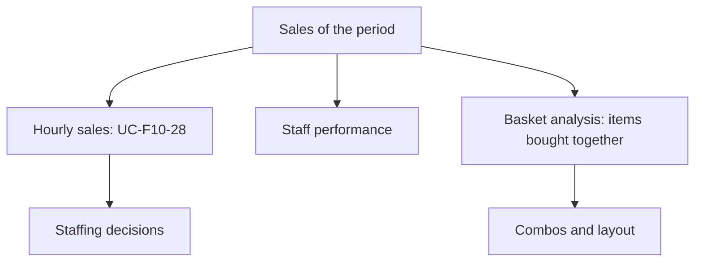

🏠 [Specs](../../../README.md) › 🧩 [Functional capabilities](../../README.md) ›
🏪 [F10 Point of sale (plugin)](../README.md) › 🔀 [Flows](README.md) › 🔀 FL-F10-11 Store reports

# 🔀 FL-F10-11 Store reports

**Status:** ✅ specified

## Summary

Hourly sales, staff performance and basket analysis for store managers and the owner.

## Personas

- [U13 Owner](../../../01-users/personas/u13-owner.md)
- [U23 Store manager](../../../01-users/personas/u23-store-manager.md)

## Flowchart

## Sequence diagram

- [UC-F10-28 Read hourly sales, staff performance and basket analysis](../use-cases/11-store-reports/uc-f10-28-read-hourly-sales-staff-performance-and-basket-analysis.md#sequence-diagram)

## Steps

| Step | Persona | Screen | Use case | What happens |
|---|---|---|---|---|
| 1 | [U23](../../../01-users/personas/u23-store-manager.md) | [S-F10-27](../screens/11-store-reports/s-f10-27-store-reports.md) | [UC-F10-28](../use-cases/11-store-reports/uc-f10-28-read-hourly-sales-staff-performance-and-basket-analysis.md) | Read hourly sales and staff performance |
| 2 | [U13](../../../01-users/personas/u13-owner.md) | [S-F10-27](../screens/11-store-reports/s-f10-27-store-reports.md) | [UC-F10-28](../use-cases/11-store-reports/uc-f10-28-read-hourly-sales-staff-performance-and-basket-analysis.md) | Read basket analysis across stores |

### Entities and screens

| Entity | States in this flow | Shown at step and screen | Aggregated view |
|---|---|---|---|
| [E-F10-03 Point of sale order](../data/e-f10-03-point-of-sale-order.md) | Draft, Paid, Invoiced, Refunded | 1, 2 [S-F10-27](../screens/11-store-reports/s-f10-27-store-reports.md) | Point of sale orders |
| [E-F7-06 Item](../../f07-purchasing-and-stock/data/e-f07-06-item.md) | Active | Shown elsewhere: [S-F7-21 Stock levels](../../f07-purchasing-and-stock/screens/03-replenish/s-f07-21-stock-levels.md) | Items |
| [E-F10-09 Combo](../data/e-f10-09-combo.md) | Active | Shown elsewhere: [S-F10-06 Prices and promotions](../screens/02-sell-at-the-counter/s-f10-06-prices-and-promotions.md) | Combos |

## Errors

A period with sessions not closed, a seller without sales (BR-F10-22).

## Images

Every step and error, for each persona taking part, in light and dark mode (D120). Steps are numbered as in the Steps
table; E rows are the error cases.

| Step | Persona | Device | Light | Dark |
|---|---|---|---|---|
| 1 | U23 | desktop | [light](../images/11-store-reports/u23-store-manager/1-store-reports-desktop-light.png) | [dark](../images/11-store-reports/u23-store-manager/1-store-reports-desktop-dark.png) |
| 1 | U23 | phone | [light](../images/11-store-reports/u23-store-manager/1-store-reports-phone-light.png) | [dark](../images/11-store-reports/u23-store-manager/1-store-reports-phone-dark.png) |
| 1 | U23 | tablet | [light](../images/11-store-reports/u23-store-manager/1-store-reports-tablet-light.png) | [dark](../images/11-store-reports/u23-store-manager/1-store-reports-tablet-dark.png) |
| 2 | U13 | desktop | [light](../images/11-store-reports/u13-owner/2-store-reports-desktop-light.png) | [dark](../images/11-store-reports/u13-owner/2-store-reports-desktop-dark.png) |
| 2 | U13 | phone | [light](../images/11-store-reports/u13-owner/2-store-reports-phone-light.png) | [dark](../images/11-store-reports/u13-owner/2-store-reports-phone-dark.png) |
| E1 | U23 | desktop | [light](../images/11-store-reports/u23-store-manager/e1-store-reports-refused-desktop-light.png) | [dark](../images/11-store-reports/u23-store-manager/e1-store-reports-refused-desktop-dark.png) |
| E1 | U23 | phone | [light](../images/11-store-reports/u23-store-manager/e1-store-reports-refused-phone-light.png) | [dark](../images/11-store-reports/u23-store-manager/e1-store-reports-refused-phone-dark.png) |
| E1 | U23 | tablet | [light](../images/11-store-reports/u23-store-manager/e1-store-reports-refused-tablet-light.png) | [dark](../images/11-store-reports/u23-store-manager/e1-store-reports-refused-tablet-dark.png) |

## Open questions

None.

---

⬅️ [FL-F10-10 Clienteling, transfers and tax-free](fl-f10-10-clienteling-transfers-and-tax-free.md) ·
⬆️ [Up](README.md) · ➡️ [FL-F10-12 Takeaway, tap to pay, labels and layaway](fl-f10-12-takeaway-softpos-and-labels.md)
