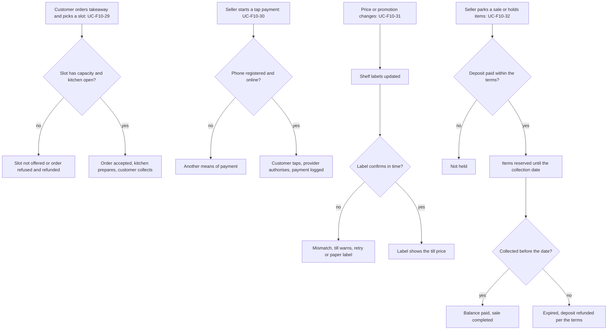
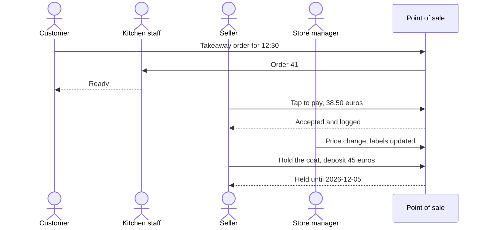

🏠 [Specs](../../../README.md) › 🧩 [Functional capabilities](../../README.md) ›
🏪 [F10 Point of sale (plugin)](../README.md) › 🔀 [Flows](README.md) ›
🔀 FL-F10-12 Takeaway, tap to pay, labels and layaway

# 🔀 FL-F10-12 Takeaway, tap to pay, labels and layaway

**Status:** ✅ specified

## Summary

Four gaps of the point of sale that benchmarked suites cover and SimpleERP lacked: customers order takeaway online
within the kitchen's capacity
([UC-F10-29](../use-cases/12-takeaway-softpos-and-labels/uc-f10-29-take-online-takeaway-orders.md)), sellers take card
payments by tap on their own phone
([UC-F10-30](../use-cases/12-takeaway-softpos-and-labels/uc-f10-30-take-payment-by-tap-on-phone.md)), electronic shelf
labels follow the till price
([UC-F10-31](../use-cases/12-takeaway-softpos-and-labels/uc-f10-31-update-electronic-shelf-labels.md)), and a sale can
be parked or items held against a deposit
([UC-F10-32](../use-cases/12-takeaway-softpos-and-labels/uc-f10-32-hold-an-item-with-a-deposit-or-park-a-sale.md)). The
owner chose each in the 2026-11-14 interview
([D529](../../../06-decisions/f10-point-of-sale/d529-benchmark-gaps-f10-point-of-sale.md)).

## Personas

- [U09 Customer](../../../01-users/personas/u09-customer.md)
- [U19 Kitchen staff](../../../01-users/personas/u19-kitchen-staff.md)
- [U17 Cashier](../../../01-users/personas/u17-cashier.md)
- [U18 Waiter](../../../01-users/personas/u18-waiter.md)
- [U23 Store manager](../../../01-users/personas/u23-store-manager.md)

## Flowchart

## Sequence diagram

## Steps

| Step | Persona | Screen | Use case | What happens |
|---|---|---|---|---|
| 1 | [U09](../../../01-users/personas/u09-customer.md), [U19](../../../01-users/personas/u19-kitchen-staff.md) | [S-F10-28](../screens/12-takeaway-softpos-and-labels/s-f10-28-online-takeaway.md) | [UC-F10-29](../use-cases/12-takeaway-softpos-and-labels/uc-f10-29-take-online-takeaway-orders.md) | The customer orders for a pickup slot on a phone and the kitchen prepares within its capacity |
| 2 | [U17](../../../01-users/personas/u17-cashier.md), [U18](../../../01-users/personas/u18-waiter.md) | [S-F10-29](../screens/12-takeaway-softpos-and-labels/s-f10-29-tap-to-pay.md) | [UC-F10-30](../use-cases/12-takeaway-softpos-and-labels/uc-f10-30-take-payment-by-tap-on-phone.md) | The seller takes a card or phone payment by tap on their own phone |
| 3 | [U23](../../../01-users/personas/u23-store-manager.md) | [S-F10-30](../screens/12-takeaway-softpos-and-labels/s-f10-30-shelf-labels.md) | [UC-F10-31](../use-cases/12-takeaway-softpos-and-labels/uc-f10-31-update-electronic-shelf-labels.md) | The store manager links the shelf labels and repairs those that do not match the till |
| 4 | [U17](../../../01-users/personas/u17-cashier.md), [U23](../../../01-users/personas/u23-store-manager.md) | [S-F10-31](../screens/12-takeaway-softpos-and-labels/s-f10-31-layaway.md) | [UC-F10-32](../use-cases/12-takeaway-softpos-and-labels/uc-f10-32-hold-an-item-with-a-deposit-or-park-a-sale.md) | The seller parks a sale or holds items against a deposit and the store manager follows them |

### Entities and screens

| Entity | States in this flow | Shown at step and screen | Aggregated view |
|---|---|---|---|
| [E-F10-22 Takeaway order](../data/e-f10-22-takeaway-order.md) | Placed, Accepted, Refused, In preparation, Ready, Collected, Cancelled, Not collected | 1 [S-F10-28](../screens/12-takeaway-softpos-and-labels/s-f10-28-online-takeaway.md) | Takeaway orders |
| [E-F10-23 Shelf label](../data/e-f10-23-shelf-label.md) | Registered, Linked, Updating, Up to date, Mismatch, Faulty, Retired | 3 [S-F10-30](../screens/12-takeaway-softpos-and-labels/s-f10-30-shelf-labels.md) | Shelf labels |
| [E-F10-24 Layaway](../data/e-f10-24-layaway.md) | Parked, Held, Resumed, Expired, Collected, Cancelled, Refunded | 4 [S-F10-31](../screens/12-takeaway-softpos-and-labels/s-f10-31-layaway.md) | Layaways |

## Errors

- **E1 The kitchen is full.** The slot is not offered, or an order that arrives anyway is refused and refunded
  ([BR-F10-23](../business-rules/br-f10-23-online-orders-stay-within-kitchen-capacity.md)), step 1.
- **E2 The phone cannot authorise the payment.** No payment is accepted and another means is offered
  ([BR-F10-24](../business-rules/br-f10-24-tap-to-pay-follows-the-card-terminal-rules-and-the-till-log.md)), step 2.
- **E3 A label that did not update.** It is flagged Mismatch and the till warns the sellers
  ([BR-F10-25](../business-rules/br-f10-25-label-prices-always-match-the-till-price.md)), step 3.
- **E4 A deposit cancelled or expired.** It is refunded per the shop's terms
  ([BR-F10-26](../business-rules/br-f10-26-layaway-deposits-are-refunded-per-the-shops-terms.md)), step 4.

## Images

Every step and error, for each persona taking part, in light and dark mode (D120). Steps are numbered as in the Steps
table; E rows are the error cases.

| Step | Persona | Device | Light | Dark |
|---|---|---|---|---|
| 1 | U09 | phone | [light](../images/12-takeaway-softpos-and-labels/u09-customer/1-online-takeaway-phone-light.png) | [dark](../images/12-takeaway-softpos-and-labels/u09-customer/1-online-takeaway-phone-dark.png) |
| 1 | U19 | desktop | [light](../images/12-takeaway-softpos-and-labels/u19-kitchen-staff/1-online-takeaway-desktop-light.png) | [dark](../images/12-takeaway-softpos-and-labels/u19-kitchen-staff/1-online-takeaway-desktop-dark.png) |
| 1 | U09 | phone | [light](../images/12-takeaway-softpos-and-labels/u09-customer/1-online-takeaway-phone-light.png) | [dark](../images/12-takeaway-softpos-and-labels/u09-customer/1-online-takeaway-phone-dark.png) |
| 1 | U19 | desktop | [light](../images/12-takeaway-softpos-and-labels/u19-kitchen-staff/1-online-takeaway-desktop-light.png) | [dark](../images/12-takeaway-softpos-and-labels/u19-kitchen-staff/1-online-takeaway-desktop-dark.png) |
| 2 | U17 | phone | [light](../images/12-takeaway-softpos-and-labels/u17-cashier/2-tap-to-pay-phone-light.png) | [dark](../images/12-takeaway-softpos-and-labels/u17-cashier/2-tap-to-pay-phone-dark.png) |
| 2 | U18 | phone | [light](../images/12-takeaway-softpos-and-labels/u18-waiter/2-tap-to-pay-phone-light.png) | [dark](../images/12-takeaway-softpos-and-labels/u18-waiter/2-tap-to-pay-phone-dark.png) |
| 2 | U17 | desktop | [light](../images/12-takeaway-softpos-and-labels/u17-cashier/2-tap-to-pay-desktop-light.png) | [dark](../images/12-takeaway-softpos-and-labels/u17-cashier/2-tap-to-pay-desktop-dark.png) |
| 2 | U17 | phone | [light](../images/12-takeaway-softpos-and-labels/u17-cashier/2-tap-to-pay-phone-light.png) | [dark](../images/12-takeaway-softpos-and-labels/u17-cashier/2-tap-to-pay-phone-dark.png) |
| 2 | U17 | tablet | [light](../images/12-takeaway-softpos-and-labels/u17-cashier/2-tap-to-pay-tablet-light.png) | [dark](../images/12-takeaway-softpos-and-labels/u17-cashier/2-tap-to-pay-tablet-dark.png) |
| 2 | U18 | phone | [light](../images/12-takeaway-softpos-and-labels/u18-waiter/2-tap-to-pay-phone-light.png) | [dark](../images/12-takeaway-softpos-and-labels/u18-waiter/2-tap-to-pay-phone-dark.png) |
| 2 | U18 | tablet | [light](../images/12-takeaway-softpos-and-labels/u18-waiter/2-tap-to-pay-tablet-light.png) | [dark](../images/12-takeaway-softpos-and-labels/u18-waiter/2-tap-to-pay-tablet-dark.png) |
| 3 | U23 | desktop | [light](../images/12-takeaway-softpos-and-labels/u23-store-manager/3-shelf-labels-desktop-light.png) | [dark](../images/12-takeaway-softpos-and-labels/u23-store-manager/3-shelf-labels-desktop-dark.png) |
| 3 | U23 | desktop | [light](../images/12-takeaway-softpos-and-labels/u23-store-manager/3-shelf-labels-desktop-light.png) | [dark](../images/12-takeaway-softpos-and-labels/u23-store-manager/3-shelf-labels-desktop-dark.png) |
| 3 | U23 | phone | [light](../images/12-takeaway-softpos-and-labels/u23-store-manager/3-shelf-labels-phone-light.png) | [dark](../images/12-takeaway-softpos-and-labels/u23-store-manager/3-shelf-labels-phone-dark.png) |
| 3 | U23 | tablet | [light](../images/12-takeaway-softpos-and-labels/u23-store-manager/3-shelf-labels-tablet-light.png) | [dark](../images/12-takeaway-softpos-and-labels/u23-store-manager/3-shelf-labels-tablet-dark.png) |
| 4 | U17 | tablet | [light](../images/12-takeaway-softpos-and-labels/u17-cashier/4-layaway-tablet-light.png) | [dark](../images/12-takeaway-softpos-and-labels/u17-cashier/4-layaway-tablet-dark.png) |
| 4 | U23 | desktop | [light](../images/12-takeaway-softpos-and-labels/u23-store-manager/4-layaway-desktop-light.png) | [dark](../images/12-takeaway-softpos-and-labels/u23-store-manager/4-layaway-desktop-dark.png) |
| 4 | U17 | desktop | [light](../images/12-takeaway-softpos-and-labels/u17-cashier/4-layaway-desktop-light.png) | [dark](../images/12-takeaway-softpos-and-labels/u17-cashier/4-layaway-desktop-dark.png) |
| 4 | U17 | phone | [light](../images/12-takeaway-softpos-and-labels/u17-cashier/4-layaway-phone-light.png) | [dark](../images/12-takeaway-softpos-and-labels/u17-cashier/4-layaway-phone-dark.png) |
| 4 | U17 | tablet | [light](../images/12-takeaway-softpos-and-labels/u17-cashier/4-layaway-tablet-light.png) | [dark](../images/12-takeaway-softpos-and-labels/u17-cashier/4-layaway-tablet-dark.png) |
| 4 | U23 | desktop | [light](../images/12-takeaway-softpos-and-labels/u23-store-manager/4-layaway-desktop-light.png) | [dark](../images/12-takeaway-softpos-and-labels/u23-store-manager/4-layaway-desktop-dark.png) |
| 4 | U23 | phone | [light](../images/12-takeaway-softpos-and-labels/u23-store-manager/4-layaway-phone-light.png) | [dark](../images/12-takeaway-softpos-and-labels/u23-store-manager/4-layaway-phone-dark.png) |
| 4 | U23 | tablet | [light](../images/12-takeaway-softpos-and-labels/u23-store-manager/4-layaway-tablet-light.png) | [dark](../images/12-takeaway-softpos-and-labels/u23-store-manager/4-layaway-tablet-dark.png) |
| E1 | U09 | phone | [light](../images/12-takeaway-softpos-and-labels/u09-customer/e1-the-kitchen-is-full-phone-light.png) | [dark](../images/12-takeaway-softpos-and-labels/u09-customer/e1-the-kitchen-is-full-phone-dark.png) |

## Open questions

None.

---

⬅️ [FL-F10-11 Store reports](fl-f10-11-store-reports.md) · ⬆️ [Up](README.md)
