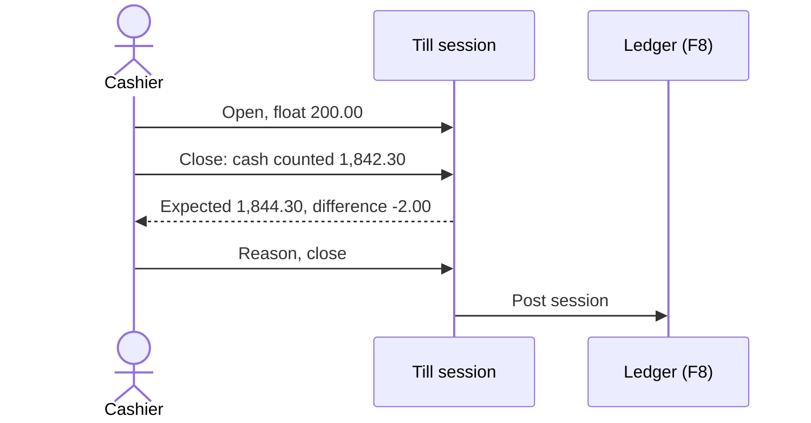

🏠 [Specs](../../../../README.md) › 🧩 [Functional capabilities](../../../README.md) ›
🏪 [F10 Point of sale (plugin)](../../README.md) › 📝 [Use cases](../README.md) ›
📝 [Use cases: FL-F10-01 Till session](README.md) › 📝 UC-F10-01 Open and close a till session

# 📝 UC-F10-01 Open and close a till session

**Status:** ✅ specified

## Summary

Open the till with its float, sell, then close with the cash count, the closure and its totals.

## Personas

- [U17 Cashier](../../../../01-users/personas/u17-cashier.md)
- [U02 Manager](../../../../01-users/personas/u02-manager.md)

## Goal

Every session opened with its float and closed with its count.

## Trigger

The store opens and closes.

## Frequency

Daily per till.

## Preconditions

F10 set up for the company.

## Postconditions

- **Succeeded:** the session is closed, its closure stored and posted.
- **Failed:** a difference without a reason blocks the closing.

## Main flow

1. The cashier opens the session on the till session screen
   ([S-F10-01](../../screens/01-till-session/s-f10-01-till-session.md)) and counts the float.
2. During the day: cash in and out with reasons.
3. At closing: order count, expected totals per method, cash counted, difference shown
   ([BR-F10-02](../../business-rules/br-f10-02-one-session-per-till.md)).
4. The daily closure stores the period and perpetual grand totals,
   [BR-F10-01](../../business-rules/br-f10-01-till-follows-the-country-pack.md),
   [CR-FR-028](../../../../10-country-packs/france/point-of-sale/cr-fr-028-till-closures.md); the session posts
   ([BR-F10-15](../../business-rules/br-f10-15-sessions-post-to-books-and-stock.md)).
5. The cash goes to the safe
   ([UC-F10-23](../09-cash-and-settlements/uc-f10-23-manage-the-safe-bank-deposits-and-cash-collection.md)).

## Alternative flows

- 1a. Several cashiers in one session.
- 4a. Monthly and yearly closures run on their date.

## Error flows

- 3e. A difference over the threshold needs a reason
  ([BR-F10-02](../../business-rules/br-f10-02-one-session-per-till.md)).
- 1e. A previous session left open: it must be closed first.

## Business rules

- [BR-F10-01 The till follows the country pack](../../business-rules/br-f10-01-till-follows-the-country-pack.md)
- [BR-F10-02 One session per till, counted at closing](../../business-rules/br-f10-02-one-session-per-till.md)
- [BR-F10-15 Closed sessions post to the books and stock](../../business-rules/br-f10-15-sessions-post-to-books-and-stock.md)

- [BR-F10-14 Training mode is marked](../../business-rules/br-f10-14-training-mode-is-marked.md)

## Entities

- [E-F10-01 Point of sale](../../data/e-f10-01-point-of-sale.md)
- [E-F10-02 Till session](../../data/e-f10-02-till-session.md)
- [E-F10-06 Closure](../../data/e-f10-06-closure.md)
- [E-F10-15 Till event log](../../data/e-f10-15-till-event-log.md)

## Permissions

Cashiers within their till rights ([UC-F10-16](uc-f10-16-log-in-staff-and-set-till-rights.md)); managers for sensitive
actions ([BR-F10-05](../../business-rules/br-f10-05-manager-pin-for-sensitive-actions.md)).

## Notifications

Store manager: differences.

## Audit events

Opened, cash in and out, closed, closure.

## AI involvement

The AI assistant prepares it for confirmation
([BR-F3-07](../../../f03-assistant/business-rules/br-f03-07-no-deletes-no-irreversible-acts.md)); figures come from
queries ([BR-F3-03](../../../f03-assistant/business-rules/br-f03-03-figures-come-from-queries.md)).

## API, MCP and A2A exposure

T5 operations of F10 with the caller's rights; the MCP tool of F10; no A2A skill.

## Screens

- [S-F10-01](../../screens/01-till-session/s-f10-01-till-session.md)

## Flowchart

See [FL-F10-01 Till session](../../flows/fl-f10-01-till-session.md#flowchart).

## Sequence diagram

## Acceptance criteria

1. **Given** a float of 200 EUR **when** the cashier opens **then** the session starts with 200 EUR.
2. **Given** expected 1,844.30 and counted 1,842.30 EUR **when** she closes **then** -2.00 shows and a reason is asked
   above the threshold.
3. **Given** the daily closure **when** it runs **then** period and perpetual totals are stored.

## Non-functional notes

Works offline as [BR-F10-06](../../business-rules/br-f10-06-offline-keeps-selling.md).

## Regulatory references

[CR-FR-028](../../../../10-country-packs/france/point-of-sale/cr-fr-028-till-closures.md);
[CR-FR-026](../../../../10-country-packs/france/point-of-sale/cr-fr-026-till-inalterability.md).

## Related use cases

See the flows.

- [UC-F10-23 Manage the safe, bank deposits and cash collection](../09-cash-and-settlements/uc-f10-23-manage-the-safe-bank-deposits-and-cash-collection.md)

## Open questions

None.

---

⬆️ [Up](README.md) · ➡️ [UC-F10-02 Sell at the counter](../02-sell-at-the-counter/uc-f10-02-sell-at-the-counter.md)
