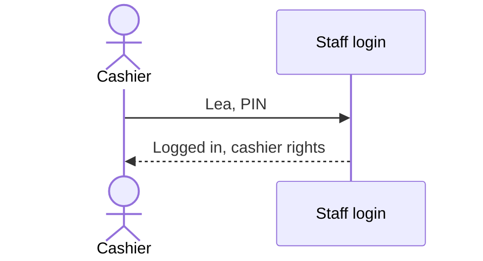

🏠 [Specs](../../../../README.md) › 🧩 [Functional capabilities](../../../README.md) ›
🏪 [F10 Point of sale (plugin)](../../README.md) › 📝 [Use cases](../README.md) ›
📝 [Use cases: FL-F10-01 Till session](README.md) › 📝 UC-F10-16 Log in staff and set till rights

# 📝 UC-F10-16 Log in staff and set till rights

**Status:** ✅ specified

## Summary

Staff log in with PIN, badge or by name; each role has its till rights.

## Personas

- [U17 Cashier](../../../../01-users/personas/u17-cashier.md)
- [U18 Waiter](../../../../01-users/personas/u18-waiter.md)
- [U19 Kitchen staff](../../../../01-users/personas/u19-kitchen-staff.md)
- [U02 Manager](../../../../01-users/personas/u02-manager.md)

## Goal

Each person sells with their own rights.

## Trigger

Staff start or switch.

## Frequency

Several times a day.

## Preconditions

F10 set up for the company.

## Postconditions

- **Succeeded:** the user is logged in with their role's rights.
- **Failed:** blocked after 5 wrong PINs.

## Main flow

1. The cashier chooses her name on staff login ([S-F10-16](../../screens/01-till-session/s-f10-16-staff-login.md)).
2. She enters her PIN or badges.
3. Her role's till rights apply.
4. She locks the till to switch user.

## Alternative flows

- 2a. RFID badge.

## Error flows

- 2e. Wrong PIN 5 times: blocked until a manager unblocks.

## Business rules

- [BR-F10-05 Manager approval for sensitive till actions](../../business-rules/br-f10-05-manager-pin-for-sensitive-actions.md)

## Entities

- [E-F10-01 Point of sale](../../data/e-f10-01-point-of-sale.md)

## Permissions

Staff; managers set rights.

## Notifications

Manager: blocked user.

## Audit events

Logins and switches.

## AI involvement

None.

## API, MCP and A2A exposure

None.

## Screens

- [S-F10-16](../../screens/01-till-session/s-f10-16-staff-login.md)

## Flowchart

See [FL-F10-01 Till session](../../flows/fl-f10-01-till-session.md#flowchart).

## Sequence diagram

## Acceptance criteria

1. **Given** Lea a cashier **when** she logs in **then** refunds above the limit need a manager.
2. **Given** 5 wrong PINs **when** the fifth fails **then** she is blocked.
3. **Given** no network **when** she logs in **then** it works with the rights loaded.

## Non-functional notes

Works offline as [BR-F10-06](../../business-rules/br-f10-06-offline-keeps-selling.md).

## Regulatory references

[CR-FR-027](../../../../10-country-packs/france/point-of-sale/cr-fr-027-till-security.md).

## Related use cases

See the flows.

## Open questions

None.

---

⬅️ [UC-F10-15](../07-set-up-and-report/uc-f10-15-set-up-a-point-of-sale-and-its-hardware.md) · ⬆️ [Up](README.md) ·
➡️ [UC-F10-17 Take delivery-platform orders](../06-mobile-and-delivery/uc-f10-17-take-delivery-platform-orders.md)
