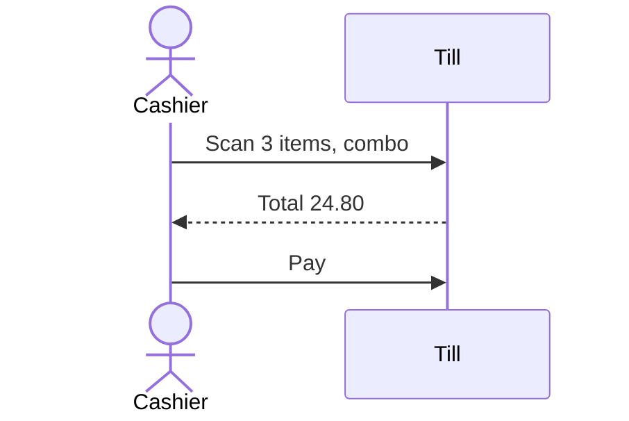

🏠 [Specs](../../../../README.md) › 🧩 [Functional capabilities](../../../README.md) ›
🏪 [F10 Point of sale (plugin)](../../README.md) › 📝 [Use cases](../README.md) ›
📝 [Use cases: FL-F10-02 Sell at the counter](README.md) › 📝 UC-F10-02 Sell at the counter

# 📝 UC-F10-02 Sell at the counter

**Status:** ✅ specified

## Summary

Build a basket by scanning, searching or tapping products, with quantities, notes and a customer.

## Personas

- [U17 Cashier](../../../../01-users/personas/u17-cashier.md)

## Goal

Serve fast and right.

## Trigger

A customer at the counter.

## Frequency

All day.

## Preconditions

F10 set up for the company.

## Postconditions

- **Succeeded:** the basket goes to payment or is parked.
- **Failed:** out-of-stock items shown.

## Main flow

1. The cashier scans or searches products on the till
   ([S-F10-02](../../screens/02-sell-at-the-counter/s-f10-02-till.md)); variants and combos are chosen.
2. Restricted items trigger the age check
   ([UC-F10-22](../08-vouchers-and-age-checks/uc-f10-22-check-age-for-restricted-sales.md)).
3. She sets quantities, notes and the customer.
4. She parks the order to serve the next customer, or goes to payment ([UC-F10-03](uc-f10-03-take-payment.md)).

## Alternative flows

- 4a. Ship later with a date.
- 4b. Taken here, paid at another till.

## Error flows

- 1e. Out of stock: shown; the sale is allowed per setting.

## Business rules

- [BR-F10-01 The till follows the country pack](../../business-rules/br-f10-01-till-follows-the-country-pack.md)
- [BR-F10-08 Prices, promotions and reference prices](../../business-rules/br-f10-08-prices-and-promotions.md)

## Entities

- [E-F10-03 Point of sale order](../../data/e-f10-03-point-of-sale-order.md)

## Permissions

Cashiers within their till rights ([UC-F10-16](../01-till-session/uc-f10-16-log-in-staff-and-set-till-rights.md));
managers for sensitive actions ([BR-F10-05](../../business-rules/br-f10-05-manager-pin-for-sensitive-actions.md)).

## Notifications

None.

## Audit events

As the till's sale records
([CR-FR-025](../../../../10-country-packs/france/point-of-sale/cr-fr-025-sale-data-recorded.md)).

## AI involvement

None at the counter.

## API, MCP and A2A exposure

T5 operations of F10 with the caller's rights; the MCP tool of F10; no A2A skill.

## Screens

- [S-F10-02](../../screens/02-sell-at-the-counter/s-f10-02-till.md)

## Flowchart

See [FL-F10-02 Sell at the counter](../../flows/fl-f10-02-sell-at-the-counter.md#flowchart).

## Sequence diagram

## Acceptance criteria

1. **Given** 3 items scanned **when** they are added **then** the total shows 24.80 EUR incl. VAT.
2. **Given** an out-of-stock item and sales allowed **when** it is scanned **then** it is added with a warning.
3. **Given** a parked order **when** the next customer is served **then** the parked order stays recallable.
4. **Given** no network **when** items are scanned **then** the sale goes on offline.

## Non-functional notes

A scan answers within 300 ms; Works offline as
[BR-F10-06](../../business-rules/br-f10-06-offline-keeps-selling.md).

## Regulatory references

[CR-FR-025](../../../../10-country-packs/france/point-of-sale/cr-fr-025-sale-data-recorded.md);
[CR-FR-034](../../../../10-country-packs/france/consumer/cr-fr-034-prices-shown-including-vat.md).

## Related use cases

See the flows.

- [UC-F5-18 Sell at the box office and scan tickets](../../../f05-social-media/use-cases/07-events-and-ticketing/uc-f05-18-sell-at-the-box-office-and-scan-tickets.md)

- [UC-F10-22 Check age for restricted sales](../08-vouchers-and-age-checks/uc-f10-22-check-age-for-restricted-sales.md)

- [UC-F10-27 Sell tax-free to a visitor from outside the EU](../10-clienteling-transfers-and-tax-free/uc-f10-27-sell-tax-free-to-a-visitor-from-outside-the-eu.md)

## Open questions

None.

---

⬅️ [UC-F10-01 Open and close a till session](../01-till-session/uc-f10-01-open-and-close-a-till-session.md) ·
⬆️ [Up](README.md) · ➡️ [UC-F10-03 Take payment](uc-f10-03-take-payment.md)
