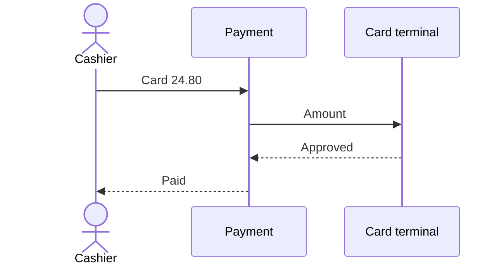

🏠 [Specs](../../../../README.md) › 🧩 [Functional capabilities](../../../README.md) ›
🏪 [F10 Point of sale (plugin)](../../README.md) › 📝 [Use cases](../README.md) ›
📝 [Use cases: FL-F10-02 Sell at the counter](README.md) › 📝 UC-F10-03 Take payment

# 📝 UC-F10-03 Take payment

**Status:** ✅ specified

## Summary

Take payment by one or several methods: cash with change, card terminal, QR bank payment, gift card, e-wallet, with
tips.

## Personas

- [U17 Cashier](../../../../01-users/personas/u17-cashier.md)
- [U18 Waiter](../../../../01-users/personas/u18-waiter.md)

## Goal

Take any payment fast and right.

## Trigger

The basket is complete.

## Frequency

All day.

## Preconditions

F10 set up for the company.

## Postconditions

- **Succeeded:** the order is paid and recorded.
- **Failed:** a cancelled card payment is asked again.

## Main flow

1. The cashier chooses methods and amounts on the payment screen
   ([S-F10-03](../../screens/02-sell-at-the-counter/s-f10-03-payment.md)): cash, card, QR, gift card, e-wallet, meal
   vouchers ([UC-F10-21](../08-vouchers-and-age-checks/uc-f10-21-accept-meal-vouchers-within-the-daily-cap.md)).
2. The card terminal confirms; cash gives change.
3. Tips are added if asked.
4. The order is paid and recorded ([BR-F10-01](../../business-rules/br-f10-01-till-follows-the-country-pack.md)); the
   receipt follows ([UC-F10-05](uc-f10-05-give-the-receipt-or-an-invoice.md)).

## Alternative flows

- 1a. Split between several payers.
- 3a. Change kept as tip.

## Error flows

- 1e. Cash above the limit ([BR-F10-03](../../business-rules/br-f10-03-cash-within-the-legal-limit.md)).
- 2e. Terminal link lost: the payment is cancelled
  ([BR-F10-06](../../business-rules/br-f10-06-offline-keeps-selling.md)).

## Business rules

- [BR-F10-01 The till follows the country pack](../../business-rules/br-f10-01-till-follows-the-country-pack.md)
- [BR-F10-03 Cash within the legal limit](../../business-rules/br-f10-03-cash-within-the-legal-limit.md)
- [BR-F10-06 Offline, the till keeps selling](../../business-rules/br-f10-06-offline-keeps-selling.md)

## Entities

- [E-F10-03 Point of sale order](../../data/e-f10-03-point-of-sale-order.md)
- [E-F10-04 Till payment](../../data/e-f10-04-till-payment.md)

## Permissions

Cashiers within their till rights ([UC-F10-16](../01-till-session/uc-f10-16-log-in-staff-and-set-till-rights.md));
managers for sensitive actions ([BR-F10-05](../../business-rules/br-f10-05-manager-pin-for-sensitive-actions.md)).

## Notifications

None.

## Audit events

Payment lines.

## AI involvement

None.

## API, MCP and A2A exposure

T5 operations of F10 with the caller's rights; the MCP tool of F10; no A2A skill.

## Screens

- [S-F10-03](../../screens/02-sell-at-the-counter/s-f10-03-payment.md)

## Flowchart

See [FL-F10-02 Sell at the counter](../../flows/fl-f10-02-sell-at-the-counter.md#flowchart).

## Sequence diagram

## Acceptance criteria

1. **Given** 24.80 EUR by card **when** the terminal approves **then** the order is paid.
2. **Given** 1,200 EUR cash from a business customer **when** it is entered **then** it is refused above the limit.
3. **Given** the terminal link lost during payment **when** it drops **then** the payment is cancelled and asked again.

## Non-functional notes

Works offline as [BR-F10-06](../../business-rules/br-f10-06-offline-keeps-selling.md).

## Regulatory references

[CR-FR-022](../../../../10-country-packs/france/payments/cr-fr-022-cash-payment-limit.md);
[CR-FR-025](../../../../10-country-packs/france/point-of-sale/cr-fr-025-sale-data-recorded.md).

## Related use cases

See the flows.

- [UC-F10-21 Accept meal vouchers within the daily cap](../08-vouchers-and-age-checks/uc-f10-21-accept-meal-vouchers-within-the-daily-cap.md)

- [UC-F10-24 Match card-terminal settlements net of fees](../09-cash-and-settlements/uc-f10-24-match-card-terminal-settlements-net-of-fees.md)

## Open questions

None.

---

⬅️ [UC-F10-02 Sell at the counter](uc-f10-02-sell-at-the-counter.md) · ⬆️ [Up](README.md) ·
➡️ [UC-F10-04 Refund or exchange](../03-after-sales/uc-f10-04-refund-or-exchange.md)
