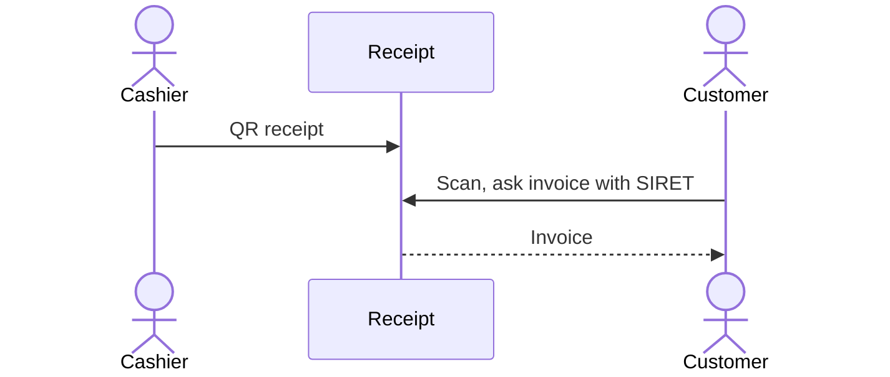

🏠 [Specs](../../../../README.md) › 🧩 [Functional capabilities](../../../README.md) ›
🏪 [F10 Point of sale (plugin)](../../README.md) › 📝 [Use cases](../README.md) ›
📝 [Use cases: FL-F10-02 Sell at the counter](README.md) › 📝 UC-F10-05 Give the receipt or an invoice

# 📝 UC-F10-05 Give the receipt or an invoice

**Status:** ✅ specified

## Summary

Give the receipt on request or digitally, and an invoice for a business customer, at once or later by the receipt's QR
code.

## Personas

- [U17 Cashier](../../../../01-users/personas/u17-cashier.md)
- [U09 Customer](../../../../01-users/personas/u09-customer.md)

## Goal

Receipts only when wanted, invoices when asked.

## Trigger

After payment.

## Frequency

All day.

## Preconditions

F10 set up for the company.

## Postconditions

- **Succeeded:** receipt given or invoice issued.
- **Failed:** missing company details asked.

## Main flow

1. After payment, the cashier offers print, email, SMS or QR on the receipt screen
   ([S-F10-05](../../screens/02-sell-at-the-counter/s-f10-05-receipt.md))
   ([BR-F10-07](../../business-rules/br-f10-07-receipts-on-request.md)).
2. For a business customer, she issues an invoice with company details.
3. Later, the customer gets the invoice from the receipt's QR code.
4. A reprint is logged ([BR-F10-05](../../business-rules/br-f10-05-manager-pin-for-sensitive-actions.md)).

## Alternative flows

- 1a. Tax-free form for an eligible visitor,
  [UC-F10-27](../10-clienteling-transfers-and-tax-free/uc-f10-27-sell-tax-free-to-a-visitor-from-outside-the-eu.md).

## Error flows

- 2e. Invoice without customer details: asked.

## Business rules

- [BR-F10-07 Paper receipts on request](../../business-rules/br-f10-07-receipts-on-request.md)
- [BR-F10-01 The till follows the country pack](../../business-rules/br-f10-01-till-follows-the-country-pack.md)

## Entities

- [E-F10-05 Receipt](../../data/e-f10-05-receipt.md)
- [E-F10-03 Point of sale order](../../data/e-f10-03-point-of-sale-order.md)

## Permissions

Cashiers within their till rights ([UC-F10-16](../01-till-session/uc-f10-16-log-in-staff-and-set-till-rights.md));
managers for sensitive actions ([BR-F10-05](../../business-rules/br-f10-05-manager-pin-for-sensitive-actions.md)).

## Notifications

The customer: digital receipt.

## Audit events

Receipts, invoices, reprints.

## AI involvement

None.

## API, MCP and A2A exposure

T5 operations of F10 with the caller's rights; the MCP tool of F10; no A2A skill.

## Screens

- [S-F10-05](../../screens/02-sell-at-the-counter/s-f10-05-receipt.md)

## Flowchart

See [FL-F10-02 Sell at the counter](../../flows/fl-f10-02-sell-at-the-counter.md#flowchart).

## Sequence diagram

## Acceptance criteria

1. **Given** a customer who wants no paper **when** the sale ends **then** no receipt is printed
   ([CR-FR-031](../../../../10-country-packs/france/point-of-sale/cr-fr-031-paper-receipt-on-request.md)).
2. **Given** a QR receipt **when** the customer asks an invoice with her SIRET **then** the invoice is issued.
3. **Given** a reprint **when** it is asked **then** it is marked as a duplicate and logged.

## Non-functional notes

Works offline as [BR-F10-06](../../business-rules/br-f10-06-offline-keeps-selling.md).

## Regulatory references

[CR-FR-031](../../../../10-country-packs/france/point-of-sale/cr-fr-031-paper-receipt-on-request.md);
[CR-FR-015](../../../../10-country-packs/france/invoicing/cr-fr-015-invoice-mandatory-mentions.md).

## Related use cases

See the flows.

- [UC-F10-27 Sell tax-free to a visitor from outside the EU](../10-clienteling-transfers-and-tax-free/uc-f10-27-sell-tax-free-to-a-visitor-from-outside-the-eu.md)

## Open questions

None.

---

⬅️ [UC-F10-04 Refund or exchange](../03-after-sales/uc-f10-04-refund-or-exchange.md) · ⬆️ [Up](README.md) ·
➡️ [UC-F10-06 Apply prices, promotions and combos](uc-f10-06-apply-prices-promotions-and-combos.md)
