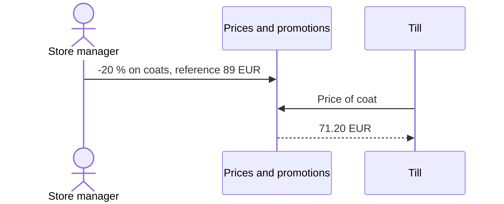

🏠 [Specs](../../../../README.md) › 🧩 [Functional capabilities](../../../README.md) ›
🏪 [F10 Point of sale (plugin)](../../README.md) › 📝 [Use cases](../README.md) ›
📝 [Use cases: FL-F10-02 Sell at the counter](README.md) › 📝 UC-F10-06 Apply prices, promotions and combos

# 📝 UC-F10-06 Apply prices, promotions and combos

**Status:** ✅ specified

## Summary

Prices from pricelists, promotions with reference prices, combos, line and order discounts, fiscal positions (eat-in,
take-away).

## Personas

- [U17 Cashier](../../../../01-users/personas/u17-cashier.md)
- [U02 Manager](../../../../01-users/personas/u02-manager.md)

## Goal

The right price every time.

## Trigger

An item is sold.

## Frequency

All day.

## Preconditions

F10 set up for the company.

## Postconditions

- **Succeeded:** prices and promotions applied.
- **Failed:** discounts above the limit need a manager.

## Main flow

1. The pricelist applies by customer and date on prices and promotions
   ([S-F10-06](../../screens/02-sell-at-the-counter/s-f10-06-prices-and-promotions.md)).
2. Promotions with their reference prices, [BR-F10-08](../../business-rules/br-f10-08-prices-and-promotions.md),
   [CR-FR-035](../../../../10-country-packs/france/consumer/cr-fr-035-reference-price-for-reductions.md), and combos
   apply.
3. The cashier gives line or order discounts within her limits.
4. Eat-in or take-away changes the VAT by fiscal position.

## Alternative flows

- 1a. A manager changes a price.
- 2a. A combo from basket analysis
  ([UC-F10-28](../11-store-reports/uc-f10-28-read-hourly-sales-staff-performance-and-basket-analysis.md)).

## Error flows

- 3e. A discount above the limit: manager PIN
  ([BR-F10-05](../../business-rules/br-f10-05-manager-pin-for-sensitive-actions.md)).

## Business rules

- [BR-F10-08 Prices, promotions and reference prices](../../business-rules/br-f10-08-prices-and-promotions.md)
- [BR-F10-05 Manager approval for sensitive till actions](../../business-rules/br-f10-05-manager-pin-for-sensitive-actions.md)

## Entities

- [E-F10-08 Price promotion](../../data/e-f10-08-price-promotion.md)
- [E-F10-09 Combo](../../data/e-f10-09-combo.md)

## Permissions

Cashiers within their till rights ([UC-F10-16](../01-till-session/uc-f10-16-log-in-staff-and-set-till-rights.md));
managers for sensitive actions ([BR-F10-05](../../business-rules/br-f10-05-manager-pin-for-sensitive-actions.md)).
Managers set prices and promotions.

## Notifications

None.

## Audit events

Price changes, discounts.

## AI involvement

The AI assistant prepares it for confirmation
([BR-F3-07](../../../f03-assistant/business-rules/br-f03-07-no-deletes-no-irreversible-acts.md)); figures come from
queries ([BR-F3-03](../../../f03-assistant/business-rules/br-f03-03-figures-come-from-queries.md)).

## API, MCP and A2A exposure

T5 operations of F10 with the caller's rights; the MCP tool of F10; no A2A skill.

## Screens

- [S-F10-06](../../screens/02-sell-at-the-counter/s-f10-06-prices-and-promotions.md)

## Flowchart

See [FL-F10-02 Sell at the counter](../../flows/fl-f10-02-sell-at-the-counter.md#flowchart).

## Sequence diagram

## Acceptance criteria

1. **Given** coats at -20 % with a reference price of 89 EUR **when** a coat is scanned **then** it costs 71.20 EUR.
2. **Given** a take-away sandwich **when** it is sold **then** the take-away VAT rate applies.
3. **Given** a 30 % discount above the 15 % limit **when** it is entered **then** the manager PIN is asked.

## Non-functional notes

Works offline as [BR-F10-06](../../business-rules/br-f10-06-offline-keeps-selling.md).

## Regulatory references

[CR-FR-035](../../../../10-country-packs/france/consumer/cr-fr-035-reference-price-for-reductions.md);
[CR-FR-093](../../../../10-country-packs/france/consumer/cr-fr-093-sales-periods.md).

## Related use cases

See the flows.

- [UC-F10-28 Read hourly sales, staff performance and basket analysis](../11-store-reports/uc-f10-28-read-hourly-sales-staff-performance-and-basket-analysis.md)

## Open questions

None.

---

⬅️ [UC-F10-05 Give the receipt or an invoice](uc-f10-05-give-the-receipt-or-an-invoice.md) · ⬆️ [Up](README.md) ·
➡️ [UC-F10-07](../03-after-sales/uc-f10-07-use-loyalty-gift-cards-and-e-wallet.md)
