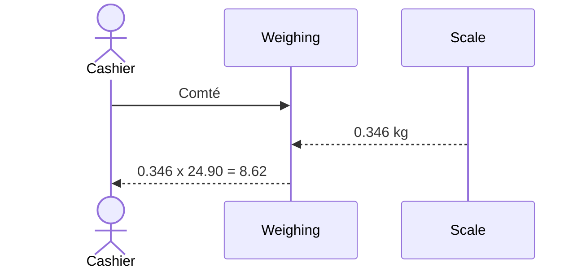

🏠 [Specs](../../../../README.md) › 🧩 [Functional capabilities](../../../README.md) ›
🏪 [F10 Point of sale (plugin)](../../README.md) › 📝 [Use cases](../README.md) ›
📝 [Use cases: FL-F10-02 Sell at the counter](README.md) › 📝 UC-F10-08 Sell by weight and barcodes

# 📝 UC-F10-08 Sell by weight and barcodes

**Status:** ✅ specified

## Summary

Sell products by weight from the scale, and read dynamic barcodes with price, weight or loyalty.

## Personas

- [U17 Cashier](../../../../01-users/personas/u17-cashier.md)

## Goal

Weighed and labelled items priced right.

## Trigger

A weighed item.

## Frequency

Daily in food shops.

## Preconditions

F10 set up for the company.

## Postconditions

- **Succeeded:** price from the scale or the barcode.
- **Failed:** a scale offline is said.

## Main flow

1. The cashier places the item on the scale on weighing
   ([S-F10-08](../../screens/02-sell-at-the-counter/s-f10-08-weighing.md)); the scale gives the weight,
   [BR-F10-09](../../business-rules/br-f10-09-weighed-items-from-the-scale.md),
   [CR-FR-033](../../../../10-country-packs/france/point-of-sale/cr-fr-033-legal-metrology-scales.md).
2. The price computes from the price per kilo.
3. A dynamic barcode gives the price or the weight.
4. The line is added to the basket.

## Alternative flows

- 3a. Several barcodes per product.

## Error flows

- 1e. Scale offline: weighed items cannot be sold by hand
  ([BR-F10-09](../../business-rules/br-f10-09-weighed-items-from-the-scale.md)).

## Business rules

- [BR-F10-09 Weighed items come from the scale](../../business-rules/br-f10-09-weighed-items-from-the-scale.md)

## Entities

- [E-F10-03 Point of sale order](../../data/e-f10-03-point-of-sale-order.md)
- [E-F10-14 Point of sale device](../../data/e-f10-14-point-of-sale-device.md)

## Permissions

Cashiers within their till rights ([UC-F10-16](../01-till-session/uc-f10-16-log-in-staff-and-set-till-rights.md));
managers for sensitive actions ([BR-F10-05](../../business-rules/br-f10-05-manager-pin-for-sensitive-actions.md)).

## Notifications

None.

## Audit events

Weighed lines.

## AI involvement

None.

## API, MCP and A2A exposure

T5 operations of F10 with the caller's rights; the MCP tool of F10; no A2A skill.

## Screens

- [S-F10-08](../../screens/02-sell-at-the-counter/s-f10-08-weighing.md)

## Flowchart

See [FL-F10-02 Sell at the counter](../../flows/fl-f10-02-sell-at-the-counter.md#flowchart).

## Sequence diagram

## Acceptance criteria

1. **Given** Ferme des Trois Chênes' comté at 24.90 EUR a kilo **when** 0.346 kg is weighed **then** the line is 8.62
   EUR.
2. **Given** a dynamic barcode with 6.40 EUR **when** it is scanned **then** the line is 6.40 EUR.
3. **Given** the scale offline **when** a weighed item is added **then** it is refused.

## Non-functional notes

Works offline as [BR-F10-06](../../business-rules/br-f10-06-offline-keeps-selling.md).

## Regulatory references

[CR-FR-033](../../../../10-country-packs/france/point-of-sale/cr-fr-033-legal-metrology-scales.md).

## Related use cases

See the flows.

## Open questions

None.

---

⬅️ [UC-F10-07](../03-after-sales/uc-f10-07-use-loyalty-gift-cards-and-e-wallet.md) · ⬆️ [Up](README.md) ·
➡️ [UC-F10-09](../04-restaurant-service/uc-f10-09-run-the-restaurant-floor-and-bookings.md)
