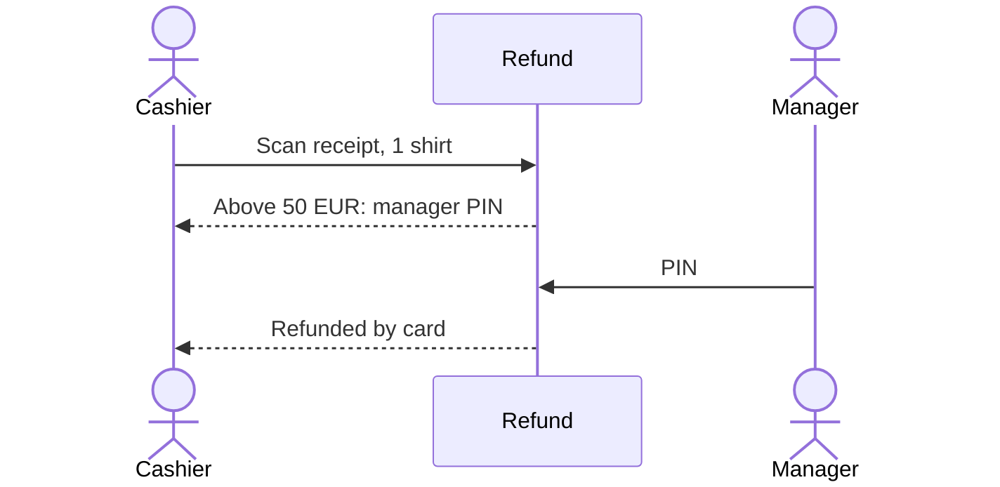

🏠 [Specs](../../../../README.md) › 🧩 [Functional capabilities](../../../README.md) ›
🏪 [F10 Point of sale (plugin)](../../README.md) › 📝 [Use cases](../README.md) ›
📝 [Use cases: FL-F10-03 After sales](README.md) › 📝 UC-F10-04 Refund or exchange

# 📝 UC-F10-04 Refund or exchange

**Status:** ✅ specified

## Summary

Refund or exchange items, linked to the original receipt.

## Personas

- [U17 Cashier](../../../../01-users/personas/u17-cashier.md)
- [U02 Manager](../../../../01-users/personas/u02-manager.md)

## Goal

Refunds and exchanges linked to their sale.

## Trigger

A customer returns an item.

## Frequency

Daily.

## Preconditions

F10 set up for the company.

## Postconditions

- **Succeeded:** refunded or exchanged, linked to the original.
- **Failed:** refused without manager PIN where needed.

## Main flow

1. The cashier finds the receipt by number, scan or customer on refund
   ([S-F10-04](../../screens/03-after-sales/s-f10-04-refund.md)).
2. She chooses items and quantities.
3. Refund by the original method, or exchange
   ([BR-F10-04](../../business-rules/br-f10-04-refunds-link-the-original.md)).
4. A credit note is issued when the sale was invoiced
   ([CR-FR-200](../../../../10-country-packs/france/invoicing/cr-fr-200-credit-notes.md)).

## Alternative flows

- 3a. Refund to the e-wallet.

## Error flows

- 1e. No receipt or above the limit: manager PIN
  ([BR-F10-05](../../business-rules/br-f10-05-manager-pin-for-sensitive-actions.md)).

## Business rules

- [BR-F10-04 Refunds link the original sale](../../business-rules/br-f10-04-refunds-link-the-original.md)
- [BR-F10-05 Manager approval for sensitive till actions](../../business-rules/br-f10-05-manager-pin-for-sensitive-actions.md)

## Entities

- [E-F10-03 Point of sale order](../../data/e-f10-03-point-of-sale-order.md)
- [E-F10-04 Till payment](../../data/e-f10-04-till-payment.md)
- [E-F10-05 Receipt](../../data/e-f10-05-receipt.md)

## Permissions

Cashiers within their till rights ([UC-F10-16](../01-till-session/uc-f10-16-log-in-staff-and-set-till-rights.md));
managers for sensitive actions ([BR-F10-05](../../business-rules/br-f10-05-manager-pin-for-sensitive-actions.md)).

## Notifications

None.

## Audit events

Refunds with the original.

## AI involvement

None.

## API, MCP and A2A exposure

T5 operations of F10 with the caller's rights; the MCP tool of F10; no A2A skill.

## Screens

- [S-F10-04](../../screens/03-after-sales/s-f10-04-refund.md)

## Flowchart

See [FL-F10-03 After sales](../../flows/fl-f10-03-after-sales.md#flowchart).

## Sequence diagram

## Acceptance criteria

1. **Given** a receipt with a shirt of 59 EUR **when** it is refunded **then** the manager PIN is asked above the limit.
2. **Given** a card sale **when** it is refunded **then** the refund goes to the card.
3. **Given** an invoiced sale **when** it is refunded **then** a credit note is issued.

## Non-functional notes

Works offline as [BR-F10-06](../../business-rules/br-f10-06-offline-keeps-selling.md).

## Regulatory references

[CR-FR-200](../../../../10-country-packs/france/invoicing/cr-fr-200-credit-notes.md).

## Related use cases

See the flows.

## Open questions

None.

---

⬅️ [UC-F10-03 Take payment](../02-sell-at-the-counter/uc-f10-03-take-payment.md) · ⬆️ [Up](README.md) ·
➡️ [UC-F10-05 Give the receipt or an invoice](../02-sell-at-the-counter/uc-f10-05-give-the-receipt-or-an-invoice.md)
