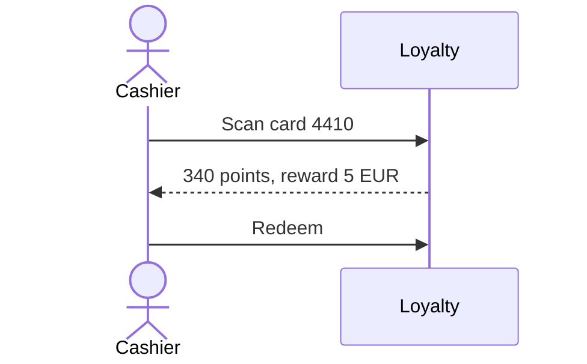

🏠 [Specs](../../../../README.md) › 🧩 [Functional capabilities](../../../README.md) ›
🏪 [F10 Point of sale (plugin)](../../README.md) › 📝 [Use cases](../README.md) ›
📝 [Use cases: FL-F10-03 After sales](README.md) › 📝 UC-F10-07 Use loyalty, gift cards and e-wallet

# 📝 UC-F10-07 Use loyalty, gift cards and e-wallet

**Status:** ✅ specified

## Summary

Earn and redeem loyalty points, sell and redeem gift cards, top up and spend an e-wallet.

## Personas

- [U17 Cashier](../../../../01-users/personas/u17-cashier.md)
- [U09 Customer](../../../../01-users/personas/u09-customer.md)

## Goal

Reward loyal customers and sell gift cards.

## Trigger

A customer is identified.

## Frequency

Daily.

## Preconditions

F10 set up for the company.

## Postconditions

- **Succeeded:** points earned or redeemed; gift cards sold or used.
- **Failed:** a reward without a customer refused.

## Main flow

1. The cashier identifies the customer by card or search on loyalty
   ([S-F10-07](../../screens/03-after-sales/s-f10-07-loyalty.md)).
2. Points are earned; rewards are offered.
3. A gift card is sold or redeemed
   ([CR-FR-097](../../../../10-country-packs/france/consumer/cr-fr-097-gift-card-validity.md)).
4. The e-wallet is topped up or spent ([BR-F10-12](../../business-rules/br-f10-12-loyalty-and-vouchers.md)).

## Alternative flows

- 4a. E-wallet credited by a refund.

## Error flows

- 2e. No customer for a reward: refused ([BR-F10-12](../../business-rules/br-f10-12-loyalty-and-vouchers.md)).

## Business rules

- [BR-F10-12 Loyalty needs a customer, vouchers follow VAT rules](../../business-rules/br-f10-12-loyalty-and-vouchers.md)

## Entities

- [E-F10-10 Loyalty card and gift card](../../data/e-f10-10-loyalty-card-and-gift-card.md)

## Permissions

Cashiers within their till rights ([UC-F10-16](../01-till-session/uc-f10-16-log-in-staff-and-set-till-rights.md));
managers for sensitive actions ([BR-F10-05](../../business-rules/br-f10-05-manager-pin-for-sensitive-actions.md)).

## Notifications

Customer: points balance.

## Audit events

Points and cards.

## AI involvement

None.

## API, MCP and A2A exposure

T5 operations of F10 with the caller's rights; the MCP tool of F10; no A2A skill.

## Screens

- [S-F10-07](../../screens/03-after-sales/s-f10-07-loyalty.md)

## Flowchart

See [FL-F10-03 After sales](../../flows/fl-f10-03-after-sales.md#flowchart).

## Sequence diagram

## Acceptance criteria

1. **Given** 340 points and a 5 EUR reward at 300 **when** the customer redeems **then** 5 EUR is deducted and 40 points
   remain.
2. **Given** a gift card of 50 EUR **when** it is sold **then** it is active with 50 EUR and its expiry.
3. **Given** no customer identified **when** a reward is asked **then** it is refused.

## Non-functional notes

Works offline as [BR-F10-06](../../business-rules/br-f10-06-offline-keeps-selling.md).

## Regulatory references

[CR-FR-097](../../../../10-country-packs/france/consumer/cr-fr-097-gift-card-validity.md);
[CR-FR-013](../../../../10-country-packs/france/tax-and-vat/cr-fr-013-vouchers-vat.md).

## Related use cases

See the flows.

- [UC-F10-25 Serve a customer with their profile](../10-clienteling-transfers-and-tax-free/uc-f10-25-serve-a-customer-with-their-profile.md)

## Open questions

None.

---

⬅️ [UC-F10-06](../02-sell-at-the-counter/uc-f10-06-apply-prices-promotions-and-combos.md) · ⬆️ [Up](README.md) ·
➡️ [UC-F10-08 Sell by weight and barcodes](../02-sell-at-the-counter/uc-f10-08-sell-by-weight-and-barcodes.md)
