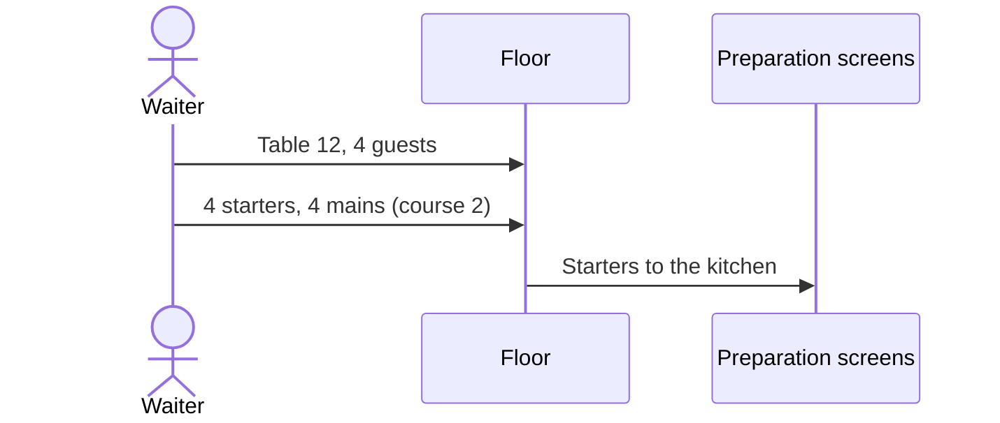

🏠 [Specs](../../../../README.md) › 🧩 [Functional capabilities](../../../README.md) ›
🏪 [F10 Point of sale (plugin)](../../README.md) › 📝 [Use cases](../README.md) ›
📝 [Use cases: FL-F10-04 Restaurant service](README.md) › 📝 UC-F10-09 Run the restaurant floor and bookings

# 📝 UC-F10-09 Run the restaurant floor and bookings

**Status:** ✅ specified

## Summary

Seat guests on the floor plan, take orders per table and course, move or merge tables, manage bookings.

## Personas

- [U18 Waiter](../../../../01-users/personas/u18-waiter.md)
- [U02 Manager](../../../../01-users/personas/u02-manager.md)

## Goal

Tables served in order, courses timed.

## Trigger

Guests arrive.

## Frequency

Every service.

## Preconditions

F10 set up for the company.

## Postconditions

- **Succeeded:** orders sent to stations; tables released.
- **Failed:** busy tables merged or another chosen.

## Main flow

1. The waiter picks a table on the floor plan ([S-F10-09](../../screens/04-restaurant-service/s-f10-09-floor.md));
   guests and course.
2. He orders with notes and modifiers and sends; items go to their station
   ([BR-F10-10](../../business-rules/br-f10-10-orders-routed-to-their-station.md)).
3. Restricted drinks are age-checked
   ([UC-F10-22](../08-vouchers-and-age-checks/uc-f10-22-check-age-for-restricted-sales.md)).
4. He moves, merges or releases the table.

## Alternative flows

- 1a. Direct order without a table; take-away.
- 1b. Bookings from the website.

## Error flows

- 1e. Table busy: merge or another table.

## Business rules

- [BR-F10-10 Orders go to their preparation station](../../business-rules/br-f10-10-orders-routed-to-their-station.md)

## Entities

- [E-F10-11 Floor and table](../../data/e-f10-11-floor-and-table.md)
- [E-F10-12 Table booking](../../data/e-f10-12-table-booking.md)
- [E-F10-03 Point of sale order](../../data/e-f10-03-point-of-sale-order.md)

## Permissions

Waiters; managers.

## Notifications

None.

## Audit events

Orders by table.

## AI involvement

None.

## API, MCP and A2A exposure

T5 operations of F10 with the caller's rights; the MCP tool of F10; no A2A skill.

## Screens

- [S-F10-09](../../screens/04-restaurant-service/s-f10-09-floor.md)

## Flowchart

See [FL-F10-04 Restaurant service](../../flows/fl-f10-04-restaurant-service.md#flowchart).

## Sequence diagram

## Acceptance criteria

1. **Given** table 12 with 4 guests **when** starters are sent **then** the kitchen screen shows them.
2. **Given** table 12 busy **when** the waiter seats on it **then** merge or another table is offered.
3. **Given** a booking at 20:00 **when** it arrives from the website **then** table 12 is held.

## Non-functional notes

Works offline as [BR-F10-06](../../business-rules/br-f10-06-offline-keeps-selling.md).

## Regulatory references

[CR-FR-032](../../../../10-country-packs/france/point-of-sale/cr-fr-032-restaurant-bill.md);
[CR-FR-107](../../../../10-country-packs/france/consumer/cr-fr-107-allergen-information.md).

## Related use cases

See the flows.

## Open questions

None.

---

⬅️ [UC-F10-08 Sell by weight and barcodes](../02-sell-at-the-counter/uc-f10-08-sell-by-weight-and-barcodes.md) ·
⬆️ [Up](README.md) · ➡️ [UC-F10-10 Prepare orders on kitchen screens](uc-f10-10-prepare-orders-on-kitchen-screens.md)
