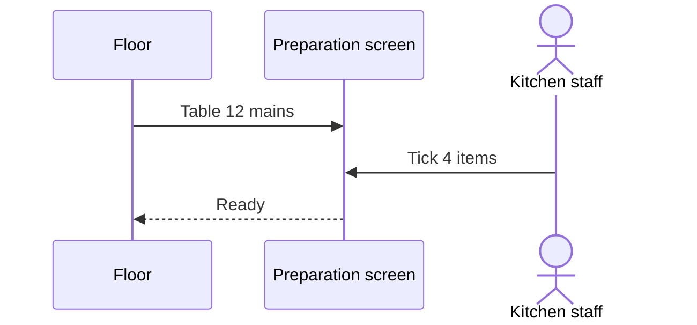

🏠 [Specs](../../../../README.md) › 🧩 [Functional capabilities](../../../README.md) ›
🏪 [F10 Point of sale (plugin)](../../README.md) › 📝 [Use cases](../README.md) ›
📝 [Use cases: FL-F10-04 Restaurant service](README.md) › 📝 UC-F10-10 Prepare orders on kitchen screens

# 📝 UC-F10-10 Prepare orders on kitchen screens

**Status:** ✅ specified

## Summary

Kitchen and bar screens show orders by stage, with notes, timers and late orders in red.

## Personas

- [U19 Kitchen staff](../../../../01-users/personas/u19-kitchen-staff.md)

## Goal

Kitchen and bar prepare in order.

## Trigger

An order reaches the station.

## Frequency

Every service.

## Preconditions

F10 set up for the company.

## Postconditions

- **Succeeded:** items ready; waiter told.
- **Failed:** screen offline: printer used.

## Main flow

1. The order arrives on its station's screen,
   [S-F10-10](../../screens/04-restaurant-service/s-f10-10-preparation-screen.md),
   [BR-F10-10](../../business-rules/br-f10-10-orders-routed-to-their-station.md).
2. Kitchen staff tick items; late orders turn red.
3. The order moves to ready.
4. The waiter or the customer is told.

## Alternative flows

- 2a. Recall to the previous stage.
- 2b. Snooze an item that runs out.

## Error flows

- 1e. Screen offline: the station's printer is used.

## Business rules

- [BR-F10-10 Orders go to their preparation station](../../business-rules/br-f10-10-orders-routed-to-their-station.md)

## Entities

- [E-F10-13 Preparation ticket](../../data/e-f10-13-preparation-ticket.md)
- [E-F10-03 Point of sale order](../../data/e-f10-03-point-of-sale-order.md)

## Permissions

Kitchen staff.

## Notifications

Waiter: ready.

## Audit events

Stages.

## AI involvement

None.

## API, MCP and A2A exposure

T5 operations of F10 with the caller's rights; the MCP tool of F10; no A2A skill.

## Screens

- [S-F10-10](../../screens/04-restaurant-service/s-f10-10-preparation-screen.md)

## Flowchart

See [FL-F10-04 Restaurant service](../../flows/fl-f10-04-restaurant-service.md#flowchart).

## Sequence diagram

## Acceptance criteria

1. **Given** an order of 4 mains **when** it arrives **then** it shows on the kitchen screen with its time.
2. **Given** an order waiting 20 minutes **when** the time passes **then** it turns red.
3. **Given** the screen offline **when** an order arrives **then** it prints on the station's printer.

## Non-functional notes

Works offline as [BR-F10-06](../../business-rules/br-f10-06-offline-keeps-selling.md).

## Regulatory references

None.

## Related use cases

See the flows.

## Open questions

None.

---

⬅️ [UC-F10-09 Run the restaurant floor and bookings](uc-f10-09-run-the-restaurant-floor-and-bookings.md) ·
⬆️ [Up](README.md) · ➡️ [UC-F10-11 Split the bill in a restaurant](uc-f10-11-split-the-bill-in-a-restaurant.md)
