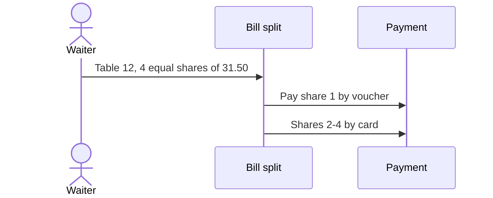

🏠 [Specs](../../../../README.md) › 🧩 [Functional capabilities](../../../README.md) ›
🏪 [F10 Point of sale (plugin)](../../README.md) › 📝 [Use cases](../README.md) ›
📝 [Use cases: FL-F10-04 Restaurant service](README.md) › 📝 UC-F10-11 Split the bill in a restaurant

# 📝 UC-F10-11 Split the bill in a restaurant

**Status:** ✅ specified

## Summary

Print a pre-bill, split by items or by payers, take tips and service charges.

## Personas

- [U18 Waiter](../../../../01-users/personas/u18-waiter.md)
- [U09 Customer](../../../../01-users/personas/u09-customer.md)

## Goal

Each guest pays their share.

## Trigger

Guests ask the bill.

## Frequency

Every service.

## Preconditions

F10 set up for the company.

## Postconditions

- **Succeeded:** every part paid.
- **Failed:** a failed part stays open.

## Main flow

1. The waiter prints a pre-bill on bill split ([S-F10-11](../../screens/04-restaurant-service/s-f10-11-bill-split.md)).
2. He splits by items or equal shares.
3. Each part is paid ([UC-F10-03](../02-sell-at-the-counter/uc-f10-03-take-payment.md)).
4. Tips and the service charge are added if set.

## Alternative flows

- 4a. Service charge added.

## Error flows

- 3e. A payment fails: that part stays open.

## Business rules

- [BR-F10-01 The till follows the country pack](../../business-rules/br-f10-01-till-follows-the-country-pack.md)
- [BR-F10-03 Cash within the legal limit](../../business-rules/br-f10-03-cash-within-the-legal-limit.md)

## Entities

- [E-F10-03 Point of sale order](../../data/e-f10-03-point-of-sale-order.md)
- [E-F10-04 Till payment](../../data/e-f10-04-till-payment.md)

## Permissions

Waiters.

## Notifications

None.

## Audit events

Splits and payments.

## AI involvement

None.

## API, MCP and A2A exposure

T5 operations of F10 with the caller's rights; the MCP tool of F10; no A2A skill.

## Screens

- [S-F10-11](../../screens/04-restaurant-service/s-f10-11-bill-split.md)

## Flowchart

See [FL-F10-04 Restaurant service](../../flows/fl-f10-04-restaurant-service.md#flowchart).

## Sequence diagram

## Acceptance criteria

1. **Given** a bill of 126 EUR for 4 **when** it is split equally **then** 4 shares of 31.50 EUR.
2. **Given** share 1 paid by meal voucher up to 25 EUR **when** it is paid **then** 6.50 EUR remains on share 1.
3. **Given** a card refused on share 3 **when** it fails **then** share 3 stays open.

## Non-functional notes

Works offline as [BR-F10-06](../../business-rules/br-f10-06-offline-keeps-selling.md).

## Regulatory references

[CR-FR-032](../../../../10-country-packs/france/point-of-sale/cr-fr-032-restaurant-bill.md).

## Related use cases

See the flows.

## Open questions

None.

---

⬅️ [UC-F10-10 Prepare orders on kitchen screens](uc-f10-10-prepare-orders-on-kitchen-screens.md) · ⬆️ [Up](README.md) ·
➡️ [UC-F10-12 Self-order by QR at the table](../05-self-order-and-kiosk/uc-f10-12-self-order-by-qr-at-the-table.md)
