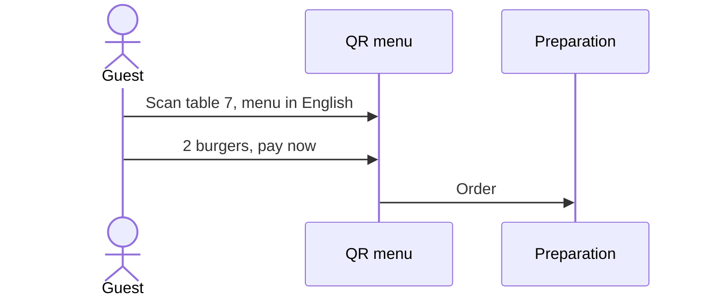

🏠 [Specs](../../../../README.md) › 🧩 [Functional capabilities](../../../README.md) ›
🏪 [F10 Point of sale (plugin)](../../README.md) › 📝 [Use cases](../README.md) ›
📝 [Use cases: FL-F10-05 Self-order and kiosk](README.md) › 📝 UC-F10-12 Self-order by QR at the table

# 📝 UC-F10-12 Self-order by QR at the table

**Status:** ✅ specified

## Summary

Guests scan the table's QR code, read the menu, order and pay from their phone.

## Personas

- [U09 Customer](../../../../01-users/personas/u09-customer.md)

## Goal

Guests order and pay from their phone.

## Trigger

Guests scan the table's QR code.

## Frequency

Every service where on.

## Preconditions

F10 set up for the company.

## Postconditions

- **Succeeded:** orders sent to stations; paid now or later.
- **Failed:** refused when the session is closed.

## Main flow

1. The guest scans the table's QR code; the menu opens in their language
   ([S-F10-12](../../screens/05-self-order-and-kiosk/s-f10-12-qr-menu.md)).
2. They order with notes and combos; restricted drinks wait for staff's age check
   ([UC-F10-22](../08-vouchers-and-age-checks/uc-f10-22-check-age-for-restricted-sales.md)).
3. The order goes to the stations.
4. They pay now or at the end.

## Alternative flows

- 1a. Menu-only mode.

## Error flows

- 1e. Session closed: ordering refused ([BR-F10-11](../../business-rules/br-f10-11-self-order-while-open.md)).

## Business rules

- [BR-F10-11 Self-order only while the session is open](../../business-rules/br-f10-11-self-order-while-open.md)
- [BR-F10-10 Orders go to their preparation station](../../business-rules/br-f10-10-orders-routed-to-their-station.md)

## Entities

- [E-F10-03 Point of sale order](../../data/e-f10-03-point-of-sale-order.md)
- [E-F10-11 Floor and table](../../data/e-f10-11-floor-and-table.md)
- [E-F10-21 Table QR code](../../data/e-f10-21-table-qr-code.md)

## Permissions

Guests at the table.

## Notifications

Guest: order ready.

## Audit events

Orders.

## AI involvement

None.

## API, MCP and A2A exposure

None.

## Screens

- [S-F10-12](../../screens/05-self-order-and-kiosk/s-f10-12-qr-menu.md)

## Flowchart

See [FL-F10-05 Self-order and kiosk](../../flows/fl-f10-05-self-order-and-kiosk.md#flowchart).

## Sequence diagram

## Acceptance criteria

1. **Given** table 7's QR code **when** a guest scans it **then** the menu opens in her phone's language.
2. **Given** a session closed **when** she orders **then** ordering is refused.
3. **Given** a beer ordered **when** it is sent **then** it waits for staff's age check.

## Non-functional notes

Works on any phone.

## Regulatory references

[CR-FR-107](../../../../10-country-packs/france/consumer/cr-fr-107-allergen-information.md).

## Related use cases

See the flows.

## Open questions

None.

---

⬅️ [UC-F10-11 Split the bill in a restaurant](../04-restaurant-service/uc-f10-11-split-the-bill-in-a-restaurant.md) ·
⬆️ [Up](README.md) · ➡️ [UC-F10-13 Order at a kiosk](uc-f10-13-order-at-a-kiosk.md)
