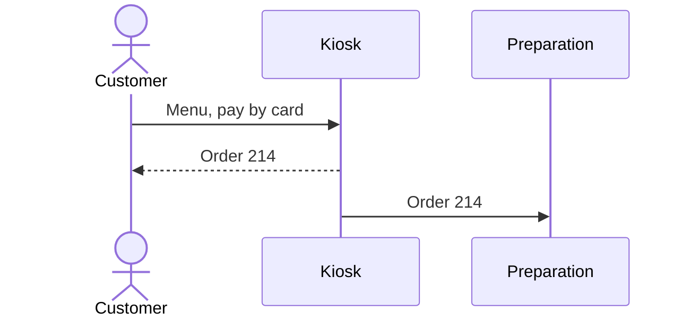

🏠 [Specs](../../../../README.md) › 🧩 [Functional capabilities](../../../README.md) ›
🏪 [F10 Point of sale (plugin)](../../README.md) › 📝 [Use cases](../README.md) ›
📝 [Use cases: FL-F10-05 Self-order and kiosk](README.md) › 📝 UC-F10-13 Order at a kiosk

# 📝 UC-F10-13 Order at a kiosk

**Status:** ✅ specified

## Summary

Customers order and pay on a kiosk screen and collect at the pickup zone.

## Personas

- [U09 Customer](../../../../01-users/personas/u09-customer.md)

## Goal

Customers order themselves and collect.

## Trigger

A customer at the kiosk.

## Frequency

All day where on.

## Preconditions

F10 set up for the company.

## Postconditions

- **Succeeded:** paid order sent to preparation.
- **Failed:** cash refused.

## Main flow

1. The customer chooses items on the kiosk ([S-F10-13](../../screens/05-self-order-and-kiosk/s-f10-13-kiosk.md)) in
   their language.
2. Restricted items are refused at the kiosk or held for staff
   ([UC-F10-22](../08-vouchers-and-age-checks/uc-f10-22-check-age-for-restricted-sales.md)).
3. They pay by card terminal or QR.
4. The order number shows and goes to preparation
   ([UC-F10-19](uc-f10-19-show-the-customer-display-and-order-status.md)).

## Alternative flows

- 1a. Several languages.

## Error flows

- 3e. No cash at a kiosk ([BR-F10-11](../../business-rules/br-f10-11-self-order-while-open.md)).

## Business rules

- [BR-F10-11 Self-order only while the session is open](../../business-rules/br-f10-11-self-order-while-open.md)
- [BR-F10-10 Orders go to their preparation station](../../business-rules/br-f10-10-orders-routed-to-their-station.md)

## Entities

- [E-F10-03 Point of sale order](../../data/e-f10-03-point-of-sale-order.md)
- [E-F10-04 Till payment](../../data/e-f10-04-till-payment.md)

## Permissions

Customers.

## Notifications

Order status screen.

## Audit events

Orders.

## AI involvement

None.

## API, MCP and A2A exposure

None.

## Screens

- [S-F10-13](../../screens/05-self-order-and-kiosk/s-f10-13-kiosk.md)

## Flowchart

See [FL-F10-05 Self-order and kiosk](../../flows/fl-f10-05-self-order-and-kiosk.md#flowchart).

## Sequence diagram

## Acceptance criteria

1. **Given** a menu ordered **when** it is paid by card **then** number 214 shows.
2. **Given** cash chosen **when** it is asked **then** it is not offered.
3. **Given** the network down **when** an order is placed **then** it is kept and sent as
   [BR-F10-06](../../business-rules/br-f10-06-offline-keeps-selling.md).

## Non-functional notes

Works offline as [BR-F10-06](../../business-rules/br-f10-06-offline-keeps-selling.md).

## Regulatory references

None.

## Related use cases

See the flows.

- [UC-F10-22 Check age for restricted sales](../08-vouchers-and-age-checks/uc-f10-22-check-age-for-restricted-sales.md)

## Open questions

None.

---

⬅️ [UC-F10-12 Self-order by QR at the table](uc-f10-12-self-order-by-qr-at-the-table.md) · ⬆️ [Up](README.md) ·
➡️ [UC-F10-14 Sell on the move and offline](../06-mobile-and-delivery/uc-f10-14-sell-on-the-move-and-offline.md)
