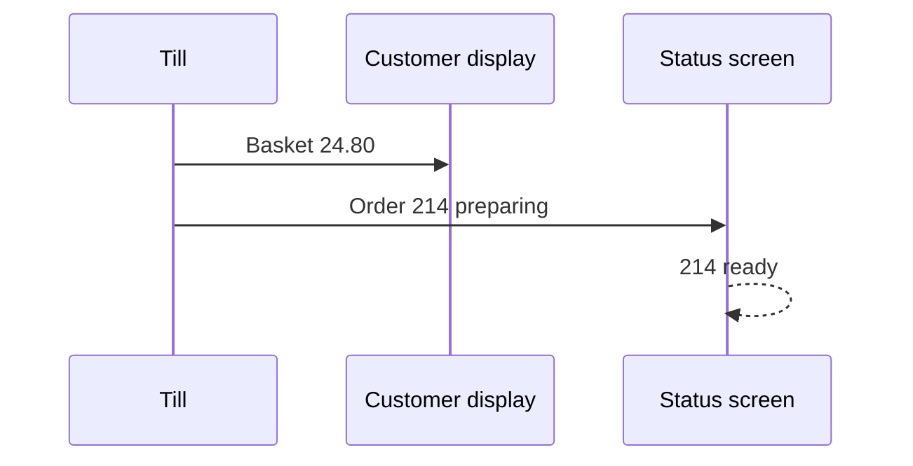

🏠 [Specs](../../../../README.md) › 🧩 [Functional capabilities](../../../README.md) ›
🏪 [F10 Point of sale (plugin)](../../README.md) › 📝 [Use cases](../README.md) ›
📝 [Use cases: FL-F10-05 Self-order and kiosk](README.md) › 📝 UC-F10-19 Show the customer display and order status

# 📝 UC-F10-19 Show the customer display and order status

**Status:** ✅ specified

## Summary

A customer display shows the basket and total; an order-status screen shows orders ready to collect.

## Personas

- [U09 Customer](../../../../01-users/personas/u09-customer.md)
- [U17 Cashier](../../../../01-users/personas/u17-cashier.md)

## Goal

Customers see their basket and when their order is ready.

## Trigger

A sale or an order.

## Frequency

All day.

## Preconditions

F10 set up for the company.

## Postconditions

- **Succeeded:** displays follow.
- **Failed:** a display offline does not stop the till.

## Main flow

1. The customer display follows the basket and total,
   [S-F10-19](../../screens/05-self-order-and-kiosk/s-f10-19-customer-display.md),
   [CR-FR-034](../../../../10-country-packs/france/consumer/cr-fr-034-prices-shown-including-vat.md).
2. The order-status screen shows numbers being prepared and ready.
3. Ready numbers are called.
4. When idle, the display shows advertising.

## Alternative flows

- 4a. Advertising when idle.

## Error flows

- 1e. Display offline: the till goes on.

## Business rules

- [BR-F10-10 Orders go to their preparation station](../../business-rules/br-f10-10-orders-routed-to-their-station.md)

## Entities

- [E-F10-14 Point of sale device](../../data/e-f10-14-point-of-sale-device.md)
- [E-F10-03 Point of sale order](../../data/e-f10-03-point-of-sale-order.md)

## Permissions

None: display only.

## Notifications

None.

## Audit events

None.

## AI involvement

None.

## API, MCP and A2A exposure

None.

## Screens

- [S-F10-19](../../screens/05-self-order-and-kiosk/s-f10-19-customer-display.md)

## Flowchart

See [FL-F10-05 Self-order and kiosk](../../flows/fl-f10-05-self-order-and-kiosk.md#flowchart).

## Sequence diagram

## Acceptance criteria

1. **Given** a basket of 24.80 EUR **when** it is built **then** the display shows 24.80 EUR incl. VAT.
2. **Given** order 214 ready **when** the kitchen marks it **then** the status screen shows 214 ready.
3. **Given** the display unplugged **when** a sale goes on **then** the till works.

## Non-functional notes

Works offline as [BR-F10-06](../../business-rules/br-f10-06-offline-keeps-selling.md).

## Regulatory references

[CR-FR-034](../../../../10-country-packs/france/consumer/cr-fr-034-prices-shown-including-vat.md).

## Related use cases

See the flows.

## Open questions

None.

---

⬅️ [UC-F10-18](../07-set-up-and-report/uc-f10-18-report-sales-and-keep-the-legal-archives.md) · ⬆️ [Up](README.md) ·
➡️ [UC-F10-20 Ask the AI assistant at the till](../07-set-up-and-report/uc-f10-20-ask-the-assistant-at-the-till.md)
