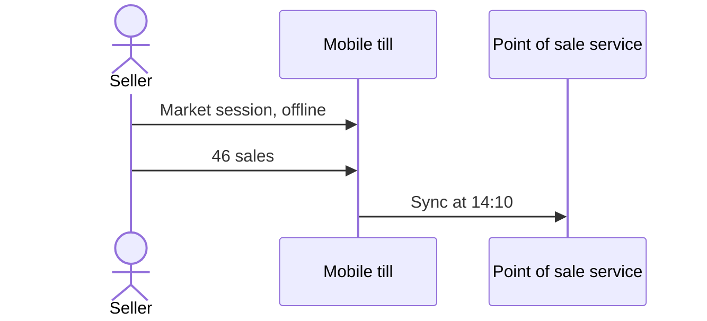

🏠 [Specs](../../../../README.md) › 🧩 [Functional capabilities](../../../README.md) ›
🏪 [F10 Point of sale (plugin)](../../README.md) › 📝 [Use cases](../README.md) ›
📝 [Use cases: FL-F10-06 Mobile and delivery](README.md) › 📝 UC-F10-14 Sell on the move and offline

# 📝 UC-F10-14 Sell on the move and offline

**Status:** ✅ specified

## Summary

Sell from a phone or tablet at markets, events or a customer's home, with or without network.

## Personas

- [U17 Cashier](../../../../01-users/personas/u17-cashier.md)
- [U14 Field worker](../../../../01-users/personas/u14-field-worker.md)

## Goal

Sell anywhere, with or without network.

## Trigger

A market, an event, a home visit.

## Frequency

Weekly for markets.

## Preconditions

F10 set up for the company.

## Postconditions

- **Succeeded:** sales synced.
- **Failed:** a warning after long offline.

## Main flow

1. The seller opens a mobile session on the mobile till
   ([S-F10-14](../../screens/06-mobile-and-delivery/s-f10-14-mobile-till.md)).
2. They sell and take payment by tap-to-pay or terminal.
3. Offline, sales are numbered and chained locally
   ([BR-F10-06](../../business-rules/br-f10-06-offline-keeps-selling.md)).
4. They sync when online; the session closes as usual.

## Alternative flows

- 4a. At a customer's home: the invoice is sent by email.

## Error flows

- 3e. Offline beyond 24 hours: a warning ([BR-F10-06](../../business-rules/br-f10-06-offline-keeps-selling.md)).

## Business rules

- [BR-F10-06 Offline, the till keeps selling](../../business-rules/br-f10-06-offline-keeps-selling.md)
- [BR-F10-01 The till follows the country pack](../../business-rules/br-f10-01-till-follows-the-country-pack.md)

## Entities

- [E-F10-02 Till session](../../data/e-f10-02-till-session.md)
- [E-F10-03 Point of sale order](../../data/e-f10-03-point-of-sale-order.md)
- [E-F10-04 Till payment](../../data/e-f10-04-till-payment.md)

## Permissions

Cashiers within their till rights ([UC-F10-16](../01-till-session/uc-f10-16-log-in-staff-and-set-till-rights.md));
managers for sensitive actions ([BR-F10-05](../../business-rules/br-f10-05-manager-pin-for-sensitive-actions.md)).

## Notifications

Seller: offline warning.

## Audit events

As the till.

## AI involvement

None.

## API, MCP and A2A exposure

T5 operations of F10 with the caller's rights; the MCP tool of F10; no A2A skill.

## Screens

- [S-F10-14](../../screens/06-mobile-and-delivery/s-f10-14-mobile-till.md)

## Flowchart

See [FL-F10-06 Mobile and delivery](../../flows/fl-f10-06-mobile-and-delivery.md#flowchart).

## Sequence diagram

## Acceptance criteria

1. **Given** Ferme des Trois Chênes at a market with no network **when** 46 sales are made **then** they are numbered
   and chained on the phone.
2. **Given** the network back at 14:10 **when** it syncs **then** the 46 sales are on the server, chain intact.
3. **Given** 25 hours offline **when** the time passes **then** a warning shows.

## Non-functional notes

Works offline as [BR-F10-06](../../business-rules/br-f10-06-offline-keeps-selling.md).

## Regulatory references

[CR-FR-026](../../../../10-country-packs/france/point-of-sale/cr-fr-026-till-inalterability.md).

## Related use cases

See the flows.

## Open questions

None.

---

⬅️ [UC-F10-13 Order at a kiosk](../05-self-order-and-kiosk/uc-f10-13-order-at-a-kiosk.md) · ⬆️ [Up](README.md) ·
➡️ [UC-F10-15](../07-set-up-and-report/uc-f10-15-set-up-a-point-of-sale-and-its-hardware.md)
