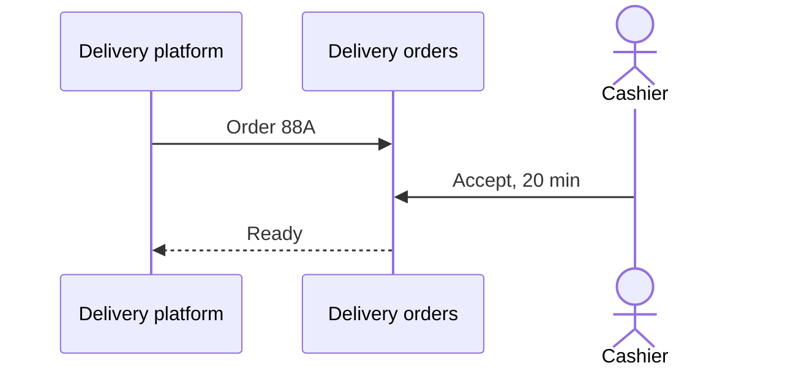

🏠 [Specs](../../../../README.md) › 🧩 [Functional capabilities](../../../README.md) ›
🏪 [F10 Point of sale (plugin)](../../README.md) › 📝 [Use cases](../README.md) ›
📝 [Use cases: FL-F10-06 Mobile and delivery](README.md) › 📝 UC-F10-17 Take delivery-platform orders

# 📝 UC-F10-17 Take delivery-platform orders

**Status:** ✅ specified

## Summary

Orders from delivery platforms arrive through connectors, are accepted and prepared like any order.

## Personas

- [U17 Cashier](../../../../01-users/personas/u17-cashier.md)
- [U19 Kitchen staff](../../../../01-users/personas/u19-kitchen-staff.md)

## Goal

Delivery orders handled like any order.

## Trigger

A platform order.

## Frequency

Every service where on.

## Preconditions

F10 set up for the company.

## Postconditions

- **Succeeded:** accepted, prepared, ready.
- **Failed:** connector down pauses the platform.

## Main flow

1. The order arrives through the connector on delivery orders,
   [S-F10-17](../../screens/06-mobile-and-delivery/s-f10-17-delivery-orders.md),
   [BR-F10-13](../../business-rules/br-f10-13-delivery-orders-through-connectors.md).
2. Staff accept or refuse with a reason.
3. It is prepared like any order ([UC-F10-10](../04-restaurant-service/uc-f10-10-prepare-orders-on-kitchen-screens.md)).
4. It is marked ready for the courier.

## Alternative flows

- 1a. Menu and availability synced.

## Error flows

- 1e. Connector down: shown, the platform paused.

## Business rules

- [BR-F10-13 Delivery orders through connectors](../../business-rules/br-f10-13-delivery-orders-through-connectors.md)
- [BR-F10-10 Orders go to their preparation station](../../business-rules/br-f10-10-orders-routed-to-their-station.md)

## Entities

- [E-F10-03 Point of sale order](../../data/e-f10-03-point-of-sale-order.md)

## Permissions

Cashiers within their till rights ([UC-F10-16](../01-till-session/uc-f10-16-log-in-staff-and-set-till-rights.md));
managers for sensitive actions ([BR-F10-05](../../business-rules/br-f10-05-manager-pin-for-sensitive-actions.md)).

## Notifications

Staff: new order.

## Audit events

Orders.

## AI involvement

None.

## API, MCP and A2A exposure

T5 operations of F10 with the caller's rights; the MCP tool of F10; no A2A skill.

## Screens

- [S-F10-17](../../screens/06-mobile-and-delivery/s-f10-17-delivery-orders.md)

## Flowchart

See [FL-F10-06 Mobile and delivery](../../flows/fl-f10-06-mobile-and-delivery.md#flowchart).

## Sequence diagram

## Acceptance criteria

1. **Given** an order from a platform **when** it arrives **then** it shows with its items.
2. **Given** refused "closing" **when** it is refused **then** the platform gets the reason.
3. **Given** the connector down **when** it fails **then** the platform is paused and staff told.

## Non-functional notes

None.

## Regulatory references

None.

## Related use cases

See the flows.

## Open questions

None.

---

⬅️ [UC-F10-16 Log in staff and set till rights](../01-till-session/uc-f10-16-log-in-staff-and-set-till-rights.md) ·
⬆️ [Up](README.md) · ➡️ [UC-F10-18](../07-set-up-and-report/uc-f10-18-report-sales-and-keep-the-legal-archives.md)
