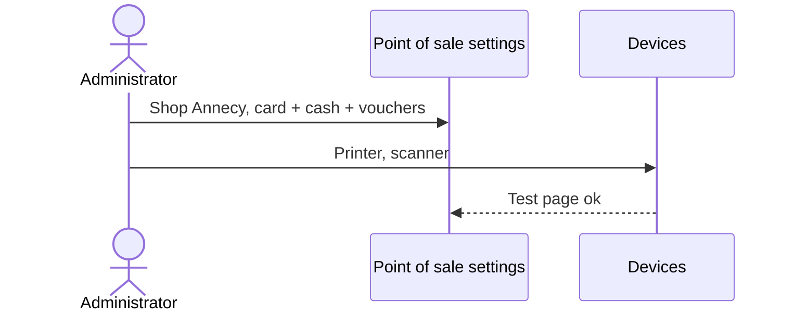

🏠 [Specs](../../../../README.md) › 🧩 [Functional capabilities](../../../README.md) ›
🏪 [F10 Point of sale (plugin)](../../README.md) › 📝 [Use cases](../README.md) ›
📝 [Use cases: FL-F10-07 Set up and report](README.md) › 📝 UC-F10-15 Set up a point of sale and its hardware

# 📝 UC-F10-15 Set up a point of sale and its hardware

**Status:** ✅ specified

## Summary

Create a point of sale with its payment methods, categories, pricelists, receipts, floor plans, stations, presets and
devices.

## Personas

- [U07 Administrator](../../../../01-users/personas/u07-administrator.md)
- [U02 Manager](../../../../01-users/personas/u02-manager.md)

## Goal

A point of sale ready to sell.

## Trigger

A new shop or till.

## Frequency

Per till.

## Preconditions

F10 set up for the company.

## Postconditions

- **Succeeded:** the point of sale and devices work.
- **Failed:** a device not found shows a test page.

## Main flow

1. The administrator creates the point of sale and its mode on settings
   ([S-F10-15](../../screens/07-set-up-and-report/s-f10-15-point-of-sale-settings.md)).
2. They set payment methods (meal vouchers,
   [UC-F10-21](../08-vouchers-and-age-checks/uc-f10-21-accept-meal-vouchers-within-the-daily-cap.md)) and terminals.
3. They add devices: printers, drawer, scanner, scale, displays.
4. They set receipts, floors and stations.

## Alternative flows

- 1a. Copy a point of sale for a new shop.

## Error flows

- 3e. Device not found: test page and help.

## Business rules

- [BR-F10-02 One session per till, counted at closing](../../business-rules/br-f10-02-one-session-per-till.md)
- [BR-F10-15 Closed sessions post to the books and stock](../../business-rules/br-f10-15-sessions-post-to-books-and-stock.md)

## Entities

- [E-F10-01 Point of sale](../../data/e-f10-01-point-of-sale.md)
- [E-F10-14 Point of sale device](../../data/e-f10-14-point-of-sale-device.md)
- [E-F10-11 Floor and table](../../data/e-f10-11-floor-and-table.md)

## Permissions

Administrators and managers.

## Notifications

None.

## Audit events

Settings changed.

## AI involvement

The AI assistant prepares it for confirmation
([BR-F3-07](../../../f03-assistant/business-rules/br-f03-07-no-deletes-no-irreversible-acts.md)); figures come from
queries ([BR-F3-03](../../../f03-assistant/business-rules/br-f03-03-figures-come-from-queries.md)).

## API, MCP and A2A exposure

T5 operations of F10 with the caller's rights; the MCP tool of F10; no A2A skill.

## Screens

- [S-F10-15](../../screens/07-set-up-and-report/s-f10-15-point-of-sale-settings.md)

## Flowchart

See [FL-F10-07 Set up and report](../../flows/fl-f10-07-set-up-and-report.md#flowchart).

## Sequence diagram

## Acceptance criteria

1. **Given** a new shop copied from Lyon **when** it is created **then** methods, categories and receipts are copied.
2. **Given** a printer not found **when** the test runs **then** help shows.
3. **Given** meal vouchers enabled **when** a sale is paid **then** vouchers are offered.

## Non-functional notes

None.

## Regulatory references

[CR-FR-024](../../../../10-country-packs/france/point-of-sale/cr-fr-024-certified-till-software.md);
[CR-FR-027](../../../../10-country-packs/france/point-of-sale/cr-fr-027-till-security.md).

## Related use cases

See the flows.

## Open questions

None.

---

⬅️ [UC-F10-14 Sell on the move and offline](../06-mobile-and-delivery/uc-f10-14-sell-on-the-move-and-offline.md) ·
⬆️ [Up](README.md) ·
➡️ [UC-F10-16 Log in staff and set till rights](../01-till-session/uc-f10-16-log-in-staff-and-set-till-rights.md)
