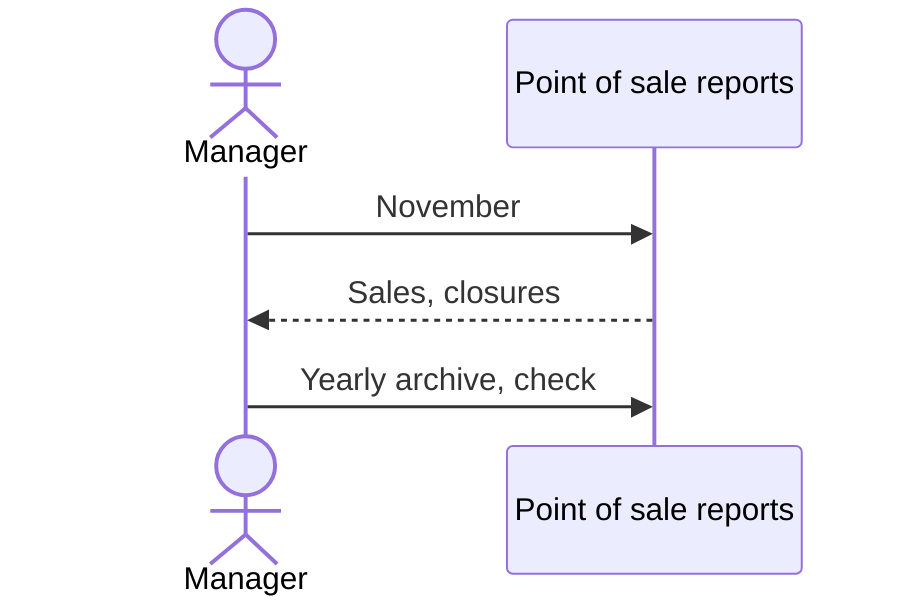

🏠 [Specs](../../../../README.md) › 🧩 [Functional capabilities](../../../README.md) ›
🏪 [F10 Point of sale (plugin)](../../README.md) › 📝 [Use cases](../README.md) ›
📝 [Use cases: FL-F10-07 Set up and report](README.md) › 📝 UC-F10-18 Report sales and keep the legal archives

# 📝 UC-F10-18 Report sales and keep the legal archives

**Status:** ✅ specified

## Summary

Sales, sessions, payments and cash reports; closures, archives and the inalterability check for audits.

## Personas

- [U02 Manager](../../../../01-users/personas/u02-manager.md)
- [U05 Accounting](../../../../01-users/personas/u05-accounting.md)
- [U13 Owner](../../../../01-users/personas/u13-owner.md)

## Goal

Sales known; legal archives safe.

## Trigger

Reviews and audits.

## Frequency

Daily reports; yearly archives.

## Preconditions

F10 set up for the company.

## Postconditions

- **Succeeded:** reports read; archives produced and checked.
- **Failed:** a broken chain alerts.

## Main flow

1. The manager opens point of sale reports
   ([S-F10-18](../../screens/07-set-up-and-report/s-f10-18-point-of-sale-reports.md)): sales, sessions, payments, cash.
2. Closures are listed with totals
   ([CR-FR-028](../../../../10-country-packs/france/point-of-sale/cr-fr-028-till-closures.md)).
3. Archives are produced and their integrity checked
   ([CR-FR-030](../../../../10-country-packs/france/point-of-sale/cr-fr-030-till-archives.md)).
4. Exports for the auditor; store reports go deeper
   ([UC-F10-28](../11-store-reports/uc-f10-28-read-hourly-sales-staff-performance-and-basket-analysis.md)).

## Alternative flows

- 4a. Export for the auditor.

## Error flows

- 3e. Broken chain: alert, logged.

## Business rules

- [BR-F10-01 The till follows the country pack](../../business-rules/br-f10-01-till-follows-the-country-pack.md)
- [BR-F10-15 Closed sessions post to the books and stock](../../business-rules/br-f10-15-sessions-post-to-books-and-stock.md)

## Entities

- [E-F10-06 Closure](../../data/e-f10-06-closure.md)
- [E-F10-07 Till archive](../../data/e-f10-07-till-archive.md)
- [E-F10-15 Till event log](../../data/e-f10-15-till-event-log.md)

## Permissions

Store managers for their store; accounting; the owner reads.

## Notifications

Owner: broken chain.

## Audit events

Archives, checks.

## AI involvement

The AI assistant prepares it for confirmation
([BR-F3-07](../../../f03-assistant/business-rules/br-f03-07-no-deletes-no-irreversible-acts.md)); figures come from
queries ([BR-F3-03](../../../f03-assistant/business-rules/br-f03-03-figures-come-from-queries.md)).

## API, MCP and A2A exposure

T5 operations of F10 with the caller's rights; the MCP tool of F10; no A2A skill.

## Screens

- [S-F10-18](../../screens/07-set-up-and-report/s-f10-18-point-of-sale-reports.md)

## Flowchart

See [FL-F10-07 Set up and report](../../flows/fl-f10-07-set-up-and-report.md#flowchart).

## Sequence diagram

## Acceptance criteria

1. **Given** November's 30 closures **when** the report opens **then** each shows its totals.
2. **Given** the yearly archive **when** the check runs **then** the chain is intact.
3. **Given** an altered record **when** the check runs **then** an alert is raised and logged.

## Non-functional notes

None.

## Regulatory references

[CR-FR-029](../../../../10-country-packs/france/point-of-sale/cr-fr-029-till-data-kept-six-years.md);
[CR-FR-030](../../../../10-country-packs/france/point-of-sale/cr-fr-030-till-archives.md).

## Related use cases

See the flows.

- [UC-F10-28 Read hourly sales, staff performance and basket analysis](../11-store-reports/uc-f10-28-read-hourly-sales-staff-performance-and-basket-analysis.md)

## Open questions

None.

---

⬅️ [UC-F10-17 Take delivery-platform orders](../06-mobile-and-delivery/uc-f10-17-take-delivery-platform-orders.md) ·
⬆️ [Up](README.md) ·
➡️ [UC-F10-19](../05-self-order-and-kiosk/uc-f10-19-show-the-customer-display-and-order-status.md)
