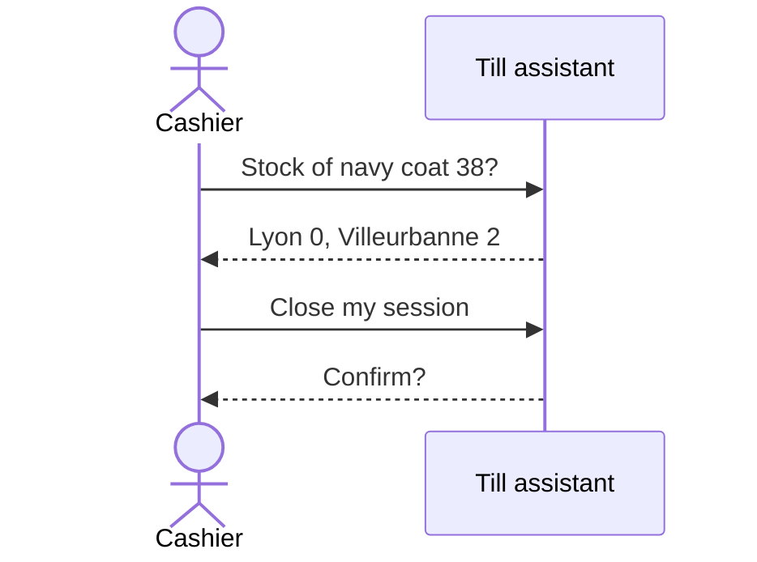

🏠 [Specs](../../../../README.md) › 🧩 [Functional capabilities](../../../README.md) ›
🏪 [F10 Point of sale (plugin)](../../README.md) › 📝 [Use cases](../README.md) ›
📝 [Use cases: FL-F10-07 Set up and report](README.md) › 📝 UC-F10-20 Ask the AI assistant at the till

# 📝 UC-F10-20 Ask the AI assistant at the till

**Status:** ✅ specified

## Summary

Ask or act by voice or text: today's sales, a product's stock, close the session, find a receipt, within the role's
rights.

## Personas

- [U17 Cashier](../../../../01-users/personas/u17-cashier.md)
- [U18 Waiter](../../../../01-users/personas/u18-waiter.md)
- [U02 Manager](../../../../01-users/personas/u02-manager.md)

## Goal

Answers and actions at the till by voice or text.

## Trigger

Staff ask.

## Frequency

Daily.

## Preconditions

F10 set up for the company.

## Postconditions

- **Succeeded:** answered or action confirmed.
- **Failed:** actions beyond rights refused.

## Main flow

1. The cashier asks the till assistant ([S-F10-20](../../screens/07-set-up-and-report/s-f10-20-till-assistant.md)):
   today's sales, a product's stock, a receipt.
2. The AI assistant answers from data within her rights
   ([BR-F3-02](../../../f03-assistant/business-rules/br-f03-02-answers-use-only-what-the-user-may-see.md)).
3. For an action (close the session), it prepares it.
4. She confirms ([BR-F3-07](../../../f03-assistant/business-rules/br-f03-07-no-deletes-no-irreversible-acts.md)).

## Alternative flows

- 1a. A manager asks for the best sellers.

## Error flows

- 3e. Action beyond rights: refused, with who can.

## Business rules

- [BR-F10-05 Manager approval for sensitive till actions](../../business-rules/br-f10-05-manager-pin-for-sensitive-actions.md)

## Entities

- [E-F10-03 Point of sale order](../../data/e-f10-03-point-of-sale-order.md)
- [E-F10-02 Till session](../../data/e-f10-02-till-session.md)

## Permissions

Cashiers within their till rights ([UC-F10-16](../01-till-session/uc-f10-16-log-in-staff-and-set-till-rights.md));
managers for sensitive actions ([BR-F10-05](../../business-rules/br-f10-05-manager-pin-for-sensitive-actions.md)).

## Notifications

None.

## Audit events

Actions through the AI assistant.

## AI involvement

Answers and prepares; staff confirm.

## API, MCP and A2A exposure

T5 operations of F10 with the caller's rights; the MCP tool of F10; no A2A skill.

## Screens

- [S-F10-20](../../screens/07-set-up-and-report/s-f10-20-till-assistant.md)

## Flowchart

See [FL-F10-07 Set up and report](../../flows/fl-f10-07-set-up-and-report.md#flowchart).

## Sequence diagram

## Acceptance criteria

1. **Given** a question about stock **when** it is asked **then** the stock per store shows.
2. **Given** a cashier asking a refund above her limit **when** it is asked **then** it is refused with who can.
3. **Given** offline **when** a question is asked **then** it is queued as
   [D182](../../../../06-decisions/f03-assistant/d182-offline-assistant.md).

## Non-functional notes

None.

## Regulatory references

None.

## Related use cases

See the flows.

## Open questions

None.

---

⬅️ [UC-F10-19](../05-self-order-and-kiosk/uc-f10-19-show-the-customer-display-and-order-status.md) ·
⬆️ [Up](README.md) ·
➡️ [UC-F10-21](../08-vouchers-and-age-checks/uc-f10-21-accept-meal-vouchers-within-the-daily-cap.md)
