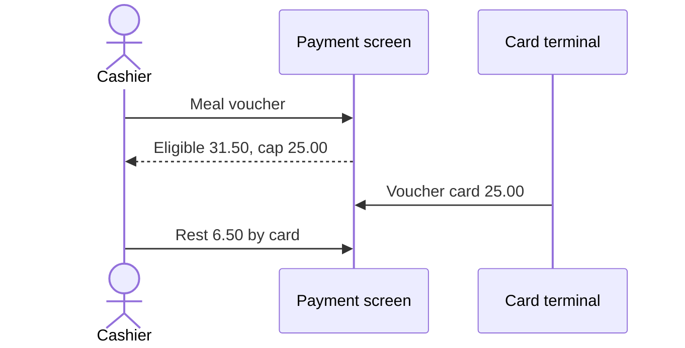

🏠 [Specs](../../../../README.md) › 🧩 [Functional capabilities](../../../README.md) ›
🏪 [F10 Point of sale (plugin)](../../README.md) › 📝 [Use cases](../README.md) ›
📝 [Use cases: FL-F10-08 Vouchers and age checks](README.md) › 📝 UC-F10-21 Accept meal vouchers within the daily cap

# 📝 UC-F10-21 Accept meal vouchers within the daily cap

**Status:** ✅ specified

## Summary

The cashier takes paper or card meal vouchers on eligible food items, within the legal daily cap, without giving change,
and the rest is paid by another method.

## Personas

- [U17 Cashier](../../../../01-users/personas/u17-cashier.md)
- [U18 Waiter](../../../../01-users/personas/u18-waiter.md)

## Goal

Meal vouchers taken right, with no refused claim from the issuer.

## Trigger

A customer pays with meal vouchers.

## Frequency

Daily in restaurants and food shops.

## Preconditions

- Meal vouchers enabled as a payment method
  ([UC-F10-15](../07-set-up-and-report/uc-f10-15-set-up-a-point-of-sale-and-its-hardware.md)); items flagged as
  eligible.

## Postconditions

- **Succeeded:** the voucher amount is recorded per issuer; the rest paid otherwise.
- **Failed:** the excess is refused and paid otherwise.

## Main flow

1. The cashier chooses Meal voucher on the payment screen
   ([S-F10-03](../../screens/02-sell-at-the-counter/s-f10-03-payment.md)).
2. The till shows the eligible amount of the basket and the daily cap
   ([BR-F10-16](../../business-rules/br-f10-16-meal-vouchers-pay-food-within-the-daily-cap.md)).
3. The card voucher is read by the terminal, or the paper vouchers are scanned.
4. Up to the eligible amount and the cap, the vouchers pay; no change is given.
5. The rest is paid by another method ([UC-F10-03](../02-sell-at-the-counter/uc-f10-03-take-payment.md)); paper vouchers
   are counted at closing and sent to their issuer.

## Alternative flows

- 4a. Sundays and holidays: refused unless the rule allows it
  ([CR-FR-112](../../../../10-country-packs/france/payments/cr-fr-112-meal-vouchers.md)).

## Error flows

- 4e. Above the daily cap: the excess is refused with the cap shown.
- 3e. A card voucher refused by its issuer: the reason shown.

## Business rules

- [BR-F10-16 Meal vouchers pay food within the daily cap](../../business-rules/br-f10-16-meal-vouchers-pay-food-within-the-daily-cap.md)
- [BR-F10-01 The till follows the country pack](../../business-rules/br-f10-01-till-follows-the-country-pack.md)

## Entities

- [E-F10-04 Till payment](../../data/e-f10-04-till-payment.md)

## Permissions

Cashiers within their till rights ([UC-F10-16](../01-till-session/uc-f10-16-log-in-staff-and-set-till-rights.md));
managers for sensitive actions ([BR-F10-05](../../business-rules/br-f10-05-manager-pin-for-sensitive-actions.md)).

## Notifications

None.

## Audit events

Payment lines per issuer.

## AI involvement

None.

## API, MCP and A2A exposure

T5 operations of F10 with the caller's rights; the MCP tool of F10; no A2A skill.

## Screens

- [S-F10-03 Payment](../../screens/02-sell-at-the-counter/s-f10-03-payment.md)

## Flowchart

See [FL-F10-08 Vouchers and age checks](../../flows/fl-f10-08-vouchers-and-age-checks.md#flowchart).

## Sequence diagram

## Acceptance criteria

1. **Given** a restaurant bill of 31.50 EUR all eligible and a cap of 25 EUR **when** a voucher card is used **then** 25
   EUR is taken and 6.50 EUR left to pay.
2. **Given** a basket with 12 EUR of non-food items **when** vouchers are used **then** only the food part is eligible.
3. **Given** a paper voucher of 9 EUR for 7.80 EUR **when** it is taken **then** no change is given.
4. **Given** no network **when** a paper voucher is taken **then** it is recorded and synced later.

## Non-functional notes

Works offline as [BR-F10-06](../../business-rules/br-f10-06-offline-keeps-selling.md).

## Regulatory references

[CR-FR-112](../../../../10-country-packs/france/payments/cr-fr-112-meal-vouchers.md).

## Related use cases

- [UC-F10-03 Take payment](../02-sell-at-the-counter/uc-f10-03-take-payment.md)
- [UC-SC06-13 Accept meal vouchers](../../../../08-sectors/sc06-hospitality/use-cases/05-taxes-and-performance/uc-sc06-13-accept-meal-vouchers.md)

## Open questions

None.

---

⬅️ [UC-F10-20 Ask the AI assistant at the till](../07-set-up-and-report/uc-f10-20-ask-the-assistant-at-the-till.md) ·
⬆️ [Up](README.md) · ➡️ [UC-F10-22 Check age for restricted sales](uc-f10-22-check-age-for-restricted-sales.md)
