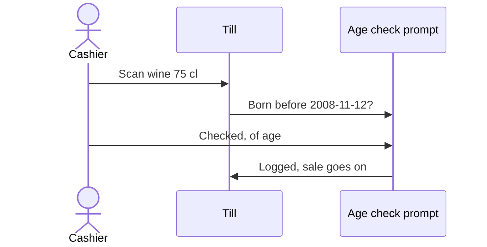

🏠 [Specs](../../../../README.md) › 🧩 [Functional capabilities](../../../README.md) ›
🏪 [F10 Point of sale (plugin)](../../README.md) › 📝 [Use cases](../README.md) ›
📝 [Use cases: FL-F10-08 Vouchers and age checks](README.md) › 📝 UC-F10-22 Check age for restricted sales

# 📝 UC-F10-22 Check age for restricted sales

**Status:** ✅ specified, ⚖️ lawyer review before launch (D574)

## Summary

When a basket holds alcohol or tobacco, the till asks the cashier to check the customer's age; a refusal removes the
item and is logged.

## Personas

- [U17 Cashier](../../../../01-users/personas/u17-cashier.md)
- [U18 Waiter](../../../../01-users/personas/u18-waiter.md)
- [U44 Box-office agent](../../../../01-users/personas/u44-box-office-agent.md)

## Goal

No restricted item sold to a minor.

## Trigger

A restricted item added to the basket.

## Frequency

Daily in shops, bars and events.

## Preconditions

- Items flagged with their restriction ([E-F10-16](../../data/e-f10-16-age-check.md)).

## Postconditions

- **Succeeded:** the sale goes on after the check, or the item is removed.
- **Failed:** the check is logged either way.

## Main flow

1. The cashier scans a bottle of wine ([UC-F10-02](../02-sell-at-the-counter/uc-f10-02-sell-at-the-counter.md)).
2. The till shows the age check prompt
   ([S-F10-21](../../screens/08-vouchers-and-age-checks/s-f10-21-age-check-prompt.md)): "Check ID: born before
   2008-11-12".
3. The cashier confirms the check (seen, or ID not needed as obviously of age).
4. The sale goes on; the check is logged with the till and cashier
   ([BR-F10-17](../../business-rules/br-f10-17-restricted-items-need-an-age-check.md)).

## Alternative flows

- 3a. The customer refuses or is under age: the item is removed and the refusal logged.

## Error flows

- 2e. Self-order and kiosks: restricted items need a person's check before preparation.

## Business rules

- [BR-F10-17 Restricted items need an age check](../../business-rules/br-f10-17-restricted-items-need-an-age-check.md)

## Entities

- [E-F10-16 Age check](../../data/e-f10-16-age-check.md)

## Permissions

Cashiers within their till rights ([UC-F10-16](../01-till-session/uc-f10-16-log-in-staff-and-set-till-rights.md));
managers for sensitive actions ([BR-F10-05](../../business-rules/br-f10-05-manager-pin-for-sensitive-actions.md)).

## Notifications

None.

## Audit events

Each check: item, result, cashier, time.

## AI involvement

None.

## API, MCP and A2A exposure

T5 operations of F10 with the caller's rights; the MCP tool of F10; no A2A skill.

## Screens

- [S-F10-21 Age check prompt](../../screens/08-vouchers-and-age-checks/s-f10-21-age-check-prompt.md)

## Flowchart

See [FL-F10-08 Vouchers and age checks](../../flows/fl-f10-08-vouchers-and-age-checks.md#flowchart).

## Sequence diagram

## Acceptance criteria

1. **Given** a bottle of wine scanned on 2026-11-12 **when** it is added **then** the prompt asks for a birth date
   before 2008-11-12.
2. **Given** the customer is under age **when** the cashier refuses **then** the item is removed and the refusal logged.
3. **Given** a beer ordered at a kiosk at Scènes du Fleuve **when** it is ordered **then** a bar person must check
   before it is served.

## Non-functional notes

Works offline as [BR-F10-06](../../business-rules/br-f10-06-offline-keeps-selling.md).

## Regulatory references

[CR-FR-109](../../../../10-country-packs/france/hospitality/cr-fr-109-alcohol-licences.md); the sale of alcohol to minors is
forbidden and the seller asks for proof of age (Code de la santé publique L3342-1, as
[CR-FR-235 Alcohol licences and opening hours](../../../../10-country-packs/france/hospitality/cr-fr-235-alcohol-licences.md) reads it).
(⚖️ lawyer review before launch, D574) to read: Code de la santé publique L3512-12 (tobacco and vaping products to minors).

## Related use cases

- [UC-F10-02 Sell at the counter](../02-sell-at-the-counter/uc-f10-02-sell-at-the-counter.md)
- [UC-F10-13 Order at a kiosk](../05-self-order-and-kiosk/uc-f10-13-order-at-a-kiosk.md)

## Open questions

None.

---

⬅️ [UC-F10-21 Accept meal vouchers within the daily cap](uc-f10-21-accept-meal-vouchers-within-the-daily-cap.md) ·
⬆️ [Up](README.md) ·
➡️ [UC-F10-23](../09-cash-and-settlements/uc-f10-23-manage-the-safe-bank-deposits-and-cash-collection.md)
