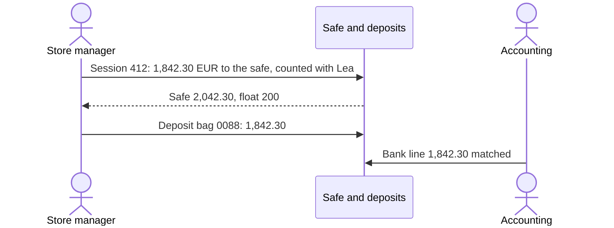

🏠 [Specs](../../../../README.md) › 🧩 [Functional capabilities](../../../README.md) ›
🏪 [F10 Point of sale (plugin)](../../README.md) › 📝 [Use cases](../README.md) ›
📝 [Use cases: FL-F10-09 Cash and settlements](README.md) ›
📝 UC-F10-23 Manage the safe, bank deposits and cash collection

# 📝 UC-F10-23 Manage the safe, bank deposits and cash collection

**Status:** 🔄 waiting for the owner

## Summary

The store manager moves session cash to the safe, counted by two people, prepares bank deposits or the cash collector's
bags, and accounting matches them to the bank.

## Personas

- [U23 Store manager](../../../../01-users/personas/u23-store-manager.md)
- [U05 Accounting](../../../../01-users/personas/u05-accounting.md)
- [U17 Cashier](../../../../01-users/personas/u17-cashier.md)

## Goal

Every euro traced from the till to the bank.

## Trigger

A session closes; the collection day.

## Frequency

Daily.

## Preconditions

- The store's safe set up ([E-F10-17](../../data/e-f10-17-cash-movement.md)).

## Postconditions

- **Succeeded:** cash moved, deposited and matched.
- **Failed:** a gap is investigated with who counted.

## Main flow

1. After closing ([UC-F10-01](../01-till-session/uc-f10-01-open-and-close-a-till-session.md)), the store manager moves
   the session's cash to the safe on Safe and deposits
   ([S-F10-22](../../screens/09-cash-and-settlements/s-f10-22-safe-and-deposits.md)); two people count
   ([BR-F10-18](../../business-rules/br-f10-18-cash-moves-are-counted-by-two.md)).
2. The safe's expected and counted balances show; the float for tomorrow is kept.
3. The manager prepares a deposit with its bag number, or hands it to the cash collector.
4. Accounting matches the bank line to the deposit,
   [UC-F8-06](../../../f08-accounting/use-cases/03-bank-and-collect/uc-f08-06-connect-banks-and-reconcile.md).

## Alternative flows

- 3a. A deposit at the bank's own machine: the receipt is scanned.

## Error flows

- 2e. Counted differs from expected: a reason is required and the owner told above the threshold.
- 4e. No bank line after 3 days (Proposed): flagged.

## Business rules

- [BR-F10-18 Cash moves are counted by two](../../business-rules/br-f10-18-cash-moves-are-counted-by-two.md)
- [BR-F10-03 Cash within the legal limit](../../business-rules/br-f10-03-cash-within-the-legal-limit.md)

## Entities

- [E-F10-17 Cash movement](../../data/e-f10-17-cash-movement.md)
- [E-F10-02 Till session](../../data/e-f10-02-till-session.md)

## Permissions

Store managers for their store; accounting; the owner reads.

## Notifications

Accounting: deposits to match; owner: gaps.

## Audit events

Every move with the two counters.

## AI involvement

The AI assistant prepares it for confirmation
([BR-F3-07](../../../f03-assistant/business-rules/br-f03-07-no-deletes-no-irreversible-acts.md)); figures come from
queries ([BR-F3-03](../../../f03-assistant/business-rules/br-f03-03-figures-come-from-queries.md)).

## API, MCP and A2A exposure

T5 operations of F10 with the caller's rights; the MCP tool of F10; no A2A skill.

## Screens

- [S-F10-22 Safe and deposits](../../screens/09-cash-and-settlements/s-f10-22-safe-and-deposits.md)

## Flowchart

See [FL-F10-09 Cash and settlements](../../flows/fl-f10-09-cash-and-settlements.md#flowchart).

## Sequence diagram

## Acceptance criteria

1. **Given** the example shop chain's Lyon store closing with 1,842.30 EUR cash **when** it is moved to the safe
   **then** the safe shows it with both counters' names.
2. **Given** bag 0088 of 1,842.30 EUR **when** the bank line arrives **then** it is matched.
3. **Given** a safe counted 20 EUR short **when** it is saved **then** a reason is asked.

## Non-functional notes

None.

## Regulatory references

[CR-FR-022](../../../../10-country-packs/france/payments/cr-fr-022-cash-payment-limit.md).

## Related use cases

- [UC-F10-01 Open and close a till session](../01-till-session/uc-f10-01-open-and-close-a-till-session.md)
- [UC-F8-06 Connect banks and reconcile](../../../f08-accounting/use-cases/03-bank-and-collect/uc-f08-06-connect-banks-and-reconcile.md)

## Open questions

None.

---

⬅️ [UC-F10-22](../08-vouchers-and-age-checks/uc-f10-22-check-age-for-restricted-sales.md) · ⬆️ [Up](README.md) ·
➡️ [UC-F10-24 Match card-terminal settlements net of fees](uc-f10-24-match-card-terminal-settlements-net-of-fees.md)
