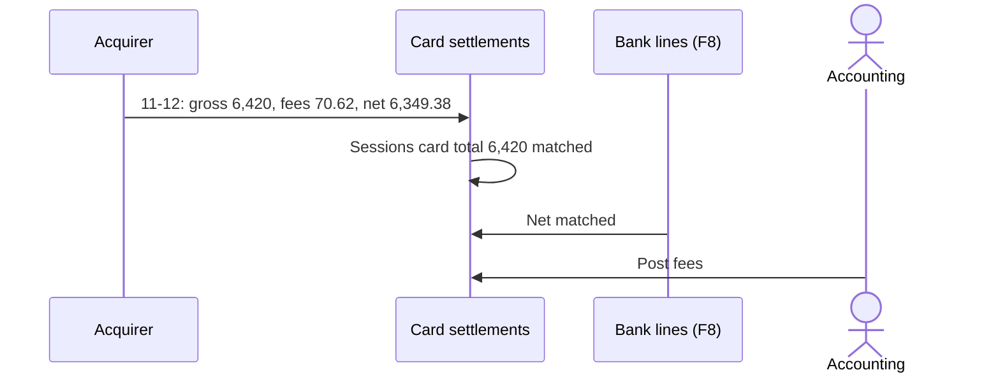

🏠 [Specs](../../../../README.md) › 🧩 [Functional capabilities](../../../README.md) ›
🏪 [F10 Point of sale (plugin)](../../README.md) › 📝 [Use cases](../README.md) ›
📝 [Use cases: FL-F10-09 Cash and settlements](README.md) › 📝 UC-F10-24 Match card-terminal settlements net of fees

# 📝 UC-F10-24 Match card-terminal settlements net of fees

**Status:** ✅ specified

## Summary

Accounting matches each card-terminal settlement (gross sales, fees, net amount) to the till sessions and the bank line,
and posts the fees.

## Personas

- [U05 Accounting](../../../../01-users/personas/u05-accounting.md)
- [U13 Owner](../../../../01-users/personas/u13-owner.md)

## Goal

Card sales and fees right in the books.

## Trigger

A settlement arrives from the acquirer.

## Frequency

Daily.

## Preconditions

- Terminals connected with their acquirer's settlement file or API.

## Postconditions

- **Succeeded:** sessions, settlement and bank matched; fees posted.
- **Failed:** differences listed.

## Main flow

1. Accounting opens card settlements ([S-F10-23](../../screens/09-cash-and-settlements/s-f10-23-card-settlements.md));
   each settlement shows gross, fees and net.
2. The gross is matched to the card payments of the sessions
   ([BR-F10-19](../../business-rules/br-f10-19-settlements-match-sessions-and-the-bank.md)).
3. The net is matched to the bank line,
   [UC-F8-06](../../../f08-accounting/use-cases/03-bank-and-collect/uc-f08-06-connect-banks-and-reconcile.md).
4. Fees are posted to their account; their rate is compared with the contract.

## Alternative flows

- 1a. Several acquirers and card types.

## Error flows

- 2e. Gross differs from the sessions: the payments not settled are listed.
- 4e. Fees above the contract's rate: flagged.

## Business rules

- [BR-F10-19 Settlements match sessions and the bank](../../business-rules/br-f10-19-settlements-match-sessions-and-the-bank.md)
- [BR-F10-15 Closed sessions post to the books and stock](../../business-rules/br-f10-15-sessions-post-to-books-and-stock.md)

## Entities

- [E-F10-18 Card settlement](../../data/e-f10-18-card-settlement.md)
- [E-F10-04 Till payment](../../data/e-f10-04-till-payment.md)

## Permissions

Accounting.

## Notifications

Accounting: differences.

## Audit events

Matches and fees.

## AI involvement

The AI assistant prepares it for confirmation
([BR-F3-07](../../../f03-assistant/business-rules/br-f03-07-no-deletes-no-irreversible-acts.md)); figures come from
queries ([BR-F3-03](../../../f03-assistant/business-rules/br-f03-03-figures-come-from-queries.md)).

## API, MCP and A2A exposure

T5 operations of F10 with the caller's rights; the MCP tool of F10; no A2A skill.

## Screens

- [S-F10-23 Card settlements](../../screens/09-cash-and-settlements/s-f10-23-card-settlements.md)

## Flowchart

See [FL-F10-09 Cash and settlements](../../flows/fl-f10-09-cash-and-settlements.md#flowchart).

## Sequence diagram

## Acceptance criteria

1. **Given** a settlement of 6,420 EUR gross and 70.62 EUR fees **when** it arrives **then** the sessions' card total
   matches and the fees post.
2. **Given** a session card total of 6,480 EUR **when** the settlement is 6,420 EUR **then** the 60 EUR difference is
   listed.
3. **Given** a fee rate of 1.1 % against 0.9 % in the contract **when** it is checked **then** it is flagged.

## Non-functional notes

None.

## Regulatory references

None.

## Related use cases

- [UC-F10-03 Take payment](../02-sell-at-the-counter/uc-f10-03-take-payment.md)
- [UC-F8-06 Connect banks and reconcile](../../../f08-accounting/use-cases/03-bank-and-collect/uc-f08-06-connect-banks-and-reconcile.md)

## Open questions

None.

---

⬅️ [UC-F10-23](uc-f10-23-manage-the-safe-bank-deposits-and-cash-collection.md) · ⬆️ [Up](README.md) ·
➡️ [UC-F10-25](../10-clienteling-transfers-and-tax-free/uc-f10-25-serve-a-customer-with-their-profile.md)
