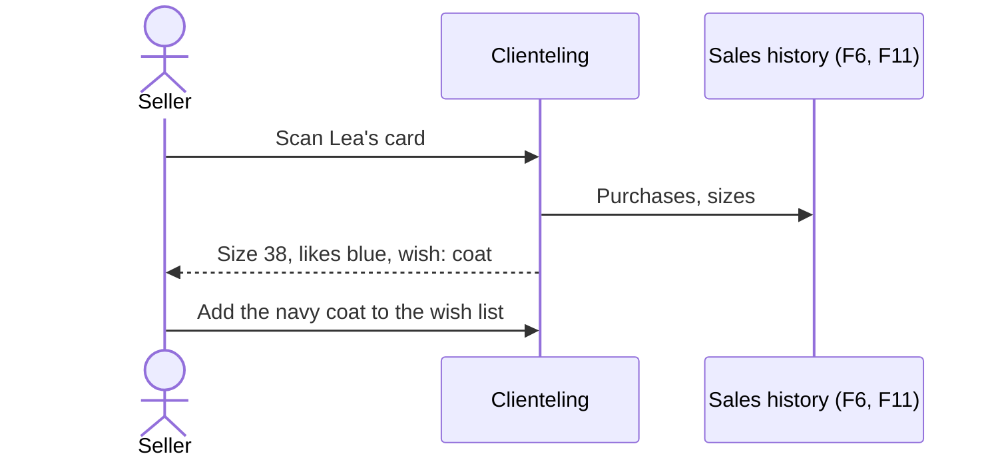

🏠 [Specs](../../../../README.md) › 🧩 [Functional capabilities](../../../README.md) ›
🏪 [F10 Point of sale (plugin)](../../README.md) › 📝 [Use cases](../README.md) ›
📝 [Use cases: FL-F10-10 Clienteling, transfers and tax-free](README.md) ›
📝 UC-F10-25 Serve a customer with their profile

# 📝 UC-F10-25 Serve a customer with their profile

**Status:** ✅ specified

## Summary

A seller identifies a customer at the till or on a tablet and sees their purchases, sizes, preferences and wish list, to
advise them and note what they want.

## Personas

- [U17 Cashier](../../../../01-users/personas/u17-cashier.md)
- [U23 Store manager](../../../../01-users/personas/u23-store-manager.md)
- [U09 Customer](../../../../01-users/personas/u09-customer.md)

## Goal

Personal service in every store.

## Trigger

A known customer in the store.

## Frequency

Daily in fashion and specialist shops.

## Preconditions

- The customer agreed to be recognised,
  [BR-F10-20](../../business-rules/br-f10-20-recognised-customers-agreed-transferred-items-are-reserved.md).

## Postconditions

- **Succeeded:** the profile shows; notes and wishes are saved.
- **Failed:** without consent, only the purchase history.

## Main flow

1. The seller searches the customer or scans their card on clienteling
   ([S-F10-24](../../screens/10-clienteling-transfers-and-tax-free/s-f10-24-clienteling.md)).
2. The profile shows purchases in every store and online, sizes, preferences and the wish list.
3. The seller advises and adds items to the wish list or a note.
4. If an item is missing, they look it up in other stores
   ([UC-F10-26](uc-f10-26-look-up-and-transfer-stock-between-stores.md)).
5. Marketing can send the wish-list items when back in stock, with consent,
   [UC-F5-15](../../../f05-social-media/use-cases/06-audiences-consent-and-journeys/uc-f05-15-record-and-prove-consent.md).

## Alternative flows

- 1a. Loyalty identifies the customer ([UC-F10-07](../03-after-sales/uc-f10-07-use-loyalty-gift-cards-and-e-wallet.md)).

## Error flows

- 3e. A note with sensitive data (health): refused with the reason.

## Business rules

- [BR-F10-20 Recognised customers agreed, transferred items are reserved](../../business-rules/br-f10-20-recognised-customers-agreed-transferred-items-are-reserved.md)
- [BR-F10-12 Loyalty needs a customer, vouchers follow VAT rules](../../business-rules/br-f10-12-loyalty-and-vouchers.md)

## Entities

- [E-F10-19 Clienteling profile](../../data/e-f10-19-clienteling-profile.md)
- [E-F6-01 Customer record](../../../f06-customers-and-sales/data/e-f06-01-customer-record.md)

## Permissions

Cashiers within their till rights ([UC-F10-16](../01-till-session/uc-f10-16-log-in-staff-and-set-till-rights.md));
managers for sensitive actions ([BR-F10-05](../../business-rules/br-f10-05-manager-pin-for-sensitive-actions.md)). Notes
for sellers of the chain.

## Notifications

None.

## Audit events

Profiles opened, notes added.

## AI involvement

The AI assistant suggests items from the history; the seller decides.

## API, MCP and A2A exposure

T5 operations of F10 with the caller's rights; the MCP tool of F10; no A2A skill.

## Screens

- [S-F10-24 Clienteling](../../screens/10-clienteling-transfers-and-tax-free/s-f10-24-clienteling.md)

## Flowchart

See
[FL-F10-10 Clienteling, transfers and tax-free](../../flows/fl-f10-10-clienteling-transfers-and-tax-free.md#flowchart).

## Sequence diagram

## Acceptance criteria

1. **Given** Lea, a customer who agreed to be recognised **when** her card is scanned in the Lyon store **then** her
   purchases in every store and online show.
2. **Given** a note "has back pain" **when** it is saved **then** it is refused as sensitive.
3. **Given** a coat on her wish list back in stock **when** marketing sends it **then** she receives it only with email
   consent.

## Non-functional notes

The profile opens within 2 seconds.

## Regulatory references

[CR-FR-063](../../../../10-country-packs/france/consumer/cr-fr-063-electronic-marketing-consent.md);
[CR-FR-050](../../../../10-country-packs/france/data-protection/cr-fr-050-privacy-by-design.md).

## Related use cases

- [UC-F10-26 Look up and transfer stock between stores](uc-f10-26-look-up-and-transfer-stock-between-stores.md)
- [UC-F10-07 Use loyalty, gift cards and e-wallet](../03-after-sales/uc-f10-07-use-loyalty-gift-cards-and-e-wallet.md)

## Open questions

None.

---

⬅️ [UC-F10-24](../09-cash-and-settlements/uc-f10-24-match-card-terminal-settlements-net-of-fees.md) ·
⬆️ [Up](README.md) ·
➡️ [UC-F10-26 Look up and transfer stock between stores](uc-f10-26-look-up-and-transfer-stock-between-stores.md)
