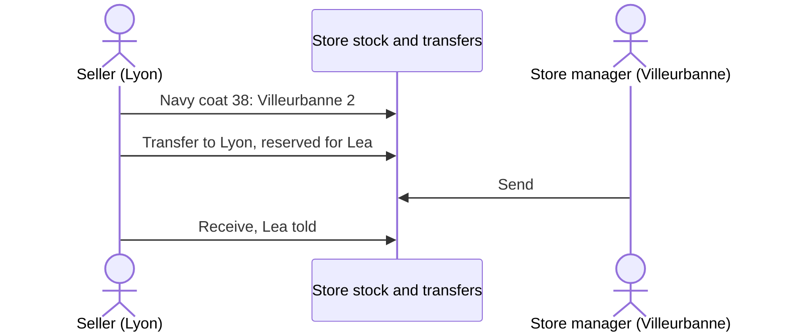

🏠 [Specs](../../../../README.md) › 🧩 [Functional capabilities](../../../README.md) ›
🏪 [F10 Point of sale (plugin)](../../README.md) › 📝 [Use cases](../README.md) ›
📝 [Use cases: FL-F10-10 Clienteling, transfers and tax-free](README.md) ›
📝 UC-F10-26 Look up and transfer stock between stores

# 📝 UC-F10-26 Look up and transfer stock between stores

**Status:** 🔄 waiting for the owner

## Summary

A seller sees an item's stock in every store and the warehouse, and asks a transfer to the store or a shipment to the
customer; the stores send and receive it.

## Personas

- [U17 Cashier](../../../../01-users/personas/u17-cashier.md)
- [U23 Store manager](../../../../01-users/personas/u23-store-manager.md)
- [U15 Warehouse operator](../../../../01-users/personas/u15-warehouse-operator.md)

## Goal

Never lose a sale because the size is in another store.

## Trigger

An item missing in the store.

## Frequency

Daily.

## Preconditions

- Stores are warehouses of F7.

## Postconditions

- **Succeeded:** the transfer is received, or the item shipped to the customer.
- **Failed:** a lost transfer is claimed.

## Main flow

1. The seller looks up the item on store stock and transfers
   ([S-F10-25](../../screens/10-clienteling-transfers-and-tax-free/s-f10-25-store-stock-and-transfers.md)): stock per
   store, the warehouse and in transit.
2. They ask a transfer to their store or a shipment to the customer, reserving the item,
   [BR-F10-20](../../business-rules/br-f10-20-recognised-customers-agreed-transferred-items-are-reserved.md).
3. The sending store's manager picks and sends it,
   [UC-F7-06](../../../f07-purchasing-and-stock/use-cases/04-pick-pack-and-ship/uc-f07-06-pick-pack-and-ship.md).
4. The receiving store scans it in; the customer is told.

## Alternative flows

- 2a. The customer pays now and collects later, or gets it at home.

## Error flows

- 4e. Not received within the expected days: the transfer is flagged and claimed.
- 2e. The stock was sold meanwhile: the seller is told at once.

## Business rules

- [BR-F10-20 Recognised customers agreed, transferred items are reserved](../../business-rules/br-f10-20-recognised-customers-agreed-transferred-items-are-reserved.md)

## Entities

- [E-F7-04 Transfer](../../../f07-purchasing-and-stock/data/e-f07-04-transfer.md)
- [E-F10-03 Point of sale order](../../data/e-f10-03-point-of-sale-order.md)

## Permissions

Cashiers within their till rights ([UC-F10-16](../01-till-session/uc-f10-16-log-in-staff-and-set-till-rights.md));
managers for sensitive actions ([BR-F10-05](../../business-rules/br-f10-05-manager-pin-for-sensitive-actions.md)). Store
managers send and receive.

## Notifications

The customer: item arrived.

## Audit events

Transfers asked, sent, received.

## AI involvement

The AI assistant prepares it for confirmation
([BR-F3-07](../../../f03-assistant/business-rules/br-f03-07-no-deletes-no-irreversible-acts.md)); figures come from
queries ([BR-F3-03](../../../f03-assistant/business-rules/br-f03-03-figures-come-from-queries.md)).

## API, MCP and A2A exposure

T5 operations of F10 with the caller's rights; the MCP tool of F10; no A2A skill.

## Screens

- [S-F10-25 Store stock and transfers](../../screens/10-clienteling-transfers-and-tax-free/s-f10-25-store-stock-and-transfers.md)

## Flowchart

See
[FL-F10-10 Clienteling, transfers and tax-free](../../flows/fl-f10-10-clienteling-transfers-and-tax-free.md#flowchart).

## Sequence diagram

## Acceptance criteria

1. **Given** the navy coat size 38 at 0 in Lyon and 2 in Villeurbanne **when** the seller looks it up **then** both
   stores' stock shows.
2. **Given** a transfer reserved for Lea **when** it is asked **then** one coat is reserved in Villeurbanne.
3. **Given** a transfer sent on 11-12 and not received on 11-16 **when** the days pass **then** it is flagged.

## Non-functional notes

Stock answers within 1 second (Proposed).

## Regulatory references

None.

## Related use cases

- [UC-F10-25 Serve a customer with their profile](uc-f10-25-serve-a-customer-with-their-profile.md)
- [UC-F7-06 Pick, pack and ship](../../../f07-purchasing-and-stock/use-cases/04-pick-pack-and-ship/uc-f07-06-pick-pack-and-ship.md)
- [UC-F11-28 Fulfil online orders from a store](../../../f11-online-shop/use-cases/10-fulfil-from-stores-and-report/uc-f11-28-fulfil-online-orders-from-a-store.md)

## Open questions

None.

---

⬅️ [UC-F10-25 Serve a customer with their profile](uc-f10-25-serve-a-customer-with-their-profile.md) ·
⬆️ [Up](README.md) · ➡️ [UC-F10-27](uc-f10-27-sell-tax-free-to-a-visitor-from-outside-the-eu.md)
