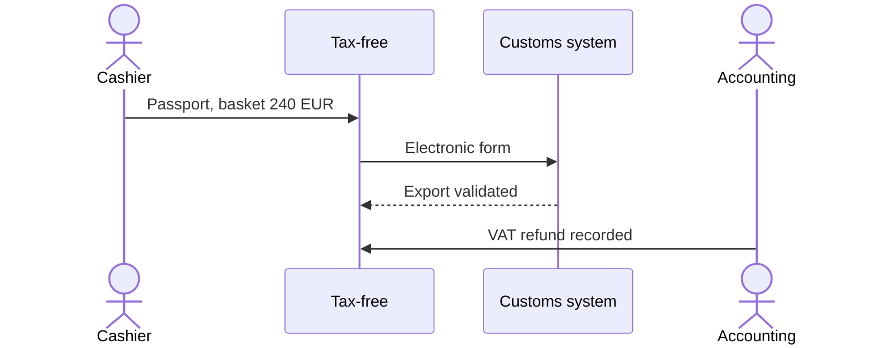

🏠 [Specs](../../../../README.md) › 🧩 [Functional capabilities](../../../README.md) ›
🏪 [F10 Point of sale (plugin)](../../README.md) › 📝 [Use cases](../README.md) ›
📝 [Use cases: FL-F10-10 Clienteling, transfers and tax-free](README.md) ›
📝 UC-F10-27 Sell tax-free to a visitor from outside the EU

# 📝 UC-F10-27 Sell tax-free to a visitor from outside the EU

**Status:** 🔄 waiting for the owner

## Summary

The cashier issues a tax-free form for an eligible visitor from outside the EU buying above the minimum; the VAT is
refunded once the export is validated.

## Personas

- [U17 Cashier](../../../../01-users/personas/u17-cashier.md)
- [U05 Accounting](../../../../01-users/personas/u05-accounting.md)

## Goal

Tourists get their VAT back, the shop stays compliant.

## Trigger

An eligible visitor asks.

## Frequency

Weekly in tourist areas.

## Preconditions

- Tax-free sales enabled, with the operator or the shop's own scheme.

## Postconditions

- **Succeeded:** the form is issued electronically; refunded after validation.
- **Failed:** an ineligible sale is refused for tax-free.

## Main flow

1. The cashier chooses Tax-free on the sale
   ([S-F10-26](../../screens/10-clienteling-transfers-and-tax-free/s-f10-26-tax-free.md)).
2. They enter the visitor's passport details; the till checks the minimum amount and the eligible items
   ([BR-F10-21](../../business-rules/br-f10-21-tax-free-only-for-eligible-visitors-above-the-minimum.md)).
3. The electronic form is issued and given to the visitor.
4. When customs validates the export, the VAT refund is recorded; without validation, the sale stays with VAT.

## Alternative flows

- 4a. Through a tax-free operator: the operator refunds and invoices its fee.

## Error flows

- 2e. Under the minimum or a resident of the EU: refused with the reason.

## Business rules

- [BR-F10-21 Tax-free only for eligible visitors above the minimum](../../business-rules/br-f10-21-tax-free-only-for-eligible-visitors-above-the-minimum.md)
- [BR-F10-01 The till follows the country pack](../../business-rules/br-f10-01-till-follows-the-country-pack.md)

## Entities

- [E-F10-20 Tax-free form](../../data/e-f10-20-tax-free-form.md)
- [E-F10-05 Receipt](../../data/e-f10-05-receipt.md)

## Permissions

Cashiers within their till rights ([UC-F10-16](../01-till-session/uc-f10-16-log-in-staff-and-set-till-rights.md));
managers for sensitive actions ([BR-F10-05](../../business-rules/br-f10-05-manager-pin-for-sensitive-actions.md)).
Accounting follows refunds.

## Notifications

Accounting: forms validated.

## Audit events

Forms issued, validated, refunded.

## AI involvement

None.

## API, MCP and A2A exposure

T5 operations of F10 with the caller's rights; the MCP tool of F10; no A2A skill.

## Screens

- [S-F10-26 Tax-free](../../screens/10-clienteling-transfers-and-tax-free/s-f10-26-tax-free.md)

## Flowchart

See
[FL-F10-10 Clienteling, transfers and tax-free](../../flows/fl-f10-10-clienteling-transfers-and-tax-free.md#flowchart).

## Sequence diagram

## Acceptance criteria

1. **Given** a visitor living outside the EU buying 240 EUR **when** the form is issued **then** it is sent
   electronically.
2. **Given** a basket under the minimum **when** tax-free is asked **then** it is refused with the minimum.
3. **Given** the export validated **when** it arrives **then** the VAT refund is recorded.

## Non-functional notes

None.

## Regulatory references

(Proposed) to read: CGI article 262-0 bis.

## Related use cases

- [UC-F10-02 Sell at the counter](../02-sell-at-the-counter/uc-f10-02-sell-at-the-counter.md)
- [UC-F10-05 Give the receipt or an invoice](../02-sell-at-the-counter/uc-f10-05-give-the-receipt-or-an-invoice.md)

## Open questions

None.

---

⬅️ [UC-F10-26 Look up and transfer stock between stores](uc-f10-26-look-up-and-transfer-stock-between-stores.md) ·
⬆️ [Up](README.md) ·
➡️ [UC-F10-28](../11-store-reports/uc-f10-28-read-hourly-sales-staff-performance-and-basket-analysis.md)
