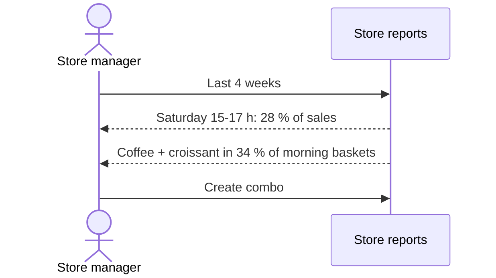

🏠 [Specs](../../../../README.md) › 🧩 [Functional capabilities](../../../README.md) ›
🏪 [F10 Point of sale (plugin)](../../README.md) › 📝 [Use cases](../README.md) ›
📝 [Use cases: FL-F10-11 Store reports](README.md) › 📝 UC-F10-28 Read hourly sales, staff performance and basket analysis

# 📝 UC-F10-28 Read hourly sales, staff performance and basket analysis

**Status:** ✅ specified

## Summary

Store managers and the owner read sales by hour, sales per staff member, and the items bought together, to plan staff
and combos.

## Personas

- [U23 Store manager](../../../../01-users/personas/u23-store-manager.md)
- [U13 Owner](../../../../01-users/personas/u13-owner.md)
- [U02 Manager](../../../../01-users/personas/u02-manager.md)

## Goal

Staff when customers come, combos that sell.

## Trigger

A weekly review.

## Frequency

Weekly.

## Preconditions

- Closed sessions ([UC-F10-01](../01-till-session/uc-f10-01-open-and-close-a-till-session.md)).

## Postconditions

- **Succeeded:** reports read and saved.
- **Failed:** unclosed sessions are flagged.

## Main flow

1. The store manager opens store reports ([S-F10-27](../../screens/11-store-reports/s-f10-27-store-reports.md)) for a
   period.
2. Hourly sales show by weekday with the staff on duty.
3. Staff performance shows sales, baskets and average basket per person
   ([BR-F10-22](../../business-rules/br-f10-22-staff-figures-go-to-their-managers.md)).
4. Basket analysis lists items bought together; the manager turns one into a combo
   ([UC-F10-06](../02-sell-at-the-counter/uc-f10-06-apply-prices-promotions-and-combos.md)).

## Alternative flows

- 1a. The owner compares stores.

## Error flows

- 1e. Sessions not closed: their sales are shown apart.

## Business rules

- [BR-F10-22 Staff figures go to their managers](../../business-rules/br-f10-22-staff-figures-go-to-their-managers.md)
- [BR-F10-15 Closed sessions post to the books and stock](../../business-rules/br-f10-15-sessions-post-to-books-and-stock.md)

## Entities

- [E-F10-03 Point of sale order](../../data/e-f10-03-point-of-sale-order.md)
- [E-F10-02 Till session](../../data/e-f10-02-till-session.md)

## Permissions

Store managers for their store; accounting; the owner reads.

## Notifications

Weekly digest to managers.

## Audit events

Exports.

## AI involvement

The AI assistant prepares it for confirmation
([BR-F3-07](../../../f03-assistant/business-rules/br-f03-07-no-deletes-no-irreversible-acts.md)); figures come from
queries ([BR-F3-03](../../../f03-assistant/business-rules/br-f03-03-figures-come-from-queries.md)).

## API, MCP and A2A exposure

T5 operations of F10 with the caller's rights; the MCP tool of F10; no A2A skill.

## Screens

- [S-F10-27 Store reports](../../screens/11-store-reports/s-f10-27-store-reports.md)

## Flowchart

See [FL-F10-11 Store reports](../../flows/fl-f10-11-store-reports.md#flowchart).

## Sequence diagram

## Acceptance criteria

1. **Given** 4 weeks of sales in the restaurant group's café **when** the report opens **then** Saturday 15:00 to 17:00
   shows 28 % of sales.
2. **Given** coffee and croissant together in 34 % of morning baskets **when** basket analysis runs **then** the pair is
   listed.
3. **Given** a session not closed **when** the report opens **then** its sales are shown apart.

## Non-functional notes

Reports within 3 seconds.

## Regulatory references

GDPR: staff figures for their managers only
([CR-FR-050](../../../../10-country-packs/france/data-protection/cr-fr-050-privacy-by-design.md)).

## Related use cases

- [UC-F10-18 Report sales and keep the legal archives](../07-set-up-and-report/uc-f10-18-report-sales-and-keep-the-legal-archives.md)
- [UC-F10-06 Apply prices, promotions and combos](../02-sell-at-the-counter/uc-f10-06-apply-prices-promotions-and-combos.md)

## Open questions

None.

---

⬅️ [UC-F10-27](../10-clienteling-transfers-and-tax-free/uc-f10-27-sell-tax-free-to-a-visitor-from-outside-the-eu.md) ·
⬆️ [Up](README.md) ·
➡️ [UC-F10-29 Take online takeaway orders](../12-takeaway-softpos-and-labels/uc-f10-29-take-online-takeaway-orders.md)
