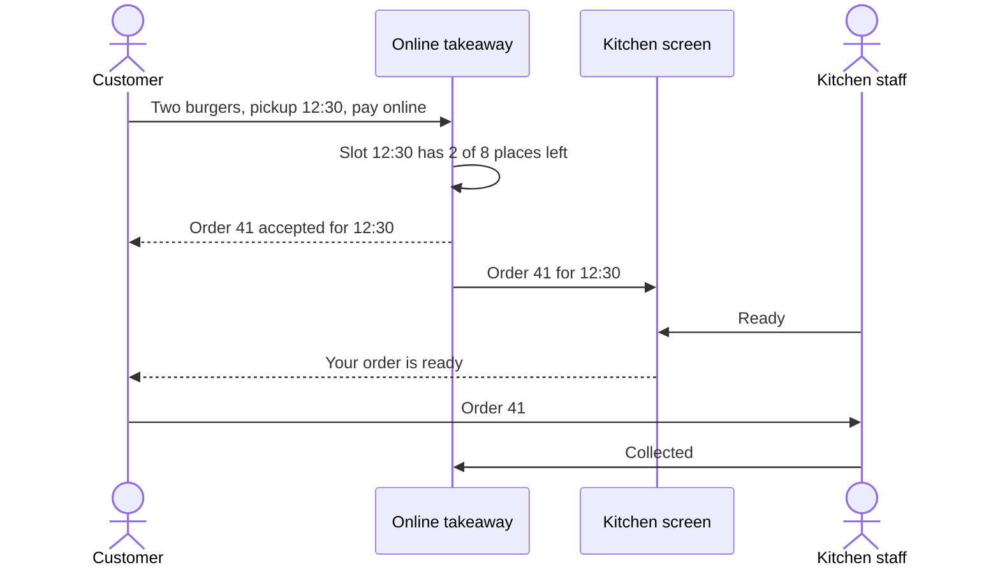

🏠 [Specs](../../../../README.md) › 🧩 [Functional capabilities](../../../README.md) ›
🏪 [F10 Point of sale (plugin)](../../README.md) › 📝 [Use cases](../README.md) › 📝 [Use cases: FL-F10-12](README.md) ›
📝 UC-F10-29 Take online takeaway orders

# 📝 UC-F10-29 Take online takeaway orders

**Status:** ✅ specified

## Summary

A customer orders food or goods to collect from the shop or restaurant, from a phone, and picks a pickup slot. Each slot
has a capacity set from what the kitchen can prepare; a full slot is not offered. The order arrives on the kitchen
screens and the till, is prepared, and handed over against its number. The kitchen can pause online orders when it is
overwhelmed.

## Personas

- [U09 Customer](../../../../01-users/personas/u09-customer.md), the customer who orders and collects
- [U19 Kitchen staff](../../../../01-users/personas/u19-kitchen-staff.md), who prepares the orders on the kitchen screen

## Goal

Customers order ahead and collect without queueing, and the kitchen never receives more than it can prepare.

## Trigger

A customer opens the shop's takeaway page, or the kitchen changes its capacity or pauses orders.

## Frequency

Continuously during opening hours.

## Preconditions

- The point of sale is open for takeaway with opening hours and slots
  ([E-F10-01 Point of sale](../../data/e-f10-01-point-of-sale.md)).
- A payment provider is connected
  ([E-F11-06 Payment provider](../../../f11-online-shop/data/e-f11-06-payment-provider.md)).
- Kitchen stations receive orders ([BR-F10-10](../../business-rules/br-f10-10-orders-routed-to-their-station.md)).

## Postconditions

- **Succeeded:** the order is paid, prepared and collected, and it is a sale of the till session of the day
  ([E-F10-22 Takeaway order](../../data/e-f10-22-takeaway-order.md),
  [E-F10-03 Point of sale order](../../data/e-f10-03-point-of-sale-order.md)).
- **Failed:** the order is refused or cancelled, the customer is told at once and any payment is refunded.

## Main flow

1. The customer opens Online takeaway
   ([S-F10-28](../../screens/12-takeaway-softpos-and-labels/s-f10-28-online-takeaway.md)) and sees the menu and the next
   pickup slots that are still open.
2. The customer builds the order, picks a slot and pays online, or chooses to pay at collection when the shop allows it.
3. The order is checked against the slot's capacity and the kitchen's state
   ([BR-F10-23](../../business-rules/br-f10-23-online-orders-stay-within-kitchen-capacity.md)) and accepted; the
   customer gets a number and the pickup time.
4. The order appears on the kitchen screen of its station in slot order
   ([UC-F10-10](../04-restaurant-service/uc-f10-10-prepare-orders-on-kitchen-screens.md)) and on the till.
5. The kitchen starts it and marks it ready; the customer is told by a notification.
6. At collection the staff find the order by its number, hand it over and mark it collected; the sale joins the till
   session ([UC-F10-02](../02-sell-at-the-counter/uc-f10-02-sell-at-the-counter.md)).

## Alternative flows

- 1a. The kitchen pauses online orders for 30 minutes: the page says so and offers the next open slot.
- 2a. The customer pays at collection: the order is accepted only up to a small unpaid limit set by the shop.
- 6a. The order is not collected within the window: it is marked not collected and the shop decides to keep or refund it
  under its terms.

## Error flows

- 3e. The slot filled while the customer paid: the order is refused before payment is taken, or refunded in full, and a
  new slot is offered ([BR-F10-23](../../business-rules/br-f10-23-online-orders-stay-within-kitchen-capacity.md)).
- 2e. The payment fails: no order is placed
  ([UC-F11-06](../../../f11-online-shop/use-cases/02-shop-and-check-out/uc-f11-06-pay-online.md)).
- 4e. The kitchen is closed or its station is offline: the order is refused with the reason.
- Any step: a service does not answer; the call is retried first
  ([BR-F3-32](../../../f03-assistant/business-rules/br-f03-32-retry-before-an-error.md)), then the message follows the
  error pattern ([D122](../../../../06-decisions/ux/d122-error-message-standard.md)) and the slot capacity and the
  kitchen's queue stay as they were.

## Business rules

- [BR-F10-23 Online orders stay within kitchen capacity](../../business-rules/br-f10-23-online-orders-stay-within-kitchen-capacity.md)
- [BR-F10-10 Orders go to their preparation station](../../business-rules/br-f10-10-orders-routed-to-their-station.md)
- [BR-F10-06 Offline, the till keeps selling](../../business-rules/br-f10-06-offline-keeps-selling.md)

## Entities

- [E-F10-22 Takeaway order](../../data/e-f10-22-takeaway-order.md): created, accepted, prepared, collected, cancelled,
  refused
- [E-F10-03 Point of sale order](../../data/e-f10-03-point-of-sale-order.md): created on acceptance
- [E-F10-13 Preparation ticket](../../data/e-f10-13-preparation-ticket.md): created for the kitchen
- [E-F10-01 Point of sale](../../data/e-f10-01-point-of-sale.md): read, for hours and slots
- [E-F11-06 Payment provider](../../../f11-online-shop/data/e-f11-06-payment-provider.md): payment

## Permissions

A customer sees and cancels their own orders. Kitchen staff accept, prepare and hand over orders of their point of sale.
A store manager sets slots, capacity and the pause.

## Notifications

- The customer, by push and email: order accepted, ready, or refused with the reason.
- The kitchen, on the screen and by sound: a new order, an order cancelled.

## Audit events

Order placed, accepted, refused, prepared, collected and cancelled, with the slot and the capacity at that time; each
pause of online orders and who set it.

## AI involvement

None: capacity and acceptance are rules, not decisions of the AI assistant.

## API, MCP and A2A exposure

T5 operations on takeaway orders for the shop's own app; a read MCP tool for the kitchen's queue; no A2A skill.

## Screens

- [S-F10-28 Online takeaway](../../screens/12-takeaway-softpos-and-labels/s-f10-28-online-takeaway.md)

## Flowchart

See
[FL-F10-12 Takeaway, tap to pay, labels and layaway](../../flows/fl-f10-12-takeaway-softpos-and-labels.md#flowchart).

## Sequence diagram

## Acceptance criteria

1. **Given** a slot with 2 places left **when** a customer orders 1 burger **then** the order is accepted and the slot
   has 1 place left.
2. **Given** a full slot **when** the customer opens the page **then** the slot is not offered.
3. **Given** online orders paused **when** a customer opens the page **then** they see the pause and the next slot.
4. **Given** an order ready **when** the customer collects it **then** it is marked collected and joins the till
   session.
5. **Given** an accepted order **when** the customer cancels in time **then** it is refunded and the slot is freed.

## Non-functional notes

The slot capacity is checked in under 1 second and cannot be exceeded by two customers at once.

## Regulatory references

Distance sale rules apply to the order button and the price display
([BR-F11-02](../../../f11-online-shop/business-rules/br-f11-02-order-button-states-the-obligation-to-pay.md),
[BR-F11-04](../../../f11-online-shop/business-rules/br-f11-04-prices-with-taxes-and-delivery.md)); the information on
allergens for food is shown with each dish.

## Related use cases

- [UC-F10-02 Sell at the counter](../02-sell-at-the-counter/uc-f10-02-sell-at-the-counter.md)
- [UC-F10-10 Prepare orders on kitchen screens](../04-restaurant-service/uc-f10-10-prepare-orders-on-kitchen-screens.md)
- [UC-F10-17 Take delivery-platform orders](../06-mobile-and-delivery/uc-f10-17-take-delivery-platform-orders.md)
- [UC-F10-12 Self-order by QR at the table](../05-self-order-and-kiosk/uc-f10-12-self-order-by-qr-at-the-table.md)
- [UC-F11-05 Check out](../../../f11-online-shop/use-cases/02-shop-and-check-out/uc-f11-05-check-out.md)

## Open questions

None.

---

⬅️ [UC-F10-28](../11-store-reports/uc-f10-28-read-hourly-sales-staff-performance-and-basket-analysis.md) ·
⬆️ [Up](README.md) · ➡️ [UC-F10-30 Take payment by tap on phone](uc-f10-30-take-payment-by-tap-on-phone.md)
