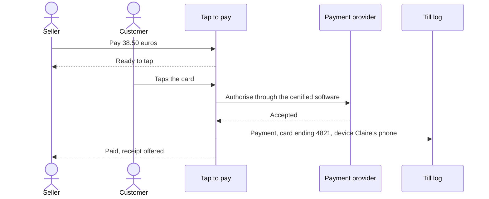

🏠 [Specs](../../../../README.md) › 🧩 [Functional capabilities](../../../README.md) ›
🏪 [F10 Point of sale (plugin)](../../README.md) › 📝 [Use cases](../README.md) › 📝 [Use cases: FL-F10-12](README.md) ›
📝 UC-F10-30 Take payment by tap on phone

# 📝 UC-F10-30 Take payment by tap on phone

**Status:** ✅ specified

## Summary

A cashier or waiter takes a card or phone payment on their own phone: the customer taps their card or phone on the back
of the seller's phone, which acts as the card terminal through the payment provider's certified software. No card data
reaches SimpleERP. The payment is a payment of the till session and is recorded in the till log like any other.

## Personas

- [U17 Cashier](../../../../01-users/personas/u17-cashier.md), who takes payments at the counter or in the aisles
- [U18 Waiter](../../../../01-users/personas/u18-waiter.md), who takes payments at the table

## Goal

Payment is taken where the customer is, with no separate terminal to buy or carry.

## Trigger

The seller opens the amount to pay on the mobile till and chooses Tap to pay.

## Frequency

Many times a day in shops and restaurants that use phones as terminals.

## Preconditions

- The phone is registered as a point of sale device and assigned to the seller
  ([E-F10-14 Point of sale device](../../data/e-f10-14-point-of-sale-device.md)).
- A till session is open ([E-F10-02 Till session](../../data/e-f10-02-till-session.md)).
- The payment provider's tap-to-pay service is enabled for the company
  ([UC-F10-15](../07-set-up-and-report/uc-f10-15-set-up-a-point-of-sale-and-its-hardware.md)).

## Postconditions

- **Succeeded:** the payment is accepted, recorded as a till payment of the session and a receipt is offered
  ([E-F10-04 Till payment](../../data/e-f10-04-till-payment.md),
  [E-F10-15 Till event log](../../data/e-f10-15-till-event-log.md)).
- **Failed:** no money is taken, the sale stays open and the reason is shown.

## Main flow

1. The seller has the sale on the mobile till and opens Tap to pay
   ([S-F10-29](../../screens/12-takeaway-softpos-and-labels/s-f10-29-tap-to-pay.md)) with the amount.
2. The screen shows the amount and Ready to tap; the customer taps their card or phone on the back of the seller's
   phone.
3. For an amount over the contactless ceiling, the customer enters their PIN on the seller's screen, which the
   provider's software protects from the seller's view.
4. The provider answers; the payment is accepted and recorded with its last four digits, the method and the device,
   never the card number.
5. The receipt is shown as a code, sent by email or printed
   ([BR-F10-07](../../business-rules/br-f10-07-receipts-on-request.md)).
6. At closing the payment is matched to the provider's settlement
   ([UC-F10-24](../09-cash-and-settlements/uc-f10-24-match-card-terminal-settlements-net-of-fees.md)).

## Alternative flows

- 2a. The customer pays with a phone wallet: the same flow, the method is shown as phone wallet.
- 2b. The customer wants to split the amount between cards: each tap is a separate payment on the sale
  ([UC-F10-11](../04-restaurant-service/uc-f10-11-split-the-bill-in-a-restaurant.md)).
- 4a. The phone has no network: the provider cannot accept the payment and the seller is told to use another way
  ([BR-F10-24](../../business-rules/br-f10-24-tap-to-pay-follows-the-card-terminal-rules-and-the-till-log.md)).

## Error flows

- 4e. The card is declined: the reason from the provider is shown and the seller may retry or take another means.
- 2e. The phone's NFC is off or unavailable: the screen says how to turn it on or to use another means.
- 1e. The phone is not registered or the service is off: the action is not offered
  ([BR-F10-24](../../business-rules/br-f10-24-tap-to-pay-follows-the-card-terminal-rules-and-the-till-log.md)).
- Any step: a service does not answer; the call is retried first
  ([BR-F3-32](../../../f03-assistant/business-rules/br-f03-32-retry-before-an-error.md)), then the message follows the
  error pattern ([D122](../../../../06-decisions/ux/d122-error-message-standard.md)) and the sale stays open and unpaid.

## Business rules

- [BR-F10-24 Tap to pay follows the card-terminal rules and the till log](../../business-rules/br-f10-24-tap-to-pay-follows-the-card-terminal-rules-and-the-till-log.md)
- [BR-F10-01 The till follows the country pack](../../business-rules/br-f10-01-till-follows-the-country-pack.md)
- [BR-F10-06 Offline, the till keeps selling](../../business-rules/br-f10-06-offline-keeps-selling.md)

## Entities

- [E-F10-04 Till payment](../../data/e-f10-04-till-payment.md): created
- [E-F10-14 Point of sale device](../../data/e-f10-14-point-of-sale-device.md): read
- [E-F10-15 Till event log](../../data/e-f10-15-till-event-log.md): written
- [E-F10-02 Till session](../../data/e-f10-02-till-session.md): read
- [E-F10-18 Card settlement](../../data/e-f10-18-card-settlement.md): matched at settlement

## Permissions

A seller with the right to take payments on a registered phone. A store manager registers phones and enables the
service. No one reads card data.

## Notifications

- The seller, on the screen: accepted or declined.
- The store manager, in the app: a phone with repeated declines.

## Audit events

Each tap payment with the amount, method, last four digits, device and result in the till log; each phone registered or
removed.

## AI involvement

None: payments are never taken or changed by the AI assistant.

## API, MCP and A2A exposure

T5 operations to start and read a payment for the till apps; no MCP tool and no A2A skill take payments.

## Screens

- [S-F10-29 Tap to pay](../../screens/12-takeaway-softpos-and-labels/s-f10-29-tap-to-pay.md)

## Flowchart

See
[FL-F10-12 Takeaway, tap to pay, labels and layaway](../../flows/fl-f10-12-takeaway-softpos-and-labels.md#flowchart).

## Sequence diagram

## Acceptance criteria

1. **Given** a sale of 38.50 euros **when** the customer taps a card **then** the payment is accepted and in the till
   log.
2. **Given** an amount over the contactless ceiling **when** the customer taps **then** a PIN is asked on the screen.
3. **Given** a declined card **when** the seller reads the result **then** the sale stays open and another means is
   offered.
4. **Given** a phone not registered **when** the seller opens the sale **then** Tap to pay is not offered.
5. **Given** any payment **when** the seller opens the till log **then** no full card number appears anywhere.

## Non-functional notes

A payment completes in under 5 seconds after the tap on a 4G network.

## Regulatory references

Card acceptance on a phone follows the payment schemes' and the payment provider's terminal rules, to be
listed in the France pack with the owner's confirmation, no article cited here. Receipts follow
[CR-FR-031](../../../../10-country-packs/france/point-of-sale/cr-fr-031-paper-receipt-on-request.md).

## Related use cases

- [UC-F10-03 Take payment](../02-sell-at-the-counter/uc-f10-03-take-payment.md)
- [UC-F10-14 Sell on the move and offline](../06-mobile-and-delivery/uc-f10-14-sell-on-the-move-and-offline.md)
- [UC-F10-24 Match card-terminal settlements net of fees](../09-cash-and-settlements/uc-f10-24-match-card-terminal-settlements-net-of-fees.md)
- [UC-F10-15 Set up a point of sale and its hardware](../07-set-up-and-report/uc-f10-15-set-up-a-point-of-sale-and-its-hardware.md)

## Open questions

None.

---

⬅️ [UC-F10-29 Take online takeaway orders](uc-f10-29-take-online-takeaway-orders.md) · ⬆️ [Up](README.md) ·
➡️ [UC-F10-31 Update electronic shelf labels](uc-f10-31-update-electronic-shelf-labels.md)
