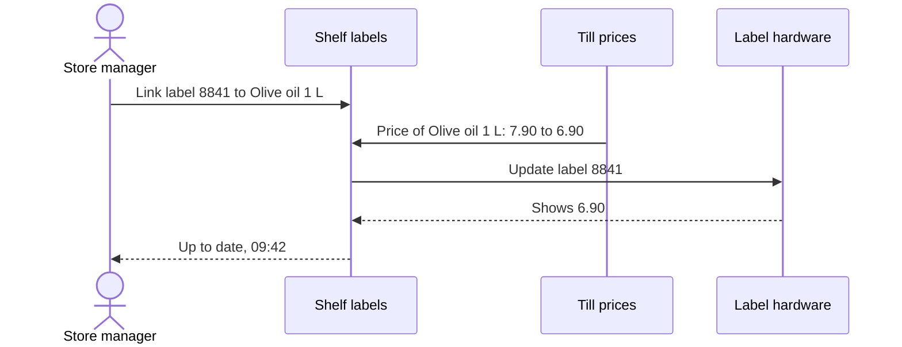

🏠 [Specs](../../../../README.md) › 🧩 [Functional capabilities](../../../README.md) ›
🏪 [F10 Point of sale (plugin)](../../README.md) › 📝 [Use cases](../README.md) › 📝 [Use cases: FL-F10-12](README.md) ›
📝 UC-F10-31 Update electronic shelf labels

# 📝 UC-F10-31 Update electronic shelf labels

**Status:** ✅ specified

## Summary

Electronic labels on the shelves show each product's price, unit price and promotion. When a price or a promotion
changes at the till, the labels of that product change by themselves within a short delay. The store manager links
labels to products and shelves, sees the labels that did not update or whose battery is low, and prints a paper label as
a fallback.

## Personas

- [U23 Store manager](../../../../01-users/personas/u23-store-manager.md), who links, checks and repairs the labels

## Goal

The price on the shelf is always the price at the till, with no one walking the aisles to change paper labels.

## Trigger

A price or promotion changes ([UC-F10-06](../02-sell-at-the-counter/uc-f10-06-apply-prices-promotions-and-combos.md)),
or the store manager opens the labels to check them.

## Frequency

Price changes, daily; checks, weekly.

## Preconditions

- Label hardware is connected through the label connector
  ([UC-F10-15](../07-set-up-and-report/uc-f10-15-set-up-a-point-of-sale-and-its-hardware.md)).
- Products have prices and shelf locations ([E-F7-06 Item](../../../f07-purchasing-and-stock/data/e-f07-06-item.md),
  [E-F7-07 Location](../../../f07-purchasing-and-stock/data/e-f07-07-location.md)).

## Postconditions

- **Succeeded:** every label shows its product's current till price, unit price and promotion, and the update time is
  kept ([E-F10-23 Shelf label](../../data/e-f10-23-shelf-label.md)).
- **Failed:** the label that failed is flagged and the till warns the sellers of the difference.

## Main flow

1. The store manager opens Shelf labels
   ([S-F10-30](../../screens/12-takeaway-softpos-and-labels/s-f10-30-shelf-labels.md)) and scans a new label with the
   phone or types its code.
2. The manager links the label to a product and a shelf position; it shows the product's price and unit price at once.
3. A price or promotion changes at the till; the labels of that product are queued and updated, in order of the change.
4. Each label confirms its update; the label is UpToDate with the time of the last update.
5. The screen lists the labels that did not confirm within the delay, the faulty ones and the ones with a flat battery.
6. For a Mismatch the manager retries, replaces the label or prints a paper label; until then the till shows the sellers
   that the shelf price may differ.

## Alternative flows

- 3a. A promotion starts at a set hour: the labels are updated just before and again when it ends.
- 5a. A label is lost: the manager marks it faulty and the product's shelf is flagged for a replacement.
- 6a. A product moves shelf: the manager relinks the label in one scan.

## Error flows

- 4e. The label connector is down: labels keep their last price, are flagged Mismatch and the till warns the sellers
  ([BR-F10-25](../../business-rules/br-f10-25-label-prices-always-match-the-till-price.md)).
- 2e. The label is already linked to another product: the manager is asked to unlink it first.
- 3e. The unit price cannot be computed (no unit given): the label shows no unit price and the product is flagged.
- Any step: a service does not answer; the call is retried first
  ([BR-F3-32](../../../f03-assistant/business-rules/br-f03-32-retry-before-an-error.md)), then the message follows the
  error pattern ([D122](../../../../06-decisions/ux/d122-error-message-standard.md)) and the label keeps its last price
  and is flagged.

## Business rules

- [BR-F10-25 Label prices always match the till price](../../business-rules/br-f10-25-label-prices-always-match-the-till-price.md)
- [BR-F10-08 Prices, promotions and reference prices](../../business-rules/br-f10-08-prices-and-promotions.md)
- [BR-F10-01 The till follows the country pack](../../business-rules/br-f10-01-till-follows-the-country-pack.md)

## Entities

- [E-F10-23 Shelf label](../../data/e-f10-23-shelf-label.md): created, linked, updated, flagged, retired
- [E-F10-08 Price promotion](../../data/e-f10-08-price-promotion.md): read
- [E-F7-06 Item](../../../f07-purchasing-and-stock/data/e-f07-06-item.md): read, for the product
- [E-F7-07 Location](../../../f07-purchasing-and-stock/data/e-f07-07-location.md): read, for the shelf

## Permissions

The store manager and the staff they authorise link and repair labels. Sellers see the shelf-price warning at the till.

## Notifications

- The store manager, in the app: labels in Mismatch or with a low battery.
- The seller, at the till: the product's shelf price may differ.

## Audit events

Label linked, unlinked, updated and retired; each Mismatch with the price shown and the till price at that time.

## AI involvement

None: labels follow the till price, never an AI decision.

## API, MCP and A2A exposure

T5 operations on labels for the store manager's app; the label connector uses a connector credential in the secret
store; no MCP tool and no A2A skill.

## Screens

- [S-F10-30 Shelf labels](../../screens/12-takeaway-softpos-and-labels/s-f10-30-shelf-labels.md)

## Flowchart

See
[FL-F10-12 Takeaway, tap to pay, labels and layaway](../../flows/fl-f10-12-takeaway-softpos-and-labels.md#flowchart).

## Sequence diagram

## Acceptance criteria

1. **Given** a price changed from 7.90 to 6.90 **when** the till saves it **then** the label shows 6.90 within the
   delay.
2. **Given** a label that did not confirm **when** the delay ends **then** it is flagged Mismatch and the till warns .
3. **Given** a product with a promotion **when** the promotion ends **then** the label shows the normal price again.
4. **Given** a label linked to another product **when** the manager links it **then** it is refused until unlinked.
5. **Given** a flat battery **when** the manager opens the screen **then** the label is listed to replace.

## Non-functional notes

A price change reaches every label of the product within 5 minutes in a shop of 20 000 labels.

## Regulatory references

The price shown on the shelf follows the price display rules in shops
([CR-FR-092](../../../../10-country-packs/france/consumer/cr-fr-092-unit-price-display.md)) and the reference price of a
reduction ([CR-FR-035](../../../../10-country-packs/france/consumer/cr-fr-035-reference-price-for-reductions.md)).

## Related use cases

- [UC-F10-06 Apply prices, promotions and combos](../02-sell-at-the-counter/uc-f10-06-apply-prices-promotions-and-combos.md)
- [UC-F10-08 Sell by weight and barcodes](../02-sell-at-the-counter/uc-f10-08-sell-by-weight-and-barcodes.md)
- [UC-F10-15 Set up a point of sale and its hardware](../07-set-up-and-report/uc-f10-15-set-up-a-point-of-sale-and-its-hardware.md)
- [UC-F10-26 Look up and transfer stock between stores](../10-clienteling-transfers-and-tax-free/uc-f10-26-look-up-and-transfer-stock-between-stores.md)

## Open questions

None.

---

⬅️ [UC-F10-30 Take payment by tap on phone](uc-f10-30-take-payment-by-tap-on-phone.md) · ⬆️ [Up](README.md) ·
➡️ [UC-F10-32 Hold an item with a deposit or park a sale](uc-f10-32-hold-an-item-with-a-deposit-or-park-a-sale.md)
