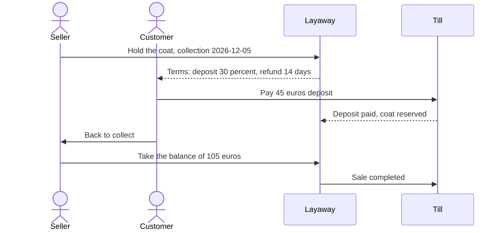

🏠 [Specs](../../../../README.md) › 🧩 [Functional capabilities](../../../README.md) ›
🏪 [F10 Point of sale (plugin)](../../README.md) › 📝 [Use cases](../README.md) › 📝 [Use cases: FL-F10-12](README.md) ›
📝 UC-F10-32 Hold an item with a deposit or park a sale

# 📝 UC-F10-32 Hold an item with a deposit or park a sale

**Status:** ✅ specified

## Summary

A seller can put a sale aside (park it) to serve another customer and resume it later, or hold items for a customer
against a deposit with a collection date (layaway). Held items are reserved in stock. When the customer pays the balance
and collects, the sale is completed; otherwise the deposit is refunded according to the terms the shop showed when it
took it.

## Personas

- [U17 Cashier](../../../../01-users/personas/u17-cashier.md), who parks sales and takes deposits on a tablet
- [U23 Store manager](../../../../01-users/personas/u23-store-manager.md), who sets the terms and follows the held items

## Goal

No sale is lost because the customer must leave, and a deposit is clear to both sides: what is held, until when, and
what comes back.

## Trigger

A customer asks the seller to keep an item, or the seller needs to serve someone else mid-sale.

## Frequency

Parking, several times a day; layaways, a few a week.

## Preconditions

- A till session is open ([E-F10-02 Till session](../../data/e-f10-02-till-session.md)).
- The shop has set its deposit terms: minimum deposit, holding time and refund conditions
  ([BR-F10-26](../../business-rules/br-f10-26-layaway-deposits-are-refunded-per-the-shops-terms.md)).
- The items are in stock ([E-F7-06 Item](../../../f07-purchasing-and-stock/data/e-f07-06-item.md)).

## Postconditions

- **Succeeded:** the sale is resumed and paid, or the layaway is collected, or the deposit is refunded according to the
  terms ([E-F10-24 Layaway](../../data/e-f10-24-layaway.md)).
- **Failed:** the items return to stock and the deposit is refunded per the terms.

## Main flow

1. The seller has a sale in progress and chooses Park; the sale is kept on the till with a name or number and a parking
   time.
2. To hold items against a deposit, the seller opens Layaway
   ([S-F10-31](../../screens/12-takeaway-softpos-and-labels/s-f10-31-layaway.md)), picks the customer and the items, and
   sets the collection date.
3. The screen shows the shop's terms and the deposit asked; the customer accepts and pays the deposit
   ([UC-F10-03](../02-sell-at-the-counter/uc-f10-03-take-payment.md)); the items are reserved.
4. A receipt for the deposit is given with the terms and the collection date.
5. When the customer returns, the seller loads the layaway, takes the balance and the sale completes; the items leave
   stock ([UC-F10-02](../02-sell-at-the-counter/uc-f10-02-sell-at-the-counter.md)).
6. A parked sale is resumed from the list of parked sales at any till of the shop during the day.

## Alternative flows

- 1a. A parked sale not resumed by the end of the session is closed and its items return to stock.
- 3a. The customer pays the whole price: the items are held fully paid until collection.
- 5a. The customer changes an item: the layaway is edited before the balance is taken.

## Error flows

- 2e. An item is not in stock: it cannot be held
  ([BR-F10-20](../../business-rules/br-f10-20-recognised-customers-agreed-transferred-items-are-reserved.md)).
- 3e. The deposit is below the shop's minimum: refused with the minimum shown.
- 5e. The collection date passes: the layaway expires, the items return to stock and the deposit is refunded per the
  terms ([BR-F10-26](../../business-rules/br-f10-26-layaway-deposits-are-refunded-per-the-shops-terms.md)).
- Any step: a service does not answer; the call is retried first
  ([BR-F3-32](../../../f03-assistant/business-rules/br-f03-32-retry-before-an-error.md)), then the message follows the
  error pattern ([D122](../../../../06-decisions/ux/d122-error-message-standard.md)) and the sale and the stock stay as
  they were.

## Business rules

- [BR-F10-26 Layaway deposits are refunded per the shop's terms](../../business-rules/br-f10-26-layaway-deposits-are-refunded-per-the-shops-terms.md)
- [BR-F10-20 Recognised customers agreed, transferred items are reserved](../../business-rules/br-f10-20-recognised-customers-agreed-transferred-items-are-reserved.md)
- [BR-F10-04 Refunds link the original sale](../../business-rules/br-f10-04-refunds-link-the-original.md)

## Entities

- [E-F10-24 Layaway](../../data/e-f10-24-layaway.md): created, resumed, collected, cancelled, expired, refunded
- [E-F10-03 Point of sale order](../../data/e-f10-03-point-of-sale-order.md): created at the balance
- [E-F10-04 Till payment](../../data/e-f10-04-till-payment.md): the deposit and the balance
- [E-F7-06 Item](../../../f07-purchasing-and-stock/data/e-f07-06-item.md): reserved while held

## Permissions

A seller parks sales and takes deposits at their till. The store manager sets the terms and may cancel or extend a
layaway. The customer sees their own layaway on their receipt.

## Notifications

- The customer, by email or text: the collection date approaching, or the expiry.
- The store manager, in the app: layaways expiring this week.

## Audit events

Sale parked and resumed; deposit taken, refunded and kept, with the terms shown; each extension and cancellation with
who and why.

## AI involvement

None: deposits and refunds follow the shop's terms, not an AI decision.

## API, MCP and A2A exposure

T5 operations on parked sales and layaways for the till apps; no MCP tool and no A2A skill.

## Screens

- [S-F10-31 Layaway](../../screens/12-takeaway-softpos-and-labels/s-f10-31-layaway.md)

## Flowchart

See
[FL-F10-12 Takeaway, tap to pay, labels and layaway](../../flows/fl-f10-12-takeaway-softpos-and-labels.md#flowchart).

## Sequence diagram

## Acceptance criteria

1. **Given** a coat at 150 euros and a minimum of 30 percent **when** the customer pays 45 euros **then** the coat is
   held until the collection date.
2. **Given** a held coat **when** the customer pays the balance and collects **then** the sale completes and stock
   decreases.
3. **Given** a collection date passed **when** the day ends **then** the layaway expires and the deposit is refunded per
   the terms.
4. **Given** an item out of stock **when** the seller holds it **then** it is refused.
5. **Given** a parked sale **when** the seller resumes it at another till **then** it opens with its lines.

## Non-functional notes

A parked sale resumes in under 2 seconds, also at another till of the shop.

## Regulatory references

The treatment of a deposit and the customer's right to cancel follow the consumer rules, to be written in the
France pack with the owner's confirmation, no article cited here; the shop shows its terms before taking the deposit. A
refund links the original sale ([BR-F10-04](../../business-rules/br-f10-04-refunds-link-the-original.md)).

## Related use cases

- [UC-F10-02 Sell at the counter](../02-sell-at-the-counter/uc-f10-02-sell-at-the-counter.md)
- [UC-F10-03 Take payment](../02-sell-at-the-counter/uc-f10-03-take-payment.md)
- [UC-F10-04 Refund or exchange](../03-after-sales/uc-f10-04-refund-or-exchange.md)
- [UC-F10-07 Use loyalty, gift cards and e-wallet](../03-after-sales/uc-f10-07-use-loyalty-gift-cards-and-e-wallet.md)
- [UC-F10-26 Look up and transfer stock between stores](../10-clienteling-transfers-and-tax-free/uc-f10-26-look-up-and-transfer-stock-between-stores.md)

## Open questions

None.

---

⬅️ [UC-F10-31 Update electronic shelf labels](uc-f10-31-update-electronic-shelf-labels.md) · ⬆️ [Up](README.md)
