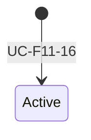

🏠 [Specs](../../../README.md) › 🧩 [Functional capabilities](../../README.md) ›
🛍️ [F11 Online shop (plugin)](../README.md) › 🗃️ [Data](README.md) › 🗃️ E-F11-01 Website

# 🗃️ E-F11-01 Website

**Status:** ✅ specified

## Purpose

A website of the company.

## Fields

| Name | Type | Required | Validation | Default | Example | Personal data | Custom fields |
|---|---|---|---|---|---|---|---|
| name, domain | text | yes | unique domain | - | shop.acme.fr | no | no |
| languages | list | yes | - | fr | fr, en | no | no |
| mode | B2C, B2B | yes | - | B2C | B2C | no | no |
| checkout | account, guest, both | yes | BR-F11-08 | both | both | no | no |

## Relations

As its use cases.

## Lifecycle

## Indexes and search

By number, date, partner.

## Retention

Kept for the period of its kind of record in the country pack (D293), or else its kind's default in the
[retention schedule](../../../05-non-functional/data-retention.md).

## Audit

Every change.

## Import and export

CSV, FEC where relevant.

## Used by

- [UC-F11-01](../use-cases/01-build-the-shop/uc-f11-01-build-and-design-the-website.md)
- [UC-F11-16](../use-cases/01-build-the-shop/uc-f11-16-manage-seo-languages-and-several-websites.md)

## Open questions

None.

---

⬆️ [Up](README.md) · ➡️ [E-F11-02 Web page](e-f11-02-web-page.md)
