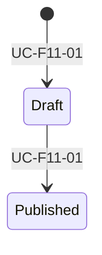

🏠 [Specs](../../../README.md) › 🧩 [Functional capabilities](../../README.md) ›
🛍️ [F11 Online shop (plugin)](../README.md) › 🗃️ [Data](README.md) › 🗃️ E-F11-02 Web page

# 🗃️ E-F11-02 Web page

**Status:** ✅ specified

## Purpose

A page of a website.

## Fields

| Name | Type | Required | Validation | Default | Example | Personal data | Custom fields |
|---|---|---|---|---|---|---|---|
| title, url | text | yes | unique url per site | - | /about | no | no |
| blocks | list | yes | - | - | banner, text | no | no |
| SEO | title, description, index | no | - | index | - | no | no |
| state | draft, published | yes | - | draft | published | no | no |

## Relations

As its use cases.

## Lifecycle

## Indexes and search

By number, date, partner.

## Retention

Kept for the period of its kind of record in the country pack (D293), or else its kind's default in the
[retention schedule](../../../05-non-functional/data-retention.md).

## Audit

Every change.

## Import and export

CSV, FEC where relevant.

## Used by

- [UC-F11-01](../use-cases/01-build-the-shop/uc-f11-01-build-and-design-the-website.md)
- [UC-F11-16](../use-cases/01-build-the-shop/uc-f11-16-manage-seo-languages-and-several-websites.md)

## Open questions

None.

---

⬅️ [E-F11-01 Website](e-f11-01-website.md) · ⬆️ [Up](README.md) ·
➡️ [E-F11-03 Online product](e-f11-03-online-product.md)
