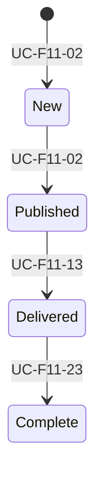

🏠 [Specs](../../../README.md) › 🧩 [Functional capabilities](../../README.md) ›
🛍️ [F11 Online shop (plugin)](../README.md) › 🗃️ [Data](README.md) › 🗃️ E-F11-03 Online product

# 🗃️ E-F11-03 Online product

**Status:** ✅ specified

## Purpose

A product as sold online.

## Fields

| Name | Type | Required | Validation | Default | Example | Personal data | Custom fields |
|---|---|---|---|---|---|---|---|
| product | product | yes | - | - | Kettle K2 | no | no |
| categories, ribbons | lists | no | - | - | Kitchen, New | no | no |
| websites | list | yes | - | all | shop.acme.fr | no | no |
| selling on order | yes, no | yes | BR-F11-06 | no | no | no | no |
| kind | goods, subscription, rental, digital | yes | - | goods | goods | no | no |

## Relations

As its use cases.

## Lifecycle

## Indexes and search

By number, date, partner.

## Retention

Kept for the period of its kind of record in the country pack (D293), or else its kind's default in the
[retention schedule](../../../05-non-functional/data-retention.md).

## Audit

Every change.

## Import and export

CSV, FEC where relevant.

## Used by

- [UC-F11-02](../use-cases/01-build-the-shop/uc-f11-02-publish-the-catalogue.md)
- [UC-F11-04](../use-cases/02-shop-and-check-out/uc-f11-04-browse-and-search-the-shop.md)
- [UC-F11-12](../use-cases/04-special-sales/uc-f11-12-sell-subscriptions-and-rentals-online.md)
- [UC-F11-13](../use-cases/04-special-sales/uc-f11-13-sell-digital-products.md)
- [UC-F11-20](../use-cases/05-grow-the-shop/uc-f11-20-ask-the-assistant-about-the-shop.md)
- [UC-F11-23 Enrich product content per channel](../use-cases/08-product-content-and-listings/uc-f11-23-enrich-product-content-per-channel.md)
- [UC-F11-25 Show product safety information](../use-cases/08-product-content-and-listings/uc-f11-25-show-product-safety-information.md)

## Open questions

None.

---

⬅️ [E-F11-02 Web page](e-f11-02-web-page.md) · ⬆️ [Up](README.md) · ➡️ [E-F11-04 Cart](e-f11-04-cart.md)
