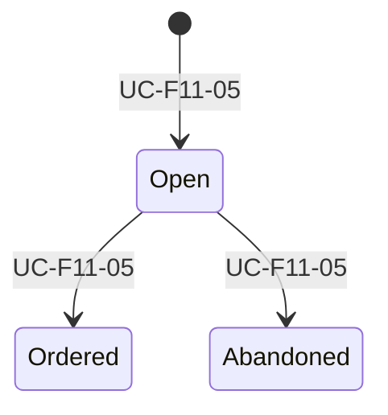

🏠 [Specs](../../../README.md) › 🧩 [Functional capabilities](../../README.md) ›
🛍️ [F11 Online shop (plugin)](../README.md) › 🗃️ [Data](README.md) › 🗃️ E-F11-04 Cart

# 🗃️ E-F11-04 Cart

**Status:** ✅ specified

## Purpose

A visitor's or customer's cart.

## Fields

| Name | Type | Required | Validation | Default | Example | Personal data | Custom fields |
|---|---|---|---|---|---|---|---|
| lines | product, quantity, price | yes | - | - | 1 x 24.00 | no | no |
| owner | customer or guest email | no | - | - | j.martin@... | yes | no |
| state | open, abandoned, ordered | yes | - | open | abandoned | no | no |

## Relations

As its use cases.

## Lifecycle

## Indexes and search

By number, date, partner.

## Retention

As an accounting record:
[CR-FR-002 Accounting records kept 10 years](../../../10-country-packs/france/accounting/cr-fr-002-accounting-records-kept-ten-years.md);
personal data per
[CR-FR-052 Personal data kept no longer than needed](../../../10-country-packs/france/data-protection/cr-fr-052-storage-limitation.md).

## Audit

Every change.

## Import and export

CSV, FEC where relevant.

## Used by

- [UC-F11-05](../use-cases/02-shop-and-check-out/uc-f11-05-check-out.md)
- [UC-F11-20](../use-cases/05-grow-the-shop/uc-f11-20-ask-the-assistant-about-the-shop.md)

## Open questions

None.

---

⬅️ [E-F11-03 Online product](e-f11-03-online-product.md) · ⬆️ [Up](README.md) ·
➡️ [E-F11-05 Checkout](e-f11-05-checkout.md)
