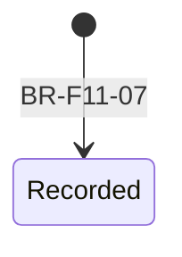

🏠 [Specs](../../../README.md) › 🧩 [Functional capabilities](../../README.md) ›
🛍️ [F11 Online shop (plugin)](../README.md) › 🗃️ [Data](README.md) › 🗃️ E-F11-05 Checkout

# 🗃️ E-F11-05 Checkout

**Status:** ✅ specified

## Purpose

The choices of an order placed online.

## Fields

| Name | Type | Required | Validation | Default | Example | Personal data | Custom fields |
|---|---|---|---|---|---|---|---|
| addresses | delivery, billing | yes | - | - | Lyon | yes | no |
| delivery | method or pickup point | yes | BR-F11-07 | - | Colissimo | no | no |
| terms version | version | yes | BR-F11-15 | - | v3 | no | no |
| order | F6 order | yes | - | - | SO-2026-918 | no | no |

## Relations

As its use cases.

## Lifecycle

## Indexes and search

By number, date, partner.

## Retention

As an accounting record:
[CR-FR-002 Accounting records kept 10 years](../../../10-country-packs/france/accounting/cr-fr-002-accounting-records-kept-ten-years.md);
personal data per
[CR-FR-052 Personal data kept no longer than needed](../../../10-country-packs/france/data-protection/cr-fr-052-storage-limitation.md).

## Audit

Every change.

## Import and export

CSV, FEC where relevant.

## Used by

- [UC-F11-05](../use-cases/02-shop-and-check-out/uc-f11-05-check-out.md)
- [UC-F11-06](../use-cases/02-shop-and-check-out/uc-f11-06-pay-online.md)
- [UC-F11-08](../use-cases/02-shop-and-check-out/uc-f11-08-confirm-the-order-and-invoice.md)
- [UC-F11-21 Screen orders for fraud and authenticate payments](../use-cases/07-payment-risk/uc-f11-21-screen-orders-for-fraud-and-authenticate-payments.md)
- [UC-F11-29 Read the funnel, customer value and return reasons](../use-cases/10-fulfil-from-stores-and-report/uc-f11-29-read-the-funnel-customer-value-and-return-reasons.md)

## Open questions

None.

---

⬅️ [E-F11-04 Cart](e-f11-04-cart.md) · ⬆️ [Up](README.md) ·
➡️ [E-F11-06 Payment provider](e-f11-06-payment-provider.md)
