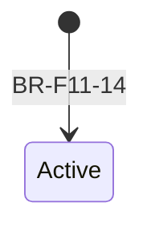

🏠 [Specs](../../../README.md) › 🧩 [Functional capabilities](../../README.md) ›
🛍️ [F11 Online shop (plugin)](../README.md) › 🗃️ [Data](README.md) › 🗃️ E-F11-06 Payment provider

# 🗃️ E-F11-06 Payment provider

**Status:** ✅ specified

## Purpose

A payment provider of a website.

## Fields

| Name | Type | Required | Validation | Default | Example | Personal data | Custom fields |
|---|---|---|---|---|---|---|---|
| provider | name | yes | - | - | Stripe | no | no |
| key reference | vault reference | yes | BR-F11-14 | - | vault:stripe | no | no |
| mode | test, live | yes | - | test | live | no | no |

## Relations

As its use cases.

## Lifecycle

## Indexes and search

By number, date, partner.

## Retention

Kept for the period of its kind of record in the country pack (D293), or else its kind's default in the
[retention schedule](../../../05-non-functional/data-retention.md).

## Audit

Every change.

## Import and export

CSV, FEC where relevant.

## Used by

- [UC-F11-06](../use-cases/02-shop-and-check-out/uc-f11-06-pay-online.md)

## Open questions

None.

---

⬅️ [E-F11-05 Checkout](e-f11-05-checkout.md) · ⬆️ [Up](README.md) ·
➡️ [E-F11-07 Delivery method](e-f11-07-delivery-method.md)
