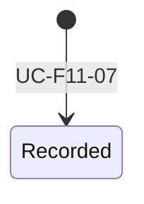

🏠 [Specs](../../../README.md) › 🧩 [Functional capabilities](../../README.md) ›
🛍️ [F11 Online shop (plugin)](../README.md) › 🗃️ [Data](README.md) › 🗃️ E-F11-07 Delivery method

# 🗃️ E-F11-07 Delivery method

**Status:** ✅ specified

## Purpose

A way to deliver online orders.

## Fields

| Name | Type | Required | Validation | Default | Example | Personal data | Custom fields |
|---|---|---|---|---|---|---|---|
| name, carrier | text | yes | - | - | Colissimo | no | no |
| price | fixed, rules, carrier rate | yes | - | - | free above 60 | no | no |
| zones | countries | no | - | - | FR | no | no |

## Relations

As its use cases.

## Lifecycle

## Indexes and search

By number, date, partner.

## Retention

Kept for the period of its kind of record in the country pack (D293), or else its kind's default in the
[retention schedule](../../../05-non-functional/data-retention.md).

## Audit

Every change.

## Import and export

CSV, FEC where relevant.

## Used by

- [UC-F11-07](../use-cases/02-shop-and-check-out/uc-f11-07-choose-delivery-or-click-collect.md)

## Open questions

None.

---

⬅️ [E-F11-06 Payment provider](e-f11-06-payment-provider.md) · ⬆️ [Up](README.md) ·
➡️ [E-F11-08 Withdrawal request](e-f11-08-withdrawal-request.md)
