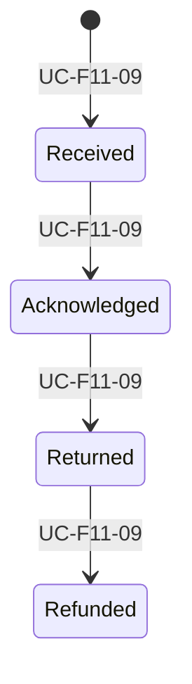

🏠 [Specs](../../../README.md) › 🧩 [Functional capabilities](../../README.md) ›
🛍️ [F11 Online shop (plugin)](../README.md) › 🗃️ [Data](README.md) › 🗃️ E-F11-08 Withdrawal request

# 🗃️ E-F11-08 Withdrawal request

**Status:** ✅ specified

## Purpose

A consumer's withdrawal.

## Fields

| Name | Type | Required | Validation | Default | Example | Personal data | Custom fields |
|---|---|---|---|---|---|---|---|
| order | order | yes | - | - | SO-2026-918 | no | no |
| items | lines | yes | not excluded (BR-F11-03) | - | 1 kettle | no | no |
| received | time | yes | within the period | - | 2026-11-20 | no | no |
| state | received, acknowledged, returned, refunded | yes | - | received | refunded | no | no |

## Relations

As its use cases.

## Lifecycle

## Indexes and search

By number, date, partner.

## Retention

As an accounting record:
[CR-FR-002 Accounting records kept 10 years](../../../10-country-packs/france/accounting/cr-fr-002-accounting-records-kept-ten-years.md);
personal data per
[CR-FR-052 Personal data kept no longer than needed](../../../10-country-packs/france/data-protection/cr-fr-052-storage-limitation.md).

## Audit

Every change.

## Import and export

CSV, FEC where relevant.

## Used by

- [UC-F11-09](../use-cases/03-after-the-order/uc-f11-09-withdraw-return-and-refund.md)
- [UC-F11-29 Read the funnel, customer value and return reasons](../use-cases/10-fulfil-from-stores-and-report/uc-f11-29-read-the-funnel-customer-value-and-return-reasons.md)

## Open questions

None.

---

⬅️ [E-F11-07 Delivery method](e-f11-07-delivery-method.md) · ⬆️ [Up](README.md) ·
➡️ [E-F11-09 Customer account](e-f11-09-customer-account.md)
