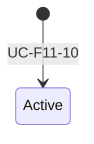

🏠 [Specs](../../../README.md) › 🧩 [Functional capabilities](../../README.md) ›
🛍️ [F11 Online shop (plugin)](../README.md) › 🗃️ [Data](README.md) › 🗃️ E-F11-09 Customer account

# 🗃️ E-F11-09 Customer account

**Status:** ✅ specified

## Purpose

A customer's online account.

## Fields

| Name | Type | Required | Validation | Default | Example | Personal data | Custom fields |
|---|---|---|---|---|---|---|---|
| contact | contact | yes | - | - | J. Martin | yes | no |
| addresses | list | no | - | - | Lyon | yes | no |
| wishlist | products | no | - | - | Kettle K2 | no | no |
| consents | list with dates | no | - | - | newsletter | yes | no |

## Relations

As its use cases.

## Lifecycle

## Indexes and search

By number, date, partner.

## Retention

While the account is active, then deleted on request or after inactivity:
[CR-FR-052 Personal data kept no longer than needed](../../../10-country-packs/france/data-protection/cr-fr-052-storage-limitation.md).

## Audit

Every change.

## Import and export

CSV, FEC where relevant.

## Used by

- [UC-F11-10](../use-cases/03-after-the-order/uc-f11-10-use-the-customer-account.md)
- [UC-F11-11](../use-cases/04-special-sales/uc-f11-11-sell-b2b-online.md)

## Open questions

None.

---

⬅️ [E-F11-08 Withdrawal request](e-f11-08-withdrawal-request.md) · ⬆️ [Up](README.md) ·
➡️ [E-F11-10 Product review](e-f11-10-product-review.md)
