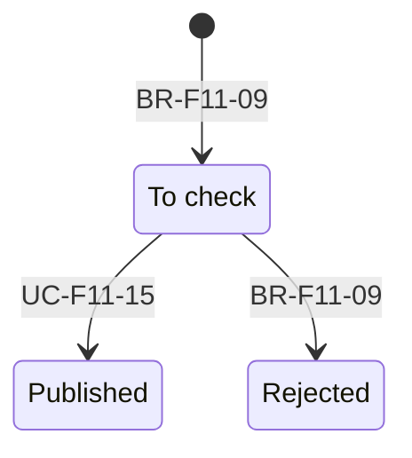

🏠 [Specs](../../../README.md) › 🧩 [Functional capabilities](../../README.md) ›
🛍️ [F11 Online shop (plugin)](../README.md) › 🗃️ [Data](README.md) › 🗃️ E-F11-10 Product review

# 🗃️ E-F11-10 Product review

**Status:** ✅ specified

## Purpose

A customer review of a product.

## Fields

| Name | Type | Required | Validation | Default | Example | Personal data | Custom fields |
|---|---|---|---|---|---|---|---|
| product | product | yes | - | - | Kettle K2 | no | no |
| rating, text | 1 to 5, text | yes | - | - | 4, Works well | no | no |
| state | to check, published, rejected | yes | BR-F11-09 | to check | published | no | no |
| date | time | yes | shown | - | 2026-11-11 | no | no |

## Relations

As its use cases.

## Lifecycle

## Indexes and search

By number, date, partner.

## Retention

Kept for the period of its kind of record in the country pack (D293), or else its kind's default in the
[retention schedule](../../../05-non-functional/data-retention.md).

## Audit

Every change.

## Import and export

CSV, FEC where relevant.

## Used by

- [UC-F11-15](../use-cases/05-grow-the-shop/uc-f11-15-collect-and-moderate-reviews.md)

## Open questions

None.

---

⬅️ [E-F11-09 Customer account](e-f11-09-customer-account.md) · ⬆️ [Up](README.md) ·
➡️ [E-F11-11 Online promotion code](e-f11-11-online-promotion-code.md)
