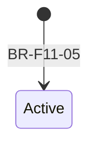

🏠 [Specs](../../../README.md) › 🧩 [Functional capabilities](../../README.md) ›
🛍️ [F11 Online shop (plugin)](../README.md) › 🗃️ [Data](README.md) › 🗃️ E-F11-11 Online promotion code

# 🗃️ E-F11-11 Online promotion code

**Status:** ✅ specified

## Purpose

A code that unlocks a reduction online.

## Fields

| Name | Type | Required | Validation | Default | Example | Personal data | Custom fields |
|---|---|---|---|---|---|---|---|
| code | text | yes | unique | - | WINTER15 | no | no |
| reduction | percent or amount | yes | BR-F11-05 | - | -15 % | no | no |
| validity | dates, uses | no | - | - | to 31 Dec | no | no |

## Relations

As its use cases.

## Lifecycle

## Indexes and search

By number, date, partner.

## Retention

Kept for the period of its kind of record in the country pack (D293), or else its kind's default in the
[retention schedule](../../../05-non-functional/data-retention.md).

## Audit

Every change.

## Import and export

CSV, FEC where relevant.

## Used by

- [UC-F11-03](../use-cases/01-build-the-shop/uc-f11-03-set-online-prices-and-promotions.md)

## Open questions

None.

---

⬅️ [E-F11-10 Product review](e-f11-10-product-review.md) · ⬆️ [Up](README.md) ·
➡️ [E-F11-12 Cart reminder](e-f11-12-cart-reminder.md)
