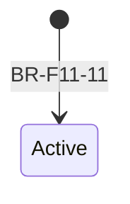

🏠 [Specs](../../../README.md) › 🧩 [Functional capabilities](../../README.md) ›
🛍️ [F11 Online shop (plugin)](../README.md) › 🗃️ [Data](README.md) › 🗃️ E-F11-12 Cart reminder

# 🗃️ E-F11-12 Cart reminder

**Status:** ✅ specified

## Purpose

A reminder sent for an abandoned cart.

## Fields

| Name | Type | Required | Validation | Default | Example | Personal data | Custom fields |
|---|---|---|---|---|---|---|---|
| cart | cart | yes | BR-F11-11 | - | C-77 | no | no |
| sent | time | yes | - | - | +2 h | no | no |
| result | recovered, ignored | no | - | - | recovered | no | no |

## Relations

As its use cases.

## Lifecycle

## Indexes and search

By number, date, partner.

## Retention

As an accounting record:
[CR-FR-002 Accounting records kept 10 years](../../../10-country-packs/france/accounting/cr-fr-002-accounting-records-kept-ten-years.md);
personal data per
[CR-FR-052 Personal data kept no longer than needed](../../../10-country-packs/france/data-protection/cr-fr-052-storage-limitation.md).

## Audit

Every change.

## Import and export

CSV, FEC where relevant.

## Used by

- [UC-F11-14](../use-cases/05-grow-the-shop/uc-f11-14-recover-abandoned-carts.md)

## Open questions

None.

---

⬅️ [E-F11-11 Online promotion code](e-f11-11-online-promotion-code.md) · ⬆️ [Up](README.md) ·
➡️ [E-F11-13 Channel listing](e-f11-13-channel-listing.md)
