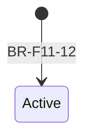

🏠 [Specs](../../../README.md) › 🧩 [Functional capabilities](../../README.md) ›
🛍️ [F11 Online shop (plugin)](../README.md) › 🗃️ [Data](README.md) › 🗃️ E-F11-13 Channel listing

# 🗃️ E-F11-13 Channel listing

**Status:** ✅ specified

## Purpose

A product listed on a marketplace or shop platform.

## Fields

| Name | Type | Required | Validation | Default | Example | Personal data | Custom fields |
|---|---|---|---|---|---|---|---|
| channel | T12 connector | yes | BR-F11-12 | - | Amazon FR | no | no |
| product, price | records | yes | - | - | Kettle K2, 25.90 | no | no |
| stock sync | time | no | - | - | 10:02 | no | no |

## Relations

As its use cases.

## Lifecycle

## Indexes and search

By number, date, partner.

## Retention

Kept for the period of its kind of record in the country pack (D293), or else its kind's default in the
[retention schedule](../../../05-non-functional/data-retention.md).

## Audit

Every change.

## Import and export

CSV, FEC where relevant.

## Used by

- [UC-F11-18](../use-cases/06-channels-and-legal/uc-f11-18-connect-marketplaces-and-other-shops.md)

## Open questions

None.

---

⬅️ [E-F11-12 Cart reminder](e-f11-12-cart-reminder.md) · ⬆️ [Up](README.md) ·
➡️ [E-F11-14 Legal page](e-f11-14-legal-page.md)
