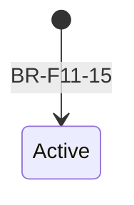

🏠 [Specs](../../../README.md) › 🧩 [Functional capabilities](../../README.md) ›
🛍️ [F11 Online shop (plugin)](../README.md) › 🗃️ [Data](README.md) › 🗃️ E-F11-14 Legal page

# 🗃️ E-F11-14 Legal page

**Status:** ✅ specified

## Purpose

A versioned legal page.

## Fields

| Name | Type | Required | Validation | Default | Example | Personal data | Custom fields |
|---|---|---|---|---|---|---|---|
| kind | legal notices, terms, privacy, cookies | yes | - | - | terms | no | no |
| version | number, date | yes | BR-F11-15 | - | v3, 2026-11-01 | no | no |
| checked | legal assistant result | no | - | - | ok | no | no |

## Relations

As its use cases.

## Lifecycle

## Indexes and search

By number, date, partner.

## Retention

Kept for the period of its kind of record in the country pack (D293), or else its kind's default in the
[retention schedule](../../../05-non-functional/data-retention.md).

## Audit

Every change.

## Import and export

CSV, FEC where relevant.

## Used by

- [UC-F11-19](../use-cases/06-channels-and-legal/uc-f11-19-publish-the-legal-pages.md)

## Open questions

None.

---

⬅️ [E-F11-13 Channel listing](e-f11-13-channel-listing.md) · ⬆️ [Up](README.md) ·
➡️ [E-F11-15 Tracker consent](e-f11-15-tracker-consent.md)
