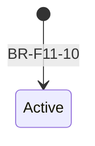

🏠 [Specs](../../../README.md) › 🧩 [Functional capabilities](../../README.md) ›
🛍️ [F11 Online shop (plugin)](../README.md) › 🗃️ [Data](README.md) › 🗃️ E-F11-15 Tracker consent

# 🗃️ E-F11-15 Tracker consent

**Status:** ✅ specified

## Purpose

A visitor's consent choices.

## Fields

| Name | Type | Required | Validation | Default | Example | Personal data | Custom fields |
|---|---|---|---|---|---|---|---|
| visitor | pseudonymous id | yes | - | - | v-8f2c | yes | no |
| choices | categories | yes | BR-F11-10 | none | analytics | no | no |
| date | time | yes | - | - | 2026-11-11 | no | no |

## Relations

As its use cases.

## Lifecycle

## Indexes and search

By number, date, partner.

## Retention

Consent proof kept while it applies, then deleted:
[CR-FR-052 Personal data kept no longer than needed](../../../10-country-packs/france/data-protection/cr-fr-052-storage-limitation.md).

## Audit

Every change.

## Import and export

CSV, FEC where relevant.

## Used by

- [UC-F11-17](../use-cases/05-grow-the-shop/uc-f11-17-read-shop-analytics.md)

## Open questions

None.

---

⬅️ [E-F11-14 Legal page](e-f11-14-legal-page.md) · ⬆️ [Up](README.md) ·
➡️ [E-F11-16 Fraud check](e-f11-16-fraud-check.md)
