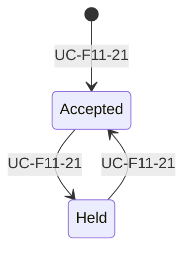

🏠 [Specs](../../../README.md) › 🧩 [Functional capabilities](../../README.md) ›
🛍️ [F11 Online shop (plugin)](../README.md) › 🗃️ [Data](README.md) › 🗃️ E-F11-16 Fraud check

# 🗃️ E-F11-16 Fraud check

**Status:** 🔄 waiting for the owner

## Purpose

An order's fraud score, signals and decision.

## Fields

| Name | Type | Required | Validation | Default | Example | Personal data | Custom fields |
|---|---|---|---|---|---|---|---|
| order | checkout | yes | - | - | W-2026-1184 | no | - |
| score and level | number, low/medium/high | yes | - | - | 82, high | no | - |
| signals | list | yes | - | - | 3 orders in 10 min | no | - |
| 3-D Secure | result | no | - | - | passed | no | - |
| decision | accepted, held, cancelled | yes | - | - | held | no | - |

## Relations

On a Checkout (E-F11-05).

## Lifecycle

Scored, accepted or held, decided.

## Indexes and search

By level.

## Retention

13 months (Proposed).

## Audit

Decision and reviewer.

## Import and export

None.

## Used by

- [UC-F11-21 Screen orders for fraud and authenticate payments](../use-cases/07-payment-risk/uc-f11-21-screen-orders-for-fraud-and-authenticate-payments.md)

## Open questions

None.

---

⬅️ [E-F11-15 Tracker consent](e-f11-15-tracker-consent.md) · ⬆️ [Up](README.md) ·
➡️ [E-F11-17 Chargeback](e-f11-17-chargeback.md)
